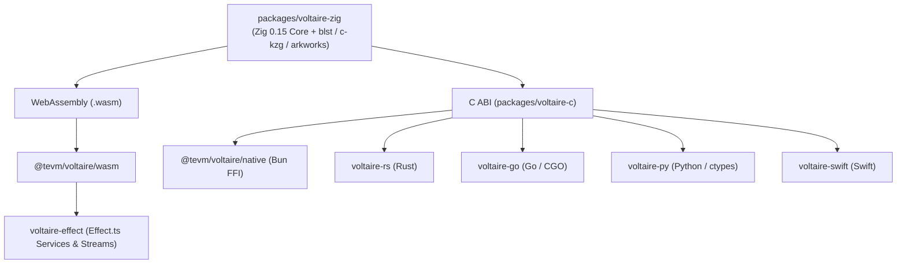

<div align="center">
  <h1>Voltaire</h1>
  <p><strong>Type-safe Ethereum primitives, cryptography, and EVM execution — written in Zig, bound everywhere.</strong></p>
  <a href="https://voltaire.tevm.sh">
    
  </a>
  <p>
    <a href="https://www.npmjs.com/package/@tevm/voltaire">
      
    </a>
    <a href="https://github.com/evmts/voltaire">
      
    </a>
    <a href="https://github.com/evmts/voltaire/actions/workflows/ci.yml">
      
    </a>
    <a href="https://github.com/evmts/voltaire/blob/main/LICENSE">
      
    </a>
  </p>
  <p>
    <a href="https://voltaire.tevm.sh"><strong>Docs</strong></a> ·
    <a href="https://playground.tevm.sh"><strong>Live Playground</strong></a> ·
    <a href="https://voltaire-effect.tevm.sh"><strong>voltaire-effect</strong></a>
  </p>
</div>

## Architecture

Voltaire implements Ethereum primitives, cryptography, and EVM execution once in **Zig**, then compiles to **WebAssembly** and exports a stable **C ABI** shared across TypeScript, Effect.ts, Rust, Go, Python, and Swift.



## Packages

| Package | Directory | Status | Description |
| --- | --- | --- | --- |
| `@tevm/voltaire` | [`packages/voltaire-ts`](./packages/voltaire-ts) | Production | Branded TypeScript primitives, crypto, EVM; Pure TS, WASM, and Bun FFI entrypoints |
| `voltaire-effect` | [`packages/voltaire-effect`](./packages/voltaire-effect) | Production | Effect.ts integration with typed errors, composable layers, contract registries, and streams |
| `voltaire-zig` | [`packages/voltaire-zig`](./packages/voltaire-zig) | Production | Core Zig 0.15 primitives, cryptography, EVM, and C ABI |
| `voltaire-c` | [`packages/voltaire-c`](./packages/voltaire-c) | Beta | C header (`voltaire.h`) and FFI tests |
| `voltaire-rs` | [`packages/voltaire-rs`](./packages/voltaire-rs) | Beta | Idiomatic Rust (`no_std` + optional `native` FFI) |
| `voltaire-go` | [`packages/voltaire-go`](./packages/voltaire-go) | Beta | Go primitives & crypto with CGO bindings |
| `voltaire-py` | [`packages/voltaire-py`](./packages/voltaire-py) | Beta | Typed Python bindings via `ctypes` |
| `voltaire-swift` | [`packages/voltaire-swift`](./packages/voltaire-swift) | Beta | Swift Package Manager bindings via C FFI |

## Quick Start (TypeScript)

```bash
pnpm add @tevm/voltaire
```

```typescript
import { Address, Wei } from '@tevm/voltaire';
import { Abi } from '@tevm/voltaire/Abi';
import { Keccak256 } from '@tevm/voltaire/Keccak256';

// Branded 20-byte Uint8Array — validated once at construction
const to = Address('0xd8da6bf26964af9d7eed9e03e53415d37aa96045');
Address.toChecksummed(to); // "0xd8dA6BF26964aF9D7eEd9e03E53415D37aA96045"

// Compile-time denomination safety (Wei ≠ Gwei ≠ Ether)
const amount = Wei(1_000_000_000_000_000_000n);
Wei.toEther(amount); // "1"

// Selectors and ABI encoding
const selector = Keccak256.selector('transfer(address,uint256)');
const erc20 = Abi([
  {
    type: 'function',
    name: 'transfer',
    stateMutability: 'nonpayable',
    inputs: [
      { type: 'address', name: 'to' },
      { type: 'uint256', name: 'amount' },
    ],
    outputs: [{ type: 'bool' }],
  },
] as const);

const calldata = erc20.encode('transfer', [to.toHex(), amount]);
```

Swap backends with a single import change:

```typescript
import { Keccak256, Secp256k1 } from '@tevm/voltaire/wasm';   // Browser, Node, Bun, Deno
import { Keccak256, Secp256k1 } from '@tevm/voltaire/native'; // Bun Native FFI
```

## Application Layer: `voltaire-effect`

For providers, signers, contract registries, explicit retries/timeouts, and reorg-aware streams built on top of Voltaire primitives, use [`voltaire-effect`](./packages/voltaire-effect):

```typescript
import { Effect, Layer } from 'effect';
import { ERC20_ABI, HttpProvider, makeContractRegistry } from 'voltaire-effect';

const userAddress = '0xd8dA6BF26964aF9D7eEd9e03E53415D37aA96045';

const Contracts = makeContractRegistry({
  USDC: { abi: ERC20_ABI, address: '0xA0b86991c6218b36c1d19D4a2e9Eb0cE3606eB48' },
  WETH: { abi: ERC20_ABI, address: '0xC02aaA39b223FE8D0A0e5C4F27eAD9083C756Cc2' },
});

const AppLayer = Contracts.layer.pipe(
  Layer.provide(HttpProvider('https://eth.llamarpc.com')),
);

const program = Effect.gen(function* () {
  const { USDC, WETH } = yield* Contracts.Service;
  const usdcBalance = yield* USDC.read.balanceOf(userAddress);
  const wethBalance = yield* WETH.read.balanceOf(userAddress);
  return { usdcBalance, wethBalance };
}).pipe(
  Effect.retry({ times: 3 }),
  Effect.timeout('10 seconds'),
  Effect.provide(AppLayer),
);
```

## AI Agent Integration

Connect the hosted MCP server or install Voltaire skills:

```bash
# Claude Code MCP
claude mcp add --transport http voltaire https://voltaire.tevm.sh/mcp

# Claude Code / Codex Skills
git clone https://github.com/evmts/skills ~/.claude/skills/voltaire-skills
```

Machine-readable indexes: [`voltaire.tevm.sh/llms.txt`](https://voltaire.tevm.sh/llms.txt) · [`voltaire.tevm.sh/llms-full.txt`](https://voltaire.tevm.sh/llms-full.txt).

## Dependencies

- **TypeScript:** `@noble/curves`, `@noble/hashes`, `@noble/ciphers`, `@scure/bip32`, `@scure/bip39`, `@adraffy/ens-normalize`, `ox`, `@tevm/chains`, `abitype` (optional peer)
- **Native / WASM:** `blst`, `c-kzg-4844`, `ark-bn254`, `ark-bls12-381`

## Links

- [Documentation](https://voltaire.tevm.sh/) · [Playground](https://playground.tevm.sh/) · [NPM](https://www.npmjs.com/package/@tevm/voltaire)
- [Telegram](https://t.me/+ANThR9bHDLAwMjUx) · [Twitter](https://twitter.com/tevmtools)
- Related: [evmts/guillotine](https://github.com/evmts/guillotine) (EVM execution) · [evmts/compiler](https://github.com/evmts/compiler) (Solidity compilation)

MIT License — see [LICENSE](./LICENSE).
