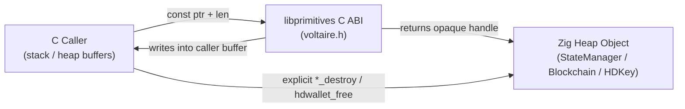

# voltaire-c

C99 header and FFI bindings for Voltaire Ethereum primitives, cryptography, state management, and blockchain caches exported directly from Zig (`libprimitives`).

`voltaire.h` declares fixed-size value types (`PrimitivesAddress`, `PrimitivesHash`, `PrimitivesU256`, `PrimitivesSignature`, `PrimitivesAuthorization`), caller-owned buffer functions, and opaque handles (`StateManagerHandle`, `BlockchainHandle`, `ForkBackendHandle`, `ForkBlockCacheHandle`). No runtime wrapper or garbage collector sits between C and the compiled Zig code.

## Architecture and Memory Ownership



Three ownership rules govern the API:

1. **Primitive and crypto functions never allocate heap memory for the caller.** The caller supplies fixed-size structs or output buffers and their lengths.
2. **Opaque handles are freed by their paired destructor.** `state_manager_create*` pairs with `state_manager_destroy`; `fork_backend_create` with `fork_backend_destroy`; `blockchain_create*` with `blockchain_destroy`; `fork_block_cache_create` with `fork_block_cache_destroy`; `hdwallet_from_seed` and `hdwallet_derive` with `hdwallet_free`; `kzg_load_trusted_setup` with `kzg_free_trusted_setup`.
3. **Fixed-width hex writers omit the NUL byte.** `primitives_address_to_hex`, `primitives_address_to_checksum_hex`, `primitives_hash_to_hex`, and `primitives_u256_to_hex` write exact byte counts (42 or 66) without `'\0'`. Print with precision (`printf("%.42s\n", buf)`) or allocate one extra byte and terminate manually.

## Building and Linking

Build the native library from the repository root (`https://github.com/evmts/voltaire`):

```bash
# Native static/shared library -> zig-out/lib/libprimitives.{a,dylib,so}
zig build build-ts-native

# WebAssembly reactor module -> zig-out/bin/primitives.wasm
zig build build-ts-wasm
```

Compile and link a C program against `packages/voltaire-c/include/voltaire.h`:

```bash
cc -std=c99 -Ipackages/voltaire-c/include your_program.c \
   -Lzig-out/lib -lprimitives -o your_program
```

State Manager, Blockchain, KZG, and HD Wallet functions are exported in native builds only; WASM builds exclude them.

## Minimal Example

```c
#include "voltaire.h"

#include <stdio.h>
#include <string.h>

int main(void) {
    PrimitivesAddress addr;
    if (primitives_address_from_hex(
            "0x742d35Cc6634C0532925a3b844Bc9e7595f0bEb0", &addr) != PRIMITIVES_SUCCESS) {
        fprintf(stderr, "invalid address\n");
        return 1;
    }

    unsigned char checksum[42];
    primitives_address_to_checksum_hex(&addr, checksum);
    printf("Address: %.42s\n", (const char*)checksum);

    static const unsigned char msg[] = "Hello, Ethereum!";
    PrimitivesHash hash;
    primitives_keccak256(msg, sizeof(msg) - 1, &hash);

    unsigned char hash_hex[66];
    primitives_hash_to_hex(&hash, hash_hex);
    printf("Keccak:  %.66s\n", (const char*)hash_hex);

    return 0;
}
```

## Return Conventions

Most `primitives_*` functions return `PRIMITIVES_SUCCESS` (`0`) or a negative error code; variable-length encoders (`primitives_hex_to_bytes`, `primitives_bytes_to_hex`, `primitives_rlp_*`, `primitives_abi_*`, `primitives_signature_serialize`) return the non-negative byte count written on success.

| Code | Macro | Meaning |
|------|-------|---------|
| `0` | `PRIMITIVES_SUCCESS` | Operation succeeded |
| `-1` | `PRIMITIVES_ERROR_INVALID_HEX` | Malformed hex input |
| `-2` | `PRIMITIVES_ERROR_INVALID_LENGTH` | Wrong input length or output buffer too small |
| `-3` | `PRIMITIVES_ERROR_INVALID_CHECKSUM` | EIP-55 checksum mismatch |
| `-4` | `PRIMITIVES_ERROR_OUT_OF_MEMORY` | Internal scratch or heap allocation failed |
| `-5` | `PRIMITIVES_ERROR_INVALID_INPUT` | Invalid argument or malformed data |
| `-6` | `PRIMITIVES_ERROR_INVALID_SIGNATURE` | Invalid ECDSA signature or recovery ID |
| `-7` | `PRIMITIVES_ERROR_INVALID_SELECTOR` | Invalid ABI function selector |
| `-8` | `PRIMITIVES_ERROR_UNSUPPORTED_TYPE` | Unsupported ABI type |
| `-9` | `PRIMITIVES_ERROR_MAX_LENGTH_EXCEEDED` | Encoded payload exceeds maximum limit |
| `-10` | `PRIMITIVES_ERROR_ACCESS_LIST_INVALID` | Invalid EIP-2930 access list |
| `-11` | `PRIMITIVES_ERROR_AUTHORIZATION_INVALID` | Invalid EIP-7702 authorization |
| `-20` | `PRIMITIVES_ERROR_KZG_NOT_LOADED` | KZG trusted setup not loaded |
| `-21` | `PRIMITIVES_ERROR_KZG_INVALID_BLOB` | Invalid 128 KiB blob |
| `-22` | `PRIMITIVES_ERROR_KZG_INVALID_PROOF` | Invalid KZG proof |

Note the non-`primitives_*` return conventions:
- `secp256k1Sign`, `secp256k1Recover`, `secp256k1DerivePublicKey`, `x25519*`, `aesGcm*`: `0` on success, `1` on failure.
- `secp256k1Verify`, `kzg_verify_*`, `hdwallet_validate_mnemonic`, `primitives_blob_is_valid`, `primitives_eventlog_matches_*`: `1` for true/valid, `0` for false/invalid (negative on KZG error).
- `ed25519Verify`, `p256Verify`: `0` if valid, `1` if invalid, negative on error.

## Documentation

Complete reference documentation lives in `docs/`:

- **Getting Started**: `docs/index.mdx`, `docs/tutorial.mdx`
- **Primitives**: `address`, `hex`, `hash`, `rlp`, `abi`, `transaction`, `accesslist`, `authorization`, `eventlog`
- **Cryptography**: `secp256k1`, `crypto`, `hdwallet`, `kzg`
- **EVM**: `bytecode`, `blob`
- **Advanced**: `statemanager`, `blockchain`

Header source: `packages/voltaire-c/include/voltaire.h`. Smoke test: `packages/voltaire-c/tests/c_api_test.c`.

## License

MIT
