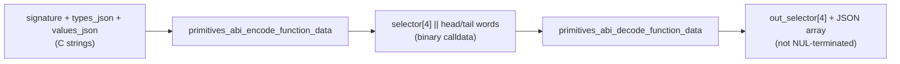

The ABI functions encode and decode Ethereum contract calldata across the C boundary using JSON string arrays for types and values. Encoders write binary calldata into `out_buf`; decoders write a UTF-8 JSON array (not NUL-terminated) into `out_buf`. Both return the byte count written (`>= 0`) or a negative error code.

## Data Flow



## Functions

### `primitives_abi_compute_selector`

```c
int primitives_abi_compute_selector(const char* signature, unsigned char out_selector[4]);
```

Computes the 4-byte selector `keccak256(signature)[0..4]` (e.g., `"transfer(address,uint256)"` produces `{0xa9, 0x05, 0x9c, 0xbb}`). Returns `PRIMITIVES_SUCCESS`.

### `primitives_abi_encode_parameters`

```c
int primitives_abi_encode_parameters(
    const char* types_json,
    const char* values_json,
    unsigned char* out_buf,
    size_t buf_len
);
```

ABI-encodes parameters specified as JSON arrays of strings, e.g. `types_json = "[\"address\",\"uint256\"]"` and `values_json = "[\"0x...\",\"1000\"]"`. Every element in `values_json` must be a JSON string. Native builds use an 8 KiB internal scratch buffer (2 MiB on WASM).

- **Returns:** Bytes written (`>= 0`), `PRIMITIVES_ERROR_INVALID_INPUT` (`-5`), `PRIMITIVES_ERROR_INVALID_LENGTH` (`-2`), `PRIMITIVES_ERROR_OUT_OF_MEMORY` (`-4`), or `PRIMITIVES_ERROR_MAX_LENGTH_EXCEEDED` (`-9`).

### `primitives_abi_decode_parameters`

```c
int primitives_abi_decode_parameters(
    const unsigned char* data,
    size_t data_len,
    const char* types_json,
    unsigned char* out_buf,
    size_t buf_len
);
```

Decodes ABI-encoded bytes into a JSON array written to `out_buf`. **Does not write a NUL terminator.** Returns bytes written (`>= 0`) or a negative error code.

### `primitives_abi_encode_function_data`

```c
int primitives_abi_encode_function_data(
    const char* signature,
    const char* types_json,
    const char* values_json,
    unsigned char* out_buf,
    size_t buf_len
);
```

Prepends the 4-byte selector of `signature` to the ABI-encoded parameters. Returns bytes written (`>= 0`) or a negative error code.

### `primitives_abi_decode_function_data`

```c
int primitives_abi_decode_function_data(
    const unsigned char* data,
    size_t data_len,
    const char* types_json,
    unsigned char out_selector[4],
    unsigned char* out_buf,
    size_t buf_len
);
```

Extracts the leading 4-byte selector into `out_selector` and decodes the remaining bytes into a JSON array in `out_buf` (not NUL-terminated). Returns JSON bytes written (`>= 0`) or a negative error code.

### `primitives_abi_encode_packed`

```c
int primitives_abi_encode_packed(
    const char* types_json,
    const char* values_json,
    unsigned char* out_buf,
    size_t buf_len
);
```

Encodes values tightly without 32-byte word padding (matching Solidity `abi.encodePacked`). Returns bytes written (`>= 0`) or a negative error code.

### `primitives_abi_estimate_gas`

```c
long long primitives_abi_estimate_gas(const unsigned char* data, size_t data_len);
```

Returns intrinsic calldata gas cost: `4` gas per zero byte (`0x00`) and `16` gas per non-zero byte.

## Supported ABI Types

| Type string | Encode (`values_json` string format) | Decode (JSON output) |
|-------------|--------------------------------------|----------------------|
| `address` | `"0x..."` (40 hex digits) | `"0x..."` |
| `bool` | `"true"` or `"false"` | `"true"` or `"false"` |
| `uint`, `uint8`, `uint16`, `uint32`, `uint64`, `uint128`, `uint256` | Decimal (`"42"`) or hex (`"0x2a"`) | Decimal string |
| `int`, `int8`, `int16`, `int32`, `int64`, `int128`, `int256` | Signed decimal (`"-42"`) or hex | Decimal string |
| `string` | `"hello world"` | `"hello world"` |
| `bytes` | `"0xdeadbeef"` | `"0xdeadbeef"` |
| `bytes4`, `bytes32` | Exact-length `"0x..."` | `"0x..."` |
| `bytes1`, `bytes2`, `bytes3`, `bytes8`, `bytes16` | Decode only | `"0x..."` |
| `uint256[]`, `address[]`, `bool[]`, `bytes32[]`, `string[]` | Decode only | JSON array |

## Example

```c
#include "voltaire.h"

#include <stdio.h>

int main(void) {
    unsigned char calldata[256];
    int len = primitives_abi_encode_function_data(
        "transfer(address,uint256)",
        "[\"address\",\"uint256\"]",
        "[\"0xd8dA6BF26964aF9D7eEd9e03E53415D37aA96045\",\"1000\"]",
        calldata,
        sizeof(calldata)
    );
    if (len < 0) return 1;

    long long gas = primitives_abi_estimate_gas(calldata, (size_t)len);
    printf("Encoded %d bytes (calldata gas: %lld)\n", len, gas);

    unsigned char selector[4];
    unsigned char decoded_json[256];
    int json_len = primitives_abi_decode_function_data(
        calldata,
        (size_t)len,
        "[\"address\",\"uint256\"]",
        selector,
        decoded_json,
        sizeof(decoded_json)
    );
    if (json_len < 0) return 1;

    printf("Selector: 0x%02x%02x%02x%02x\n",
           selector[0], selector[1], selector[2], selector[3]);
    printf("Decoded:  %.*s\n", json_len, (const char*)decoded_json);

    return 0;
}
```
