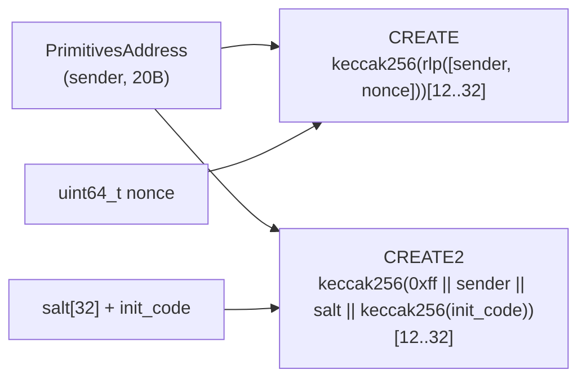

A `PrimitivesAddress` is a fixed 20-byte struct representing an Ethereum account address.

## Type

```c
typedef struct {
    unsigned char bytes[20];
} PrimitivesAddress;
```

## Contract Derivation Flow



## Functions

### `primitives_address_from_hex`

```c
int primitives_address_from_hex(const char* hex, PrimitivesAddress* out);
```

Parses a NUL-terminated 40-character hexadecimal string (with or without a `0x` prefix) into `*out`. Returns `PRIMITIVES_SUCCESS` (`0`) or `PRIMITIVES_ERROR_INVALID_HEX` (`-1`).

### `primitives_address_to_hex`

```c
int primitives_address_to_hex(const PrimitivesAddress* address, unsigned char* buf);
```

Writes 42 lowercase ASCII bytes (`"0x"` followed by 40 hex digits) to `buf`. **Does not write a NUL terminator.** `buf` must hold at least 42 bytes. Returns `PRIMITIVES_SUCCESS`.

### `primitives_address_to_checksum_hex`

```c
int primitives_address_to_checksum_hex(const PrimitivesAddress* address, unsigned char* buf);
```

Writes 42 EIP-55 mixed-case checksummed ASCII bytes (`"0x"` followed by 40 hex digits) to `buf`. **Does not write a NUL terminator.** `buf` must hold at least 42 bytes. Returns `PRIMITIVES_SUCCESS`.

### `primitives_address_is_zero`

```c
bool primitives_address_is_zero(const PrimitivesAddress* address);
```

Returns `true` if all 20 bytes are `0x00`.

### `primitives_address_equals`

```c
bool primitives_address_equals(const PrimitivesAddress* a, const PrimitivesAddress* b);
```

Returns `true` if `a->bytes` and `b->bytes` are identical.

### `primitives_address_validate_checksum`

```c
bool primitives_address_validate_checksum(const char* hex);
```

Validates the EIP-55 checksum of a NUL-terminated hex address string. Returns `true` if valid, `false` otherwise.

### `primitives_calculate_create_address`

```c
int primitives_calculate_create_address(
    const PrimitivesAddress* sender,
    uint64_t nonce,
    PrimitivesAddress* out
);
```

Computes the contract address deployed by `sender` at transaction `nonce`. Uses a 1 KiB internal stack buffer; returns `PRIMITIVES_SUCCESS` or `PRIMITIVES_ERROR_OUT_OF_MEMORY` (`-4`).

### `primitives_calculate_create2_address`

```c
int primitives_calculate_create2_address(
    const PrimitivesAddress* sender,
    const unsigned char salt[32],
    const unsigned char* init_code,
    size_t init_code_len,
    PrimitivesAddress* out
);
```

Computes the deterministic CREATE2 address `keccak256(0xff || sender || salt || keccak256(init_code))[12..32]`. Returns `PRIMITIVES_SUCCESS` or `PRIMITIVES_ERROR_OUT_OF_MEMORY` (`-4`).

## Summary Table

| Function | Output buffer | NUL-terminated | Returns |
|----------|---------------|----------------|---------|
| `primitives_address_from_hex` | `PrimitivesAddress*` (20 B) | N/A | `0` or `-1` |
| `primitives_address_to_hex` | `unsigned char[42]` | No | `0` |
| `primitives_address_to_checksum_hex` | `unsigned char[42]` | No | `0` |
| `primitives_address_is_zero` | — | N/A | `bool` |
| `primitives_address_equals` | — | N/A | `bool` |
| `primitives_address_validate_checksum` | — | N/A | `bool` |
| `primitives_calculate_create_address` | `PrimitivesAddress*` (20 B) | N/A | `0` or `-4` |
| `primitives_calculate_create2_address` | `PrimitivesAddress*` (20 B) | N/A | `0` or `-4` |

## Example

```c
#include "voltaire.h"

#include <stdio.h>
#include <string.h>

int main(void) {
    PrimitivesAddress sender, created, created2;

    if (primitives_address_from_hex(
            "0xd8dA6BF26964aF9D7eEd9e03E53415D37aA96045",
            &sender) != PRIMITIVES_SUCCESS) {
        return 1;
    }

    if (primitives_calculate_create_address(&sender, 0, &created) != PRIMITIVES_SUCCESS) {
        return 1;
    }

    unsigned char salt[32] = {0};
    static const unsigned char init_code[] = {0x60, 0x00, 0x60, 0x00, 0xf3};
    if (primitives_calculate_create2_address(
            &sender, salt, init_code, sizeof(init_code), &created2) != PRIMITIVES_SUCCESS) {
        return 1;
    }

    unsigned char hex[42];
    primitives_address_to_checksum_hex(&created, hex);
    printf("CREATE  (nonce 0): %.42s\n", (const char*)hex);

    primitives_address_to_checksum_hex(&created2, hex);
    printf("CREATE2 (salt 0):  %.42s\n", (const char*)hex);

    return 0;
}
```
