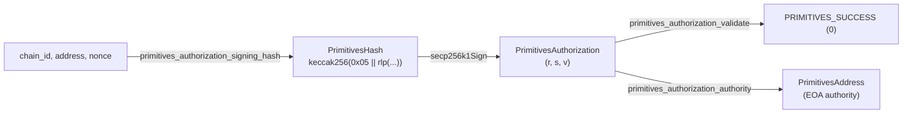

An EIP-7702 authorization delegates an EOA's execution code to a contract address for a specific chain ID (or `0` for cross-chain) and nonce. `PrimitivesAuthorization` holds the delegation fields and ECDSA signature components.

## Type

```c
typedef struct {
    uint64_t chain_id;
    PrimitivesAddress address;
    uint64_t nonce;
    uint64_t v;
    unsigned char r[32];
    unsigned char s[32];
} PrimitivesAuthorization;
```

## Signing and Recovery Flow



## Functions

### `primitives_authorization_signing_hash`

```c
int primitives_authorization_signing_hash(
    uint64_t chain_id,
    const PrimitivesAddress* address,
    uint64_t nonce,
    PrimitivesHash* out_hash
);
```

Computes the EIP-7702 signing digest `keccak256(0x05 || rlp([chain_id, address, nonce]))`. Returns `PRIMITIVES_SUCCESS` (`0`) or `PRIMITIVES_ERROR_INVALID_INPUT` (`-5`).

### `primitives_authorization_validate`

```c
int primitives_authorization_validate(const PrimitivesAuthorization* auth);
```

Validates the authorization fields and signature invariants (including canonical low-`s` and non-zero target address). Returns `PRIMITIVES_SUCCESS` (`0`) or `PRIMITIVES_ERROR_AUTHORIZATION_INVALID` (`-11`).

### `primitives_authorization_authority`

```c
int primitives_authorization_authority(
    const PrimitivesAuthorization* auth,
    PrimitivesAddress* out_address
);
```

Recovers the authorizing EOA address from `auth`. Returns `PRIMITIVES_SUCCESS` (`0`) or `PRIMITIVES_ERROR_INVALID_SIGNATURE` (`-6`).

### `primitives_authorization_gas_cost`

```c
uint64_t primitives_authorization_gas_cost(size_t count, size_t empty_accounts);
```

Computes the intrinsic EIP-7702 gas cost for `count` authorization tuples of which `empty_accounts` target empty accounts (`PER_AUTH_BASE_COST * count + PER_EMPTY_ACCOUNT_COST * empty_accounts`).

## Example

```c
#include "voltaire.h"

#include <inttypes.h>
#include <stdio.h>
#include <string.h>

int main(void) {
    PrimitivesAuthorization auth = {0};
    auth.chain_id = 1;
    auth.nonce = 0;

    if (primitives_address_from_hex(
            "0x1234567890123456789012345678901234567890",
            &auth.address) != PRIMITIVES_SUCCESS) {
        return 1;
    }

    PrimitivesHash hash;
    if (primitives_authorization_signing_hash(
            auth.chain_id, &auth.address, auth.nonce, &hash) != PRIMITIVES_SUCCESS) {
        return 1;
    }

    unsigned char privkey[32];
    primitives_generate_private_key(privkey);

    unsigned char sig[64];
    unsigned char recid = 0;
    if (secp256k1Sign(hash.bytes, privkey, sig, &recid) != 0) {
        return 1;
    }

    memcpy(auth.r, sig, 32);
    memcpy(auth.s, sig + 32, 32);
    auth.v = recid;

    if (primitives_authorization_validate(&auth) != PRIMITIVES_SUCCESS) {
        fprintf(stderr, "invalid authorization\n");
        return 1;
    }

    PrimitivesAddress authority;
    if (primitives_authorization_authority(&auth, &authority) != PRIMITIVES_SUCCESS) {
        return 1;
    }

    unsigned char hex[42];
    primitives_address_to_checksum_hex(&authority, hex);
    printf("Authority: %.42s\n", (const char*)hex);
    printf("Gas cost:  %" PRIu64 "\n", primitives_authorization_gas_cost(1, 0));

    return 0;
}
```
