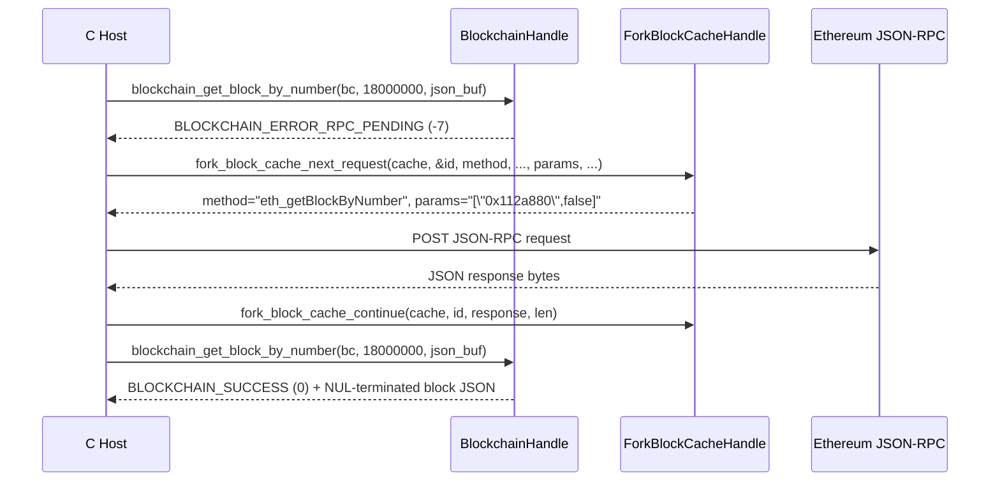

`BlockchainHandle` manages a canonical block chain with an optional `ForkBlockCacheHandle` for fetching pre-fork historical blocks via an async request/continue RPC queue. **Available in native builds only.**

## Types and Error Codes

```c
typedef void* BlockchainHandle;
typedef void* ForkBlockCacheHandle;
```

| Macro | Value | Meaning |
|-------|-------|---------|
| `BLOCKCHAIN_SUCCESS` | `0` | Success |
| `BLOCKCHAIN_ERROR_INVALID_INPUT` | `-1` | Null handle/pointer or invalid argument |
| `BLOCKCHAIN_ERROR_OUT_OF_MEMORY` | `-2` | Allocation failed or formatted block JSON `>= 4096` bytes |
| `BLOCKCHAIN_ERROR_BLOCK_NOT_FOUND` | `-3` | No block at requested number/hash |
| `BLOCKCHAIN_ERROR_INVALID_PARENT` | `-4` | Invalid parent block linkage |
| `BLOCKCHAIN_ERROR_ORPHAN_HEAD` | `-5` | Cannot set orphan as canonical head |
| `BLOCKCHAIN_ERROR_INVALID_HASH` | `-6` | Block hash mismatch |
| `BLOCKCHAIN_ERROR_RPC_PENDING` | `-7` | Cache miss; poll `fork_block_cache_next_request` |
| `BLOCKCHAIN_ERROR_NO_PENDING_REQUEST` | `-8` | No queued fork block request |
| `BLOCKCHAIN_ERROR_OUTPUT_TOO_SMALL` | `-9` | `method_buf_len` or `params_buf_len` too small |
| `BLOCKCHAIN_ERROR_INVALID_REQUEST` | `-10` | Unknown `request_id` in `fork_block_cache_continue` |
| `BLOCKCHAIN_ERROR_NOT_IMPLEMENTED` | `-999` | Stubbed operation (`put_block`, `set_canonical_head`) |

## Async Fork Block Fetch Flow



## Lifecycle

```c
BlockchainHandle     blockchain_create(void);
BlockchainHandle     blockchain_create_with_fork(ForkBlockCacheHandle fork_cache);
void                 blockchain_destroy(BlockchainHandle handle);

ForkBlockCacheHandle fork_block_cache_create(
    size_t rpc_context,            /* ignored; pass 0 */
    size_t vtable_fetch_by_number, /* ignored; pass 0 */
    size_t vtable_fetch_by_hash,   /* ignored; pass 0 */
    uint64_t fork_block_number
);
void fork_block_cache_destroy(ForkBlockCacheHandle handle);
```

Destroy `BlockchainHandle` before destroying its `ForkBlockCacheHandle`.

## Chain Metadata and Block Queries

```c
size_t blockchain_local_block_count(BlockchainHandle handle);
size_t blockchain_canonical_chain_length(BlockchainHandle handle);
size_t blockchain_orphan_count(BlockchainHandle handle);
int    blockchain_get_head_block_number(BlockchainHandle handle, uint64_t* out_number);
bool   blockchain_is_fork_block(BlockchainHandle handle, uint64_t number);

/* out_block must be at least 4096 bytes; writes NUL-terminated JSON */
int    blockchain_get_block_by_number(BlockchainHandle handle, uint64_t number, unsigned char* out_block);
int    blockchain_get_block_by_hash(BlockchainHandle handle, const unsigned char block_hash[32], unsigned char* out_block);
bool   blockchain_has_block(BlockchainHandle handle, const unsigned char block_hash[32]);
int    blockchain_get_canonical_hash(BlockchainHandle handle, uint64_t number, unsigned char out_hash[32]);

/* Currently stubbed — return BLOCKCHAIN_ERROR_NOT_IMPLEMENTED (-999) */
int    blockchain_put_block(BlockchainHandle handle, const unsigned char* block_data);
int    blockchain_set_canonical_head(BlockchainHandle handle, const unsigned char block_hash[32]);
```

## Fork Block Cache Async Queue

```c
int fork_block_cache_next_request(
    ForkBlockCacheHandle handle,
    uint64_t* out_request_id,
    unsigned char* out_method, size_t method_buf_len, size_t* out_method_len,
    unsigned char* out_params, size_t params_buf_len, size_t* out_params_len
);

int fork_block_cache_continue(
    ForkBlockCacheHandle handle,
    uint64_t request_id,
    const unsigned char* response,
    size_t response_len
);
```

`out_method` (`"eth_getBlockByNumber"` or `"eth_getBlockByHash"`) and `out_params` are written without NUL terminators; use `*out_method_len` and `*out_params_len`.

## Example

```c
#include "voltaire.h"

#include <inttypes.h>
#include <stdio.h>

int main(void) {
    ForkBlockCacheHandle cache = fork_block_cache_create(0, 0, 0, 18000000);
    if (!cache) return 1;

    BlockchainHandle bc = blockchain_create_with_fork(cache);
    if (!bc) {
        fork_block_cache_destroy(cache);
        return 1;
    }

    printf("Local blocks: %zu, Canonical length: %zu, Orphans: %zu\n",
           blockchain_local_block_count(bc),
           blockchain_canonical_chain_length(bc),
           blockchain_orphan_count(bc));

    char block_json[4096];
    int rc = blockchain_get_block_by_number(bc, 18000000, (unsigned char*)block_json);
    if (rc == BLOCKCHAIN_ERROR_RPC_PENDING) {
        uint64_t req_id = 0;
        char method[64], params[256];
        size_t method_len = 0, params_len = 0;

        if (fork_block_cache_next_request(
                cache, &req_id,
                (unsigned char*)method, sizeof(method), &method_len,
                (unsigned char*)params, sizeof(params), &params_len) == BLOCKCHAIN_SUCCESS) {
            printf("RPC #%" PRIu64 ": %.*s(%.*s)\n",
                   req_id, (int)method_len, method, (int)params_len, params);
        }
    }

    blockchain_destroy(bc);
    fork_block_cache_destroy(cache);
    return 0;
}
```
