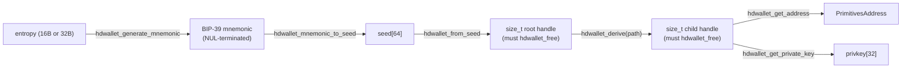

HD wallet functions generate BIP-39 mnemonics, stretch them to 64-byte PBKDF2 seeds, and derive BIP-32 child keys via opaque `size_t` handles. Backed by `libwally-core`; **available in native builds only** (stubbed out in WASM).

## Derivation Lifecycle



Every non-zero handle returned by `hdwallet_from_seed` or `hdwallet_derive` owns a heap-allocated `libwally` key structure and must be released with `hdwallet_free`.

## Functions

### BIP-39 Mnemonics

```c
int hdwallet_generate_mnemonic(
    const unsigned char* entropy,
    size_t entropy_len,          /* 16 (12 words) or 32 (24 words) */
    unsigned char* out_mnemonic, /* NUL-terminated; allocate >= 256 bytes */
    size_t out_len
);

int hdwallet_validate_mnemonic(const char* mnemonic);

int hdwallet_mnemonic_to_seed(
    const char* mnemonic,
    const char* passphrase,      /* optional; pass NULL for empty passphrase */
    unsigned char out_seed[64]
);
```

- `hdwallet_generate_mnemonic` writes a NUL-terminated mnemonic into `out_mnemonic` and returns its character length (`>= 0`), `PRIMITIVES_ERROR_INVALID_LENGTH` (`-2`), or `PRIMITIVES_ERROR_INVALID_INPUT` (`-5`).
- `hdwallet_validate_mnemonic` returns `1` if valid, `0` if invalid.
- `hdwallet_mnemonic_to_seed` returns `PRIMITIVES_SUCCESS` (`0`) or `PRIMITIVES_ERROR_INVALID_INPUT` (`-5`).

### BIP-32 Key Derivation and Extraction

```c
size_t hdwallet_from_seed(const unsigned char* seed, size_t seed_len); /* seed_len must be 64 */

size_t hdwallet_derive(
    size_t hdkey_handle,
    const uint32_t* path, /* OR with 0x80000000U for hardened indices */
    size_t path_len
);

int hdwallet_get_private_key(size_t hdkey_handle, unsigned char out_private_key[32]);
int hdwallet_get_public_key(size_t hdkey_handle, unsigned char out_public_key[33]);
int hdwallet_get_address(size_t hdkey_handle, PrimitivesAddress* out_address);
int hdwallet_free(size_t hdkey_handle);
```

- `hdwallet_from_seed` and `hdwallet_derive` return a non-zero opaque handle on success, or `0` on failure.
- `hdwallet_get_public_key` writes the 33-byte SEC1 compressed public key.
- `hdwallet_free(0)` is a safe no-op returning `PRIMITIVES_SUCCESS`.

## Standard Ethereum BIP-44 Paths

| Path | `uint32_t` array (`H = 0x80000000U`) | Account |
|------|--------------------------------------|---------|
| `m/44'/60'/0'/0/0` | `{H\|44, H\|60, H\|0, 0, 0}` | Default first Ethereum account |
| `m/44'/60'/0'/0/1` | `{H\|44, H\|60, H\|0, 0, 1}` | Second address of account 0 |
| `m/44'/60'/1'/0/0` | `{H\|44, H\|60, H\|1, 0, 0}` | First address of account 1 |

## Example

```c
#include "voltaire.h"

#include <stdio.h>

#define HARDENED(i) (0x80000000U | (uint32_t)(i))

int main(void) {
    /* Generate 32 bytes of CSPRNG output and slice 16 bytes for a 12-word mnemonic */
    unsigned char rand32[32];
    if (primitives_generate_private_key(rand32) != PRIMITIVES_SUCCESS) return 1;

    char mnemonic[256];
    int mlen = hdwallet_generate_mnemonic(rand32, 16, (unsigned char*)mnemonic, sizeof(mnemonic));
    if (mlen < 0 || hdwallet_validate_mnemonic(mnemonic) != 1) return 1;
    printf("Mnemonic: %s\n", mnemonic);

    unsigned char seed[64];
    if (hdwallet_mnemonic_to_seed(mnemonic, NULL, seed) != PRIMITIVES_SUCCESS) return 1;

    size_t root = hdwallet_from_seed(seed, sizeof(seed));
    if (root == 0) return 1;

    const uint32_t path[5] = {HARDENED(44), HARDENED(60), HARDENED(0), 0, 0};
    size_t account = hdwallet_derive(root, path, 5);
    if (account == 0) {
        hdwallet_free(root);
        return 1;
    }

    PrimitivesAddress addr;
    if (hdwallet_get_address(account, &addr) == PRIMITIVES_SUCCESS) {
        unsigned char hex[42];
        primitives_address_to_checksum_hex(&addr, hex);
        printf("m/44'/60'/0'/0/0: %.42s\n", (const char*)hex);
    }

    hdwallet_free(account);
    hdwallet_free(root);
    return 0;
}
```
