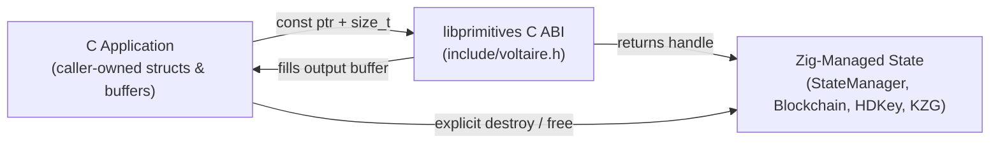

Voltaire exports a C99-compatible ABI directly from Zig via `voltaire.h` and `libprimitives`. Callers link against a single native archive or shared library with zero C wrapper code and zero runtime allocator assumptions for primitive operations.

## Architecture and Memory Model



| Category | Memory ownership | Available in WASM |
|----------|------------------|-------------------|
| Address, Hash, Hex, U256, RLP, ABI, Tx, AccessList, Authorization, EventLog, Bytecode, Blob | Caller-owned stack or heap buffers | Yes |
| secp256k1, Ed25519, P256, X25519, AES-GCM | Caller-owned fixed byte arrays | Yes |
| HD Wallet (BIP-32/39) | Opaque `size_t` handles freed via `hdwallet_free` | No |
| KZG (EIP-4844) | Global trusted setup loaded/freed via `kzg_*_trusted_setup` | No |
| State Manager & Blockchain | Opaque `void*` handles freed via `*_destroy` | No |

## Building and Linking

Build the library from the Voltaire repository root:

```bash
# Native static and dynamic library (zig-out/lib/libprimitives.*)
zig build build-ts-native

# WebAssembly reactor module (zig-out/bin/primitives.wasm)
zig build build-ts-wasm
```

Link against `voltaire.h`:

```bash
cc -std=c99 -Ipackages/voltaire-c/include main.c -Lzig-out/lib -lprimitives -o main
```

## Quick Start

```c
#include "voltaire.h"

#include <stdio.h>
#include <string.h>

int main(void) {
    PrimitivesAddress addr;
    int rc = primitives_address_from_hex(
        "0xd8dA6BF26964aF9D7eEd9e03E53415D37aA96045",
        &addr
    );
    if (rc != PRIMITIVES_SUCCESS) {
        fprintf(stderr, "address parse failed: %d\n", rc);
        return 1;
    }

    static const unsigned char msg[] = "hello";
    PrimitivesHash hash;
    primitives_keccak256(msg, sizeof(msg) - 1, &hash);

    unsigned char hex[66];
    primitives_hash_to_hex(&hash, hex);
    printf("keccak256(\"hello\") = %.66s\n", (const char*)hex);
    printf("library version    = %s\n", primitives_version_string());

    return 0;
}
```

## Core Value Types

`voltaire.h` defines six plain-old-data structs passed by pointer across the ABI boundary:

```c
typedef struct { unsigned char bytes[20]; } PrimitivesAddress;
typedef struct { unsigned char bytes[32]; } PrimitivesHash;
typedef struct { unsigned char bytes[32]; } PrimitivesU256; /* big-endian */

typedef struct {
    unsigned char r[32];
    unsigned char s[32];
    unsigned char v;
} PrimitivesSignature;

typedef struct {
    PrimitivesAddress address;
    const PrimitivesHash* storage_keys_ptr;
    size_t storage_keys_len;
} PrimitivesAccessListEntry;

typedef struct {
    uint64_t chain_id;
    PrimitivesAddress address;
    uint64_t nonce;
    uint64_t v;
    unsigned char r[32];
    unsigned char s[32];
} PrimitivesAuthorization;
```

## Version

```c
const char* primitives_version_string(void);
```

Returns a static NUL-terminated library version string (e.g., `"primitives-0.1.0"`). Do not free the returned pointer.

## Error Codes

`primitives_*` functions return `PRIMITIVES_SUCCESS` (`0`), a non-negative length for variable-size output writers, or one of the negative error constants below.

| Constant | Value | Meaning |
|----------|-------|---------|
| `PRIMITIVES_SUCCESS` | `0` | Success |
| `PRIMITIVES_ERROR_INVALID_HEX` | `-1` | Invalid hexadecimal string |
| `PRIMITIVES_ERROR_INVALID_LENGTH` | `-2` | Input length mismatch or output buffer too small |
| `PRIMITIVES_ERROR_INVALID_CHECKSUM` | `-3` | EIP-55 checksum validation failed |
| `PRIMITIVES_ERROR_OUT_OF_MEMORY` | `-4` | Internal scratch or heap allocation failed |
| `PRIMITIVES_ERROR_INVALID_INPUT` | `-5` | Invalid argument, null pointer, or malformed input |
| `PRIMITIVES_ERROR_INVALID_SIGNATURE` | `-6` | Invalid ECDSA signature or recovery ID |
| `PRIMITIVES_ERROR_INVALID_SELECTOR` | `-7` | Invalid ABI function selector |
| `PRIMITIVES_ERROR_UNSUPPORTED_TYPE` | `-8` | Unsupported ABI type |
| `PRIMITIVES_ERROR_MAX_LENGTH_EXCEEDED` | `-9` | Payload exceeds maximum length |
| `PRIMITIVES_ERROR_ACCESS_LIST_INVALID` | `-10` | Invalid EIP-2930 access list |
| `PRIMITIVES_ERROR_AUTHORIZATION_INVALID` | `-11` | Invalid EIP-7702 authorization |
| `PRIMITIVES_ERROR_KZG_NOT_LOADED` | `-20` | KZG trusted setup not loaded |
| `PRIMITIVES_ERROR_KZG_INVALID_BLOB` | `-21` | Invalid EIP-4844 blob |
| `PRIMITIVES_ERROR_KZG_INVALID_PROOF` | `-22` | Invalid KZG proof |

<Warning>
Non-`primitives_*` crypto functions use distinct return conventions: `secp256k1Sign`, `secp256k1Recover`, `secp256k1DerivePublicKey`, `x25519*`, and `aesGcm*` return `0` on success and `1` on error; `secp256k1Verify` returns `1` for valid and `0` for invalid; `ed25519Verify` and `p256Verify` return `0` for valid, `1` for invalid, and negative on error.
</Warning>

## Modules

- **Getting Started**: [Tutorial: Sign, Verify & Encode in C](/tutorial)
- **Primitives**: [Address](/address) · [Hex](/hex) · [Hash](/hash) · [RLP](/rlp) · [ABI](/abi) · [Transaction](/transaction) · [Access List](/accesslist) · [Authorization](/authorization) · [Event Log](/eventlog)
- **Cryptography**: [secp256k1](/secp256k1) · [Additional Crypto](/crypto) · [HD Wallet](/hdwallet) · [KZG](/kzg)
- **EVM**: [Bytecode](/bytecode) · [Blob](/blob)
- **Advanced**: [State Manager](/statemanager) · [Blockchain](/blockchain)
