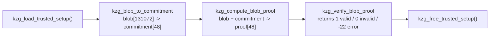

KZG (Kate-Zaverucha-Goldberg) functions compute and verify EIP-4844 polynomial commitments and proofs over 128 KiB blobs using the embedded Ethereum KZG ceremony trusted setup. **Available in native builds only** (not available in WASM).

## Constants and Error Codes

```c
#define KZG_BLOB_SIZE       131072 /* 4096 field elements * 32 bytes */
#define KZG_COMMITMENT_SIZE 48     /* compressed BLS12-381 G1 point */
#define KZG_PROOF_SIZE      48     /* compressed BLS12-381 G1 point */
```

| Error macro | Value | Condition |
|-------------|-------|-----------|
| `PRIMITIVES_ERROR_KZG_NOT_LOADED` | `-20` | Trusted setup not initialized or failed to load/free |
| `PRIMITIVES_ERROR_KZG_INVALID_BLOB` | `-21` | Invalid blob (e.g., field element `>= BLS_MODULUS`) or commitment failed |
| `PRIMITIVES_ERROR_KZG_INVALID_PROOF` | `-22` | Malformed proof, commitment, or field element during verification |

## Lifecycle and Verification Flow



Call `kzg_load_trusted_setup()` once before any KZG call and `kzg_free_trusted_setup()` at shutdown.

## Functions

### Trusted Setup Lifecycle

```c
int kzg_load_trusted_setup(void);
int kzg_free_trusted_setup(void);
```

Return `PRIMITIVES_SUCCESS` (`0`) or `PRIMITIVES_ERROR_KZG_NOT_LOADED` (`-20`).

### Commitments and Proofs

```c
int kzg_blob_to_commitment(
    const unsigned char blob[131072],
    unsigned char out_commitment[48]
);

int kzg_compute_proof(
    const unsigned char blob[131072],
    const unsigned char z[32],    /* BLS12-381 scalar evaluation point */
    unsigned char out_proof[48],
    unsigned char out_y[32]       /* p(z) evaluation result */
);

int kzg_compute_blob_proof(
    const unsigned char blob[131072],
    const unsigned char commitment[48],
    unsigned char out_proof[48]
);
```

Each 32-byte chunk of `blob` must represent a canonical BLS12-381 scalar field element (`< BLS_MODULUS`, guaranteed when byte 0 of every 32-byte field element is `0x00`). Return `PRIMITIVES_SUCCESS` (`0`) or `PRIMITIVES_ERROR_KZG_INVALID_BLOB` (`-21`).

### Verification

```c
int kzg_verify_proof(
    const unsigned char commitment[48],
    const unsigned char z[32],
    const unsigned char y[32],
    const unsigned char proof[48]
);

int kzg_verify_blob_proof(
    const unsigned char blob[131072],
    const unsigned char commitment[48],
    const unsigned char proof[48]
);
```

**Returns:** `1` if valid, `0` if invalid, or `PRIMITIVES_ERROR_KZG_INVALID_PROOF` (`-22`) on malformed input.

## Example

```c
#include "voltaire.h"

#include <stdio.h>
#include <stdlib.h>
#include <string.h>

int main(void) {
    if (kzg_load_trusted_setup() != PRIMITIVES_SUCCESS) {
        fprintf(stderr, "failed to load KZG trusted setup\n");
        return 1;
    }

    /* Allocate 128 KiB blob on heap; keep high byte of each 32-byte field element < 0x73 */
    unsigned char* blob = calloc(1, KZG_BLOB_SIZE);
    if (!blob) return 1;
    memcpy(blob + 1, "test data", 9);

    unsigned char commitment[KZG_COMMITMENT_SIZE];
    unsigned char proof[KZG_PROOF_SIZE];

    int rc = kzg_blob_to_commitment(blob, commitment);
    if (rc == PRIMITIVES_SUCCESS) {
        rc = kzg_compute_blob_proof(blob, commitment, proof);
    }
    if (rc == PRIMITIVES_SUCCESS) {
        int valid = kzg_verify_blob_proof(blob, commitment, proof);
        printf("KZG blob proof valid: %d\n", valid); /* 1 */
    }

    free(blob);
    kzg_free_trusted_setup();
    return rc == PRIMITIVES_SUCCESS ? 0 : 1;
}
```
