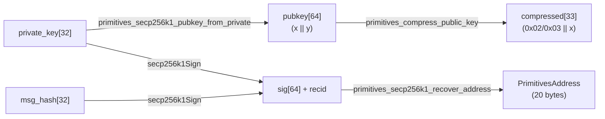

`voltaire.h` exposes two complementary secp256k1 function families: `primitives_secp256k1_*` / `primitives_signature_*` (returning `PRIMITIVES_SUCCESS` or negative error codes) and `secp256k1*` (compact signing/verification exports with `0`/`1` return values).

## Type and Byte Layouts

```c
typedef struct {
    unsigned char r[32]; /* big-endian signature scalar r */
    unsigned char s[32]; /* big-endian signature scalar s */
    unsigned char v;     /* recovery id (0/1 or 27/28) */
} PrimitivesSignature;
```

| Object | Size (bytes) | Format |
|--------|--------------|--------|
| Private key | `32` | Big-endian scalar in `[1, n - 1]` |
| Uncompressed public key | `64` | `x (32B) \|\| y (32B)` (no `0x04` prefix) |
| Compressed public key | `33` | `0x02` (even `y`) or `0x03` (odd `y`) `\|\| x (32B)` |
| Compact signature | `64` or `65` | `r (32B) \|\| s (32B)` plus optional `v (1B)` |



## Return Conventions

<Warning>
Check return values carefully across the two families:
- `primitives_secp256k1_*`, `primitives_signature_parse`, `primitives_generate_private_key`, `primitives_compress_public_key`: `PRIMITIVES_SUCCESS` (`0`) on success, negative error code on failure.
- `secp256k1Sign`, `secp256k1Recover`, `secp256k1DerivePublicKey`: `0` on success, `1` on error.
- `secp256k1Verify`: **`1` if valid, `0` if invalid.**
- `primitives_signature_serialize`: `64` or `65` (bytes written).
</Warning>

## Recovery and Key Derivation (`primitives_secp256k1_*`)

```c
int primitives_secp256k1_recover_pubkey(
    const unsigned char message_hash[32],
    const unsigned char r[32],
    const unsigned char s[32],
    unsigned char v,              /* 0-1 or 27-28 */
    unsigned char out_pubkey[64]  /* x || y */
);

int primitives_secp256k1_recover_address(
    const unsigned char message_hash[32],
    const unsigned char r[32],
    const unsigned char s[32],
    unsigned char v,              /* 0-1 or 27-28 */
    PrimitivesAddress* out_address
);

int primitives_secp256k1_pubkey_from_private(
    const unsigned char private_key[32],
    unsigned char out_pubkey[64]  /* x || y */
);

bool primitives_secp256k1_validate_signature(
    const unsigned char r[32],
    const unsigned char s[32]
);
```

- `recover_pubkey` and `recover_address` return `PRIMITIVES_SUCCESS` (`0`) or `PRIMITIVES_ERROR_INVALID_SIGNATURE` (`-6`).
- `pubkey_from_private` returns `PRIMITIVES_SUCCESS` (`0`) or `PRIMITIVES_ERROR_INVALID_INPUT` (`-5`) when the scalar is `0` or `>= n`.
- `validate_signature` returns `true` if `1 <= r < n` and `1 <= s <= n/2` (canonical low-`s`).

## Signing and Verification (`secp256k1*`)

```c
int secp256k1Sign(
    const unsigned char* msgHash_ptr, /* 32 bytes */
    const unsigned char* privKey_ptr, /* 32 bytes */
    unsigned char* sig_ptr,           /* 64 bytes output (r || s, low-s normalized) */
    unsigned char* recid_ptr          /* 1 byte recovery id (0 or 1) */
);

int secp256k1Verify(
    const unsigned char* msgHash_ptr, /* 32 bytes */
    const unsigned char* sig_ptr,     /* 64 bytes (r || s) */
    const unsigned char* pubKey_ptr   /* 64 bytes (x || y) */
);

int secp256k1Recover(
    const unsigned char* msgHash_ptr, /* 32 bytes */
    const unsigned char* sig_ptr,     /* 64 bytes (r || s) */
    unsigned char recid,              /* 0 or 1 */
    unsigned char* pubKey_ptr         /* 64 bytes output (x || y) */
);

int secp256k1DerivePublicKey(
    const unsigned char* privKey_ptr, /* 32 bytes */
    unsigned char* pubKey_ptr         /* 64 bytes output (x || y) */
);
```

`secp256k1Sign` automatically normalizes `s` to low-`s` (EIP-2) and adjusts `*recid_ptr` accordingly.

## Signature Utilities and Key Generation

```c
bool primitives_signature_normalize(unsigned char r[32], unsigned char s[32]);
bool primitives_signature_is_canonical(const unsigned char r[32], const unsigned char s[32]);

int primitives_signature_parse(
    const unsigned char* sig_data, /* 64 or 65 bytes */
    size_t sig_len,
    unsigned char out_r[32],
    unsigned char out_s[32],
    unsigned char* out_v           /* set to 0 when sig_len == 64 */
);

int primitives_signature_serialize(
    const unsigned char r[32],
    const unsigned char s[32],
    unsigned char v,
    bool include_v,                /* true -> 65 bytes, false -> 64 bytes */
    unsigned char* out_buf
);

int primitives_generate_private_key(unsigned char out_private_key[32]);

int primitives_compress_public_key(
    const unsigned char uncompressed[64],
    unsigned char out_compressed[33]
);
```

- `primitives_signature_normalize` replaces `s` in place with `n - s` if `s > n / 2` and returns `true` when modified. Remember to flip `v` parity (`0 <-> 1` or `27 <-> 28`) if normalization occurred.
- `primitives_signature_parse` returns `PRIMITIVES_SUCCESS` (`0`) or `PRIMITIVES_ERROR_INVALID_LENGTH` (`-2`).
- `primitives_generate_private_key` draws 32 bytes from OS cryptographic randomness (`std.crypto.random`) and rejects `0` or `>= n`.

## Example

```c
#include "voltaire.h"

#include <stdio.h>
#include <string.h>

int main(void) {
    unsigned char privkey[32];
    if (primitives_generate_private_key(privkey) != PRIMITIVES_SUCCESS) return 1;

    unsigned char pubkey[64];
    if (primitives_secp256k1_pubkey_from_private(privkey, pubkey) != PRIMITIVES_SUCCESS) return 1;

    static const unsigned char msg[] = "hello";
    PrimitivesHash digest;
    if (primitives_eip191_hash_message(msg, sizeof(msg) - 1, &digest) != PRIMITIVES_SUCCESS) {
        return 1;
    }

    unsigned char sig[64];
    unsigned char recid = 0;
    if (secp256k1Sign(digest.bytes, privkey, sig, &recid) != 0) return 1;

    int valid = secp256k1Verify(digest.bytes, sig, pubkey);
    printf("Verified: %d\n", valid); /* 1 */

    PrimitivesAddress signer;
    if (primitives_secp256k1_recover_address(
            digest.bytes, sig, sig + 32, recid, &signer) != PRIMITIVES_SUCCESS) {
        return 1;
    }

    unsigned char hex[42];
    primitives_address_to_checksum_hex(&signer, hex);
    printf("Signer:   %.42s\n", (const char*)hex);

    return 0;
}
```
