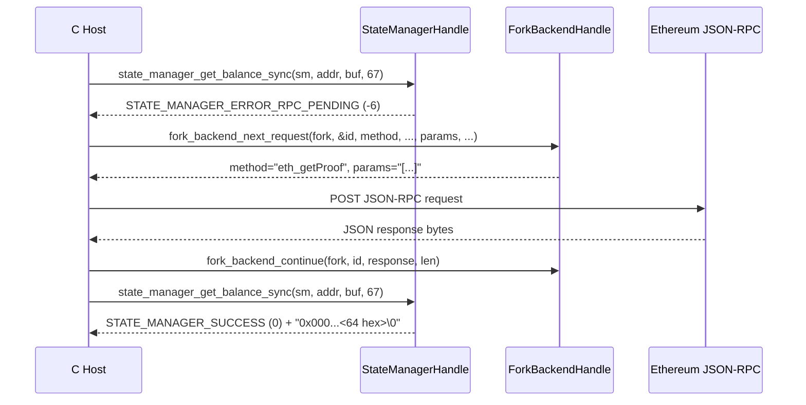

`StateManagerHandle` is an opaque handle to a Zig-allocated EVM state store holding account balances, nonces, storage slots, and contract bytecode, with nested checkpoint/revert/commit, snapshot IDs, and an optional asynchronous RPC `ForkBackendHandle`. **Available in native builds only.**

## Async Fork Request/Continue State Machine

Instead of blocking inside C callbacks, fork cache misses use a pull-based request/continue loop driven by the host:



## Types and Error Codes

```c
typedef void* StateManagerHandle;
typedef void* ForkBackendHandle;
```

| Macro | Value | Meaning |
|-------|-------|---------|
| `STATE_MANAGER_SUCCESS` | `0` | Success |
| `STATE_MANAGER_ERROR_INVALID_INPUT` | `-1` | Null handle/pointer or output buffer too small |
| `STATE_MANAGER_ERROR_OUT_OF_MEMORY` | `-2` | Allocation failed |
| `STATE_MANAGER_ERROR_INVALID_SNAPSHOT` | `-3` | Unknown snapshot ID |
| `STATE_MANAGER_ERROR_RPC_FAILED` | `-4` | RPC response parse or backend error |
| `STATE_MANAGER_ERROR_INVALID_HEX` | `-5` | Malformed hex address, slot, or value |
| `STATE_MANAGER_ERROR_RPC_PENDING` | `-6` | Cache miss; poll `fork_backend_next_request` |
| `STATE_MANAGER_ERROR_NO_PENDING_REQUEST` | `-7` | Fork request queue is empty |
| `STATE_MANAGER_ERROR_OUTPUT_TOO_SMALL` | `-8` | `method_buf_len` or `params_buf_len` too small |
| `STATE_MANAGER_ERROR_INVALID_REQUEST` | `-9` | Unknown `request_id` in `fork_backend_continue` |

## Lifecycle

```c
StateManagerHandle state_manager_create(void);
StateManagerHandle state_manager_create_with_fork(ForkBackendHandle fork_backend);
void               state_manager_destroy(StateManagerHandle handle);

ForkBackendHandle  fork_backend_create(
    void* rpc_client_ptr,  /* ignored; pass NULL */
    void* rpc_vtable,      /* ignored; pass NULL */
    const char* block_tag, /* e.g. "latest", "0x112a880" */
    size_t max_cache_size
);
void fork_backend_destroy(ForkBackendHandle handle);
void fork_backend_clear_cache(ForkBackendHandle handle);
```

Destroy `StateManagerHandle` before destroying the `ForkBackendHandle` it references.

## Fork Async RPC Queue

```c
int fork_backend_next_request(
    ForkBackendHandle handle,
    uint64_t* out_request_id,
    unsigned char* out_method, size_t method_buf_len, size_t* out_method_len,
    unsigned char* out_params, size_t params_buf_len, size_t* out_params_len
);

int fork_backend_continue(
    ForkBackendHandle handle,
    uint64_t request_id,
    const unsigned char* response,
    size_t response_len
);
```

`fork_backend_next_request` emits `"eth_getProof"` or `"eth_getCode"` without NUL terminators; use `*out_method_len` and `*out_params_len`. If a buffer is too small, it writes the required lengths to `*out_method_len` / `*out_params_len` and returns `STATE_MANAGER_ERROR_OUTPUT_TOO_SMALL` without dequeuing the request.

## Account, Storage, and Code Operations

```c
/* Balance: out_buffer >= 67 bytes, writes NUL-terminated "0x" + 64 hex chars */
int state_manager_get_balance_sync(StateManagerHandle handle, const char* address_hex, unsigned char* out_buffer, size_t buffer_len);
int state_manager_set_balance(StateManagerHandle handle, const char* address_hex, const char* balance_hex);

/* Nonce */
int state_manager_get_nonce_sync(StateManagerHandle handle, const char* address_hex, uint64_t* out_nonce);
int state_manager_set_nonce(StateManagerHandle handle, const char* address_hex, uint64_t nonce);

/* Storage: out_buffer >= 67 bytes, writes NUL-terminated "0x" + 64 hex chars */
int state_manager_get_storage_sync(StateManagerHandle handle, const char* address_hex, const char* slot_hex, unsigned char* out_buffer, size_t buffer_len);
int state_manager_set_storage(StateManagerHandle handle, const char* address_hex, const char* slot_hex, const char* value_hex);

/* Bytecode: query length first, then copy raw bytes */
int state_manager_get_code_len_sync(StateManagerHandle handle, const char* address_hex, size_t* out_len);
int state_manager_get_code_sync(StateManagerHandle handle, const char* address_hex, unsigned char* out_buffer, size_t buffer_len);
int state_manager_set_code(StateManagerHandle handle, const char* address_hex, const unsigned char* code, size_t code_len);
```

`balance_hex`, `slot_hex`, and `value_hex` accept either `0x`-prefixed hex or decimal strings (`parseInt(..., 0)`).

## Checkpoints, Snapshots, Caches, and Mock Data

```c
int  state_manager_checkpoint(StateManagerHandle handle);
void state_manager_revert(StateManagerHandle handle);
void state_manager_commit(StateManagerHandle handle);

int  state_manager_snapshot(StateManagerHandle handle, uint64_t* out_snapshot_id);
int  state_manager_revert_to_snapshot(StateManagerHandle handle, uint64_t snapshot_id);

void state_manager_clear_caches(StateManagerHandle handle);
void state_manager_clear_fork_cache(StateManagerHandle handle);

void mock_data_load(uint32_t num_accounts, uint32_t num_blocks, uint64_t fork_block_number, const unsigned char* data, size_t data_len);
void mock_data_clear(void);
```

## Example

```c
#include "voltaire.h"

#include <stdio.h>

int main(void) {
    StateManagerHandle sm = state_manager_create();
    if (!sm) return 1;

    const char* addr = "0xd8dA6BF26964aF9D7eEd9e03E53415D37aA96045";
    state_manager_set_balance(sm, addr, "0xde0b6b3a7640000"); /* 1 ETH */

    uint64_t snap = 0;
    state_manager_snapshot(sm, &snap);

    state_manager_checkpoint(sm);
    state_manager_set_balance(sm, addr, "0x0");
    state_manager_revert(sm); /* restores 1 ETH */

    char balance[67];
    if (state_manager_get_balance_sync(sm, addr, (unsigned char*)balance, sizeof(balance))
            == STATE_MANAGER_SUCCESS) {
        printf("Balance: %s\n", balance);
    }

    state_manager_revert_to_snapshot(sm, snap);
    state_manager_destroy(sm);
    return 0;
}
```
