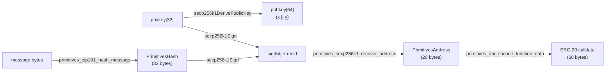

Your hardware-signer daemon is written in C99. It needs to:

1. Derive an Ethereum address from a 32-byte private key.
2. Hash and sign an EIP-191 authorization message.
3. Recover the signer address from `(hash, r, s, v)` and verify it matches.
4. Build the 68-byte ERC-20 `transfer(address,uint256)` calldata.

Before writing the clean version, look at this snippet written by a developer who skimmed the header. **Spot all three C bugs before scrolling.**

```c
/* BUGGY CODE — DO NOT COPY */
PrimitivesAddress signer;
unsigned char key[16];
primitives_generate_private_key(key);                       /* Bug 1 */

unsigned char hex[42];
primitives_address_to_checksum_hex(&signer, hex);
printf("Signer: %s\n", hex);                                /* Bug 2 */

unsigned char sig[64], recid;
int ok = secp256k1Verify(msg_hash.bytes, sig, pubkey);
if (ok == 0) { printf("Verified!\n"); }                     /* Bug 3 */
```

<Accordion title="Reveal the three bugs">
1. **Stack buffer overflow:** `primitives_generate_private_key` always writes **32 bytes**. Passing `unsigned char key[16]` smashes 16 bytes past the end of `key`.
2. **Missing NUL terminator:** `primitives_address_to_checksum_hex` writes exactly **42 bytes** (`"0x"` + 40 ASCII hex characters) and does **not** write `'\0'`. Passing `hex` to `printf("%s", hex)` reads past the array until a stray zero byte appears in memory. Always print with `%.42s` or allocate `char hex[43]` and set `hex[42] = '\0'`.
3. **Inverted return code:** Unlike `primitives_*` (where `0` means success) or `ed25519Verify` (where `0` means valid), `secp256k1Verify` returns **`1` if valid and `0` if invalid**. Checking `ok == 0` accepts forged signatures and rejects real ones.
</Accordion>

## Data Flow

Trace how bytes move across the C-to-Zig boundary — every buffer stays on the C stack:



<Steps>
<Step title="Build libprimitives_c">
From the Voltaire repository root, compile the native C ABI library:

```bash
git submodule update --init packages/voltaire-zig/lib/libwally-core
zig build -Dwith-c-api=true
```

Confirm `zig-out/lib/libprimitives_c.dylib` (or `.so`) exists.
</Step>

<Step title="Generate a key and sign an EIP-191 message">
Create `signer_demo.c`. Always check return codes and size every buffer to match `voltaire.h`.

```c
#include "voltaire.h"

#include <stdio.h>
#include <string.h>

int main(void) {
    /* 1. Generate a 32-byte secp256k1 private key */
    unsigned char privkey[32];
    if (primitives_generate_private_key(privkey) != PRIMITIVES_SUCCESS) {
        fprintf(stderr, "key generation failed\n");
        return 1;
    }

    /* 2. Derive the 64-byte uncompressed public key (x || y) */
    unsigned char pubkey[64];
    if (primitives_secp256k1_pubkey_from_private(privkey, pubkey) != PRIMITIVES_SUCCESS) {
        fprintf(stderr, "public key derivation failed\n");
        return 1;
    }

    /* Compute expected Ethereum address: last 20 bytes of keccak256(pubkey) */
    PrimitivesHash pub_hash;
    primitives_keccak256(pubkey, sizeof(pubkey), &pub_hash);
    PrimitivesAddress expected_addr;
    memcpy(expected_addr.bytes, pub_hash.bytes + 12, 20);

    /* 3. Hash the message with the EIP-191 personal_sign prefix */
    static const unsigned char msg[] = "Approve transfer of 1000 tokens";
    PrimitivesHash digest;
    if (primitives_eip191_hash_message(msg, sizeof(msg) - 1, &digest) != PRIMITIVES_SUCCESS) {
        fprintf(stderr, "EIP-191 hash failed\n");
        return 1;
    }

    /* 4. Sign the 32-byte digest (secp256k1Sign returns 0 on success) */
    unsigned char sig[64];
    unsigned char recid = 0;
    if (secp256k1Sign(digest.bytes, privkey, sig, &recid) != 0) {
        fprintf(stderr, "signing failed\n");
        return 1;
    }
```

<Note>
Watch `sizeof(msg) - 1`: a C string literal includes its trailing `'\0'`. Passing `sizeof(msg)` would hash a NUL byte into the EIP-191 message and break compatibility with MetaMask and Solidity `ecrecover`.
</Note>
</Step>

<Step title="Verify the signature and recover the signer address">
Append verification and address recovery to `main()`:

```c
    /* 5. Verify against pubkey (secp256k1Verify returns 1 if valid) */
    if (secp256k1Verify(digest.bytes, sig, pubkey) != 1) {
        fprintf(stderr, "signature verification failed\n");
        return 1;
    }

    /* 6. Recover Ethereum address from (digest, r, s, v) */
    PrimitivesAddress recovered;
    if (primitives_secp256k1_recover_address(
            digest.bytes, sig, sig + 32, recid, &recovered) != PRIMITIVES_SUCCESS) {
        fprintf(stderr, "address recovery failed\n");
        return 1;
    }

    if (!primitives_address_equals(&expected_addr, &recovered)) {
        fprintf(stderr, "recovered address mismatch\n");
        return 1;
    }

    /* Format with EIP-55 checksum — explicitly NUL-terminate in a 43-byte buffer */
    char addr_hex[43];
    primitives_address_to_checksum_hex(&recovered, (unsigned char*)addr_hex);
    addr_hex[42] = '\0';
    printf("Verified signer: %s\n", addr_hex);
```

Checkpoint: `primitives_address_equals` returns `true`, and `addr_hex` prints a valid mixed-case EIP-55 address.
</Step>

<Step title="Encode ERC-20 transfer calldata">
Encode `transfer(address,uint256)` using the recovered address and inspect the 4-byte selector plus two 32-byte ABI words (68 bytes total):

```c
    char values_json[96];
    snprintf(values_json, sizeof(values_json), "[\"%s\",\"1000\"]", addr_hex);

    unsigned char calldata[128];
    int calldata_len = primitives_abi_encode_function_data(
        "transfer(address,uint256)",
        "[\"address\",\"uint256\"]",
        values_json,
        calldata,
        sizeof(calldata)
    );
    if (calldata_len < 0) {
        fprintf(stderr, "ABI encode failed: %d\n", calldata_len);
        return 1;
    }

    /* Convert calldata to a NUL-terminated hex string (needs 2 + 2*len + 1 bytes) */
    char calldata_hex[2 + 128 * 2 + 1];
    int hex_len = primitives_bytes_to_hex(
        calldata, (size_t)calldata_len,
        (unsigned char*)calldata_hex, sizeof(calldata_hex)
    );
    if (hex_len < 0) {
        fprintf(stderr, "hex encode failed: %d\n", hex_len);
        return 1;
    }

    long long gas = primitives_abi_estimate_gas(calldata, (size_t)calldata_len);
    printf("Calldata (%d bytes, %lld calldata gas):\n%s\n", calldata_len, gas, calldata_hex);
    return 0;
}
```
</Step>

<Step title="Compile and run">
```bash
cc -std=c99 -Wall -Wextra -Ipackages/voltaire-c/include signer_demo.c \
   -Lzig-out/lib -lprimitives_c -Wl,-rpath,"$PWD/zig-out/lib" -o signer_demo
./signer_demo
```

Expected output shape:

```text
Verified signer: 0x... (40 hex chars, mixed-case EIP-55)
Calldata (68 bytes, ... calldata gas):
0xa9059cbb000000000000000000000000<20-byte-addr>00000000000000000000000000000000000000000000000000000000000003e8
```

Notice the first 4 bytes are `0xa9059cbb` (`keccak256("transfer(address,uint256)")[0..4]`) and the last word ends in `03e8` (`1000` in hex).
</Step>
</Steps>

<Accordion title="Check your understanding">
1. Why did `calldata_hex` work with `printf("%s", calldata_hex)` without setting `calldata_hex[hex_len] = '\0'`, whereas `addr_hex` required manual termination?
   - `primitives_bytes_to_hex` writes a trailing `'\0'` at `out_buf[required_len]` (so `buf_len` must be at least `2 + 2*data_len + 1`). Fixed-width formatters (`primitives_address_to_hex`, `primitives_address_to_checksum_hex`, `primitives_hash_to_hex`, `primitives_u256_to_hex`) write exact byte lengths with no `'\0'`.
2. What does `primitives_abi_encode_function_data` return on success vs. failure?
   - A non-negative integer giving the exact number of bytes written (`68` here) on success, or a negative `PRIMITIVES_ERROR_*` code on failure.
</Accordion>

## What You Built

You wrote a stack-only C99 signing and ABI encoding pipeline with zero heap allocations, explicit buffer sizing, and strict return-code verification across two FFI conventions (`primitives_*` and `secp256k1*`).

Next, inspect the reference pages for [Address](/address), [secp256k1](/secp256k1), [ABI Encoding](/abi), or forkable EVM state in [State Manager](/statemanager).
