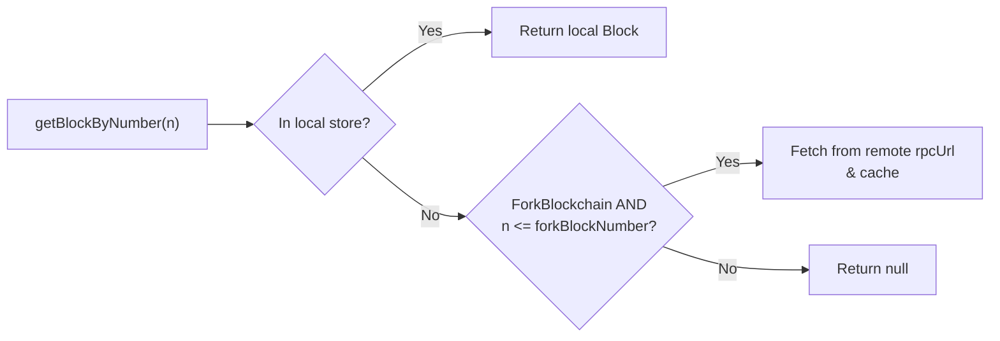

`BlockchainService` stores, indexes, and queries Ethereum blocks, canonical head pointers, and orphan blocks. Two layers implement it: `InMemoryBlockchain` for pure local chains and `ForkBlockchain` for lazily fetching historical blocks at or below a fork point from a remote RPC.



## `InMemoryBlockchain`

Stores blocks exclusively in memory; populate via `putBlock()`:

```typescript
import { Effect } from 'effect'
import { BlockchainService, InMemoryBlockchain } from 'voltaire-effect'

const program = Effect.gen(function* () {
  const blockchain = yield* BlockchainService

  yield* blockchain.putBlock(block1)
  yield* blockchain.putBlock(block2)

  const block = yield* blockchain.getBlockByNumber(1n)
  const head = yield* blockchain.getHeadBlockNumber()
  const count = yield* blockchain.localBlockCount()
  return { block, head, count }
}).pipe(Effect.provide(InMemoryBlockchain))
```

## `ForkBlockchain`

Fetches blocks with `number <= forkBlockNumber` from `rpcUrl` on demand while storing locally produced blocks above the fork point in memory:

```typescript
import { Effect } from 'effect'
import { BlockchainService, ForkBlockchain } from 'voltaire-effect'

const forkLayer = ForkBlockchain({
  forkBlockNumber: 18_000_000n,
  rpcUrl: 'https://eth.llamarpc.com'
})

const program = Effect.gen(function* () {
  const blockchain = yield* BlockchainService

  // Fetched from remote RPC (<= forkBlockNumber)
  const historical = yield* blockchain.getBlockByNumber(17_999_999n)
  // Returns null (> forkBlockNumber and not locally added)
  const future = yield* blockchain.getBlockByNumber(18_000_001n)
  const fromFork = yield* blockchain.isForkBlock(17_999_999n) // true

  return { historical, future, fromFork }
}).pipe(Effect.provide(forkLayer))
```

## Service Interface (`BlockchainShape`)

| Method | Signature | Behavior |
| --- | --- | --- |
| `getBlockByHash` | `(hash: HexInput) => Effect<Block \| null, BlockchainError>` | Lookup block by 32-byte hash |
| `getBlockByNumber` | `(number: bigint) => Effect<Block \| null, BlockchainError>` | Lookup canonical block by height |
| `getCanonicalHash` | `(number: bigint) => Effect<HexInput \| null, BlockchainError>` | Canonical hash at height |
| `getHeadBlockNumber` | `() => Effect<bigint \| null, BlockchainError>` | Current canonical head height |
| `putBlock` | `(block: Block) => Effect<void, BlockchainError>` | Insert block into store |
| `setCanonicalHead` | `(hash: HexInput) => Effect<void, BlockchainError>` | Move canonical head pointer |
| `hasBlock` | `(hash: HexInput) => Effect<boolean, BlockchainError>` | Membership check |
| `localBlockCount` | `() => Effect<number, BlockchainError>` | Count of locally stored blocks |
| `orphanCount` | `() => Effect<number, BlockchainError>` | Count of blocks with missing parents |
| `canonicalChainLength` | `() => Effect<number, BlockchainError>` | Length of canonical chain |
| `isForkBlock` | `(number: bigint) => Effect<boolean, BlockchainError>` | `true` if `number <= forkBlockNumber` |
| `destroy` | `() => Effect<void, never>` | Release internal store resources |

## `Block` Shape

```typescript
interface Block {
  readonly hash: HexInput
  readonly parentHash: HexInput
  readonly ommersHash: HexInput
  readonly beneficiary: HexInput
  readonly stateRoot: HexInput
  readonly transactionsRoot: HexInput
  readonly receiptsRoot: HexInput
  readonly logsBloom: HexInput
  readonly difficulty: bigint
  readonly number: bigint
  readonly gasLimit: bigint
  readonly gasUsed: bigint
  readonly timestamp: bigint
  readonly extraData: HexInput
  readonly mixHash: HexInput
  readonly nonce: bigint
  readonly baseFeePerGas?: bigint           // EIP-1559
  readonly withdrawalsRoot?: HexInput       // EIP-4895
  readonly blobGasUsed?: bigint             // EIP-4844
  readonly excessBlobGas?: bigint           // EIP-4844
  readonly parentBeaconBlockRoot?: HexInput // EIP-4788
  readonly transactions: HexInput           // RLP-encoded
  readonly ommers: HexInput                 // RLP-encoded
  readonly withdrawals: HexInput            // RLP-encoded
  readonly size: bigint
  readonly totalDifficulty?: bigint
}
```

## Error Handling (`BlockchainError`)

| `errorCode` | Cause |
| --- | --- |
| `BLOCK_NOT_FOUND` | Requested block hash or number does not exist |
| `INVALID_PARENT` | Block references a missing or invalid parent hash |
| `ORPHAN_HEAD` | Attempted to set an unlinked orphan block as canonical head |
| `INVALID_HASH` | Malformed block hash |
| `RPC_ERROR` | Remote RPC call failed in `ForkBlockchain` mode |

```typescript
program.pipe(
  Effect.catchTag('BlockchainError', (e) => {
    console.error(e.errorCode, e.message)
    return Effect.succeed(null)
  })
)
```

## See Also

- [Block Module](/block) — Fetch blocks directly from JSON-RPC
- [BlockStream](/services/block-stream) — Continuous block streaming with reorg detection
