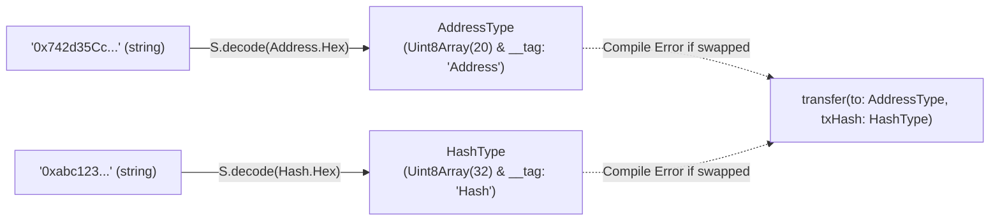

A Voltaire primitive is a plain `Uint8Array` at runtime intersected with a phantom brand tag at compile time. `voltaire-effect` schemas decode external input directly into these branded types so distinct byte arrays cannot be swapped accidentally.



## Compile-Time Brand, Runtime `Uint8Array`

```typescript
type AddressType = Uint8Array & { readonly __tag: 'Address' }
type HashType = Uint8Array & { readonly __tag: 'Hash' }

function recordTransfer(to: AddressType, txHash: HashType): void { /* ... */ }

recordTransfer(addr, hash) // Compiles
recordTransfer(hash, addr) // Compile error: HashType is not assignable to AddressType
```

| Type | Runtime Representation | Byte Length | Compile-Time Tag |
| --- | --- | --- | --- |
| `AddressType` | `Uint8Array` | 20 | `Address` |
| `HashType` | `Uint8Array` | 32 | `Hash` |
| `Bytes32Type` | `Uint8Array` | 32 | `Bytes32` |
| `BytecodeType` | `Uint8Array` | Variable | `Bytecode` |

Brands are erased completely during TypeScript compilation. No wrapper object is allocated.

## Boundary Validation via Schema

Decode untrusted strings or byte buffers once at application boundaries. Every downstream function receives a validated branded type:

```typescript
import * as S from 'effect/Schema'
import * as Address from 'voltaire-effect/primitives/Address'
import * as A from '@tevm/voltaire/Address'

const addr = S.decodeSync(Address.Hex)('0x742d35Cc6634C0532925a3b844Bc9e7595f251e3')

addr instanceof Uint8Array // true
addr.length                // 20

// Interoperates directly with @tevm/voltaire functions
A.toHex(addr)              // "0x742d35cc6634c0532925a3b844bc9e7595f251e3"
A.isZero(addr)             // false
A.equals(addr, addr)       // true
```

## Interoperability with Platform APIs

Because a branded primitive is a standard `Uint8Array`, it passes directly to Web Crypto, Node `Buffer`, and typed array views with zero copying:

```typescript
const digest = await crypto.subtle.digest('SHA-256', addr)
const nodeBuf = Buffer.from(addr)
const view = new DataView(addr.buffer, addr.byteOffset, addr.byteLength)
const prefix = addr.subarray(0, 4)
```

## Relation to `effect/Brand`

Effect's `Brand` module brands primitive values (`string & Brand.Brand<'UserId'>`). Voltaire brands `Uint8Array` instances so cryptographic and ABI operations work on raw bytes without repeated hex parsing. `voltaire-effect` schemas bridge both: they execute inside Effect's `Schema` pipeline and emit Voltaire's branded `Uint8Array` types.

## See Also

- [Data-First API](/concepts/data-first-api) — Composing branded values with `pipe`
- [Error Handling](/concepts/error-handling) — Handling `ParseError` from schema decoding
- [Address Primitive](/primitives/address) — Address schemas and conversions
- [Voltaire Branded Types](https://voltaire.tevm.sh/concepts/branded-types) — Core primitive branding specification
