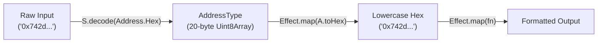

Voltaire represents Ethereum values as plain data (`Uint8Array`, `bigint`) rather than stateful wrapper classes. Functions accept the data value as their first argument, matching Effect's `pipe` convention.



## Data-First Functions

Pass decoded primitives directly to `@tevm/voltaire` module functions:

```typescript
import * as S from 'effect/Schema'
import * as Address from 'voltaire-effect/primitives/Address'
import * as A from '@tevm/voltaire/Address'

const addr = S.decodeSync(Address.Hex)('0x742d35Cc6634C0532925a3b844Bc9e7595f251e3')

A.toHex(addr)        // "0x742d35cc6634c0532925a3b844bc9e7595f251e3"
A.isZero(addr)       // false
A.equals(addr, addr) // true
```

Because functions are standalone and stateless, tree-shaking removes unused operations and `pipe` composes transformations without intermediate wrappers:

```typescript
import { pipe } from 'effect'
import * as Effect from 'effect/Effect'
import * as S from 'effect/Schema'
import * as Address from 'voltaire-effect/primitives/Address'
import * as A from '@tevm/voltaire/Address'

const formatAddress = (input: string) =>
  pipe(
    S.decode(Address.Hex)(input),
    Effect.map(A.toHex),
    Effect.map((hex) => `Address: ${hex}`)
  )
```

Equivalent `Effect.gen` form:

```typescript
const formatAddressGen = (input: string) =>
  Effect.gen(function* () {
    const addr = yield* S.decode(Address.Hex)(input)
    return `Address: ${A.toHex(addr)}`
  })
```

## Why Data-First Matters

| Property | Class Wrapper (`new Address(...)`) | Data-First (`Uint8Array` + functions) |
| --- | --- | --- |
| Tree-shaking | Methods retained on prototype | Unused functions dropped by bundler |
| Binary interop | Requires `.toBytes()` conversion | Passes directly to `Buffer.from`, `crypto.subtle`, `DataView` |
| Serialization | Custom serializer needed | Plain `Uint8Array` bytes |
| Pipeline composition | Method chaining only | Works with `pipe`, `Effect.map`, `Stream.map` |

## FiberRef Request Modifiers

Per-request configuration helpers (`withTimeout`, `withRetrySchedule`, `withoutCache`, `withTracing`) are data-last Effect combinators designed for `.pipe(...)`. They scope configuration to the current fiber without mutating shared transport or provider instances:

```typescript
import * as Schedule from 'effect/Schedule'
import {
  getBalance,
  getBlock,
  getTransactionReceipt,
  withTimeout,
  withRetrySchedule,
  withoutCache,
  withTracing
} from 'voltaire-effect'

const fastBalance = getBalance(addr).pipe(
  withTimeout('5 seconds')
)

const retriedBlock = getBlock({ blockTag: 'latest' }).pipe(
  withRetrySchedule(
    Schedule.exponential('500 millis').pipe(
      Schedule.jittered,
      Schedule.compose(Schedule.recurs(5))
    )
  )
)

const freshTracedReceipt = getTransactionReceipt(txHash).pipe(
  withTimeout('10 seconds'),
  withRetrySchedule(Schedule.recurs(3)),
  withoutCache,
  withTracing(true)
)
```

## See Also

- [Branded Types](/concepts/branded-types) — Zero-overhead compile-time tags
- [Effect Primer](/concepts/effect-primer) — Core `pipe` and `Effect.gen` patterns
- [Voltaire Data-First](https://voltaire.tevm.sh/concepts/data-first) — Core library design notes
