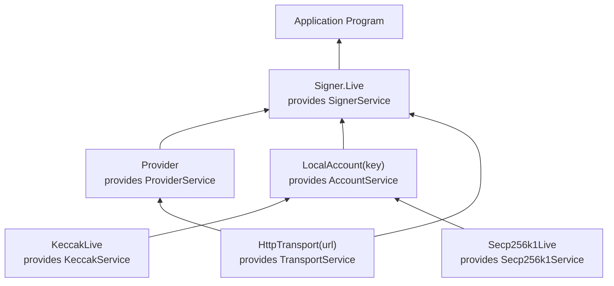

Base Voltaire passes cryptographic primitives explicitly as options (`Address.from(hex, { keccak256 })`). `voltaire-effect` replaces manual parameter threading with Effect services (`Context.Tag`) and `Layer` graphs. Programs declare dependencies in their `R` type parameter and receive implementations once at the entry point.



## Declaring and Providing a Service

```typescript
import * as Effect from 'effect/Effect'
import { KeccakService, KeccakLive } from 'voltaire-effect/crypto/Keccak256'

// Declares requirement: Effect<Uint8Array, never, KeccakService>
const hashBytes = (data: Uint8Array) =>
  Effect.gen(function* () {
    const keccak = yield* KeccakService
    return yield* keccak.hash(data)
  })

// Satisfy requirement at the boundary
const digest = await Effect.runPromise(
  hashBytes(new Uint8Array([1, 2, 3])).pipe(Effect.provide(KeccakLive))
)
```

## Schemas That Require Services

Schemas can declare service requirements directly in their `R` channel. `Address.Checksummed` requires `KeccakService` to compute EIP-55 casing:

```typescript
import * as Effect from 'effect/Effect'
import * as S from 'effect/Schema'
import * as Address from 'voltaire-effect/primitives/Address'
import { KeccakLive } from 'voltaire-effect/crypto/Keccak256'

const addr = S.decodeSync(Address.Hex)('0x742d35cc6634c0532925a3b844bc9e7595f251e3')

const checksummed = await Effect.runPromise(
  S.encode(Address.Checksummed)(addr).pipe(Effect.provide(KeccakLive))
)
```

## Core Services

| Service Tag | Live Layer | Purpose |
| --- | --- | --- |
| `TransportService` | `HttpTransport`, `WebSocketTransport`, `BrowserTransport` | JSON-RPC transport |
| `ProviderService` | `Provider` | Request layer for provider free functions |
| `AccountService` | `LocalAccount`, `JsonRpcAccount`, `MnemonicAccount` | Message, typed-data, and tx signing |
| `SignerService` | `Signer.Live`, `Signer.fromProvider`, `Signer.fromPrivateKey` | Nonce/gas/chainId auto-fill + broadcast |
| `KeccakService` | `KeccakLive` | Keccak-256 hashing |
| `Secp256k1Service` | `Secp256k1Live` | ECDSA signing and recovery |

## Composing and Swapping Layers

Merge independent layers with `Layer.merge` / `Layer.mergeAll`, and wire dependencies with `Layer.provide`:

```typescript
import * as Effect from 'effect/Effect'
import * as Layer from 'effect/Layer'
import { getBlock, getBalance, ProviderService, Provider, HttpTransport } from 'voltaire-effect'

const fetchAccountSummary = (addr: `0x${string}`) =>
  Effect.gen(function* () {
    const balance = yield* getBalance(addr)
    const block = yield* getBlock({ blockTag: 'latest' })
    return { balance, block }
  })

// Production layer
const ProviderLive = Provider.pipe(
  Layer.provide(HttpTransport('https://eth.llamarpc.com'))
)

// Test layer: same program, zero network calls
const ProviderTest = Layer.succeed(ProviderService, {
  request: (_method, _params) => Effect.succeed(mockResponse)
})

await Effect.runPromise(fetchAccountSummary(addr).pipe(Effect.provide(ProviderLive)))
await Effect.runPromise(fetchAccountSummary(addr).pipe(Effect.provide(ProviderTest)))
```

## Scoped Per-Request Overrides (`FiberRef`)

To vary timeout, retry schedule, cache behavior, or tracing for a single call without rebuilding layers, apply FiberRef helpers:

```typescript
import * as Schedule from 'effect/Schedule'
import {
  getBalance, getBlockNumber, getBlock,
  withTimeout, withRetrySchedule, withoutCache, withTracing
} from 'voltaire-effect'

const fastBalance = yield* getBalance(addr).pipe(
  withTimeout('5 seconds'),
  withRetrySchedule(Schedule.recurs(1))
)

const freshHead = yield* getBlockNumber().pipe(withoutCache)
const tracedBlock = yield* getBlock({ blockTag: 'latest' }).pipe(withTracing(true))
```

## Design Consequences

- **Tree-shaking:** Crypto implementations (`KeccakLive`, `Secp256k1Live`) are bundled only when provided.
- **No ambient singletons:** Programs never read global RPC clients or hidden environment state.
- **Compile-time wiring verification:** Missing a dependency produces a TypeScript error on `Effect.runPromise`.

## See Also

- [Architecture & Layers](/layers) — Schema, Effect, and Service tiers
- [Layer Composition Guide](/guides/layers) — Reusable layer modules
- [Testing](/testing) — `TestTransport` and `CryptoTest`
