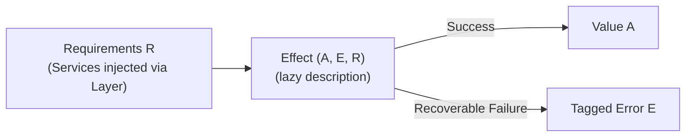

`voltaire-effect` builds on three primitives from [Effect](https://effect.website):

1. **`Effect<A, E, R>`** — A lazy description of a computation with typed success `A`, typed failure `E`, and required services `R`.
2. **`Schema`** — Bidirectional validation and transformation between wire formats (`0x` strings, JSON) and branded `Uint8Array` primitives.
3. **`Context.Tag` & `Layer`** — Compile-time dependency injection for transports, providers, signers, contracts, and crypto backends.

## The `Effect<A, E, R>` Type



```typescript
import * as Effect from 'effect/Effect'

// Succeeds with string, cannot fail (never), requires no services (never)
const greeting: Effect.Effect<string, never, never> = Effect.succeed('hello')

// Execute once at the application entry point
const result = await Effect.runPromise(greeting)
```

<Tip>
Invoke `Effect.runPromise` or `Effect.runSync` only at the outermost boundary of your application (CLI entrypoint, HTTP handler, test case). Calling runners inside inner helpers breaks error tracking, resource scopes, and cancellation.
</Tip>

## Sequencing with `Effect.gen`

`Effect.gen` writes sequential effectful code using `yield*`. Any failure short-circuits the generator and widens the inferred `E` union automatically:

```typescript
import * as Effect from 'effect/Effect'

const sum = Effect.gen(function* () {
  const a = yield* Effect.succeed(1)
  const b = yield* Effect.succeed(2)
  return a + b
})
```

## Validation with `Schema`

`Schema` validates unknown input and decodes directly into Voltaire branded types:

```typescript
import * as S from 'effect/Schema'
import * as Address from 'voltaire-effect/primitives/Address'
import * as A from '@tevm/voltaire/Address'

// Sync decode: throws ParseError on invalid input
const addr = S.decodeSync(Address.Hex)('0x742d35Cc6634C0532925a3b844Bc9e7595f251e3')
// addr: AddressType (20-byte Uint8Array)

A.toHex(addr)  // "0x742d35cc6634c0532925a3b844bc9e7595f251e3"
A.isZero(addr) // false

// Effect decode: Effect<AddressType, ParseError, never>
const addrEffect = S.decode(Address.Hex)(userInput)
```

## Services & Layers

Declare a service interface with `Context.Tag`, yield it in business logic, and supply an implementation with a `Layer`:

```typescript
import * as Effect from 'effect/Effect'
import * as Context from 'effect/Context'
import { KeccakService, KeccakLive } from 'voltaire-effect/crypto/Keccak256'

class Logger extends Context.Tag('Logger')<
  Logger,
  { readonly log: (msg: string) => Effect.Effect<void> }
>() {}

const program = Effect.gen(function* () {
  const logger = yield* Logger
  const keccak = yield* KeccakService
  const digest = yield* keccak.hash(new Uint8Array([1, 2, 3]))
  yield* logger.log(`Digest bytes: ${digest.length}`)
  return digest
}).pipe(
  Effect.provideService(Logger, { log: (msg) => Effect.sync(() => console.log(msg)) }),
  Effect.provide(KeccakLive)
)
```

## Typed Error Handling & Pipelines

Errors are values carrying a `_tag` field. Combine `pipe`, `Effect.map`, and `Effect.catchTag` left-to-right:

```typescript
import { pipe } from 'effect'
import * as Effect from 'effect/Effect'
import * as S from 'effect/Schema'
import * as Address from 'voltaire-effect/primitives/Address'
import * as A from '@tevm/voltaire/Address'

const normalizedHex = (input: string) =>
  pipe(
    S.decode(Address.Hex)(input),
    Effect.map(A.toHex),
    Effect.catchTag('ParseError', () => Effect.succeed('0x0000000000000000000000000000000000000000'))
  )
```

## Duration, Schedule & Per-Request Overrides

`DurationInput` accepts human-readable strings (`'30 seconds'`, `'500 millis'`) or `Duration` constructors. `Schedule` composes backoff, jitter, and retry caps. FiberRef helpers scope overrides to a single request:

```typescript
import * as Schedule from 'effect/Schedule'
import {
  getBalance, getBlock, getBlockNumber,
  withTimeout, withRetrySchedule, withoutCache
} from 'voltaire-effect'

const backoff = Schedule.exponential('500 millis').pipe(
  Schedule.jittered,
  Schedule.compose(Schedule.recurs(5))
)

const balance = getBalance(addr).pipe(withTimeout('5 seconds'))
const block = getBlock({ blockTag: 'latest' }).pipe(withRetrySchedule(backoff))
const freshHead = getBlockNumber().pipe(withoutCache)
```

## Runners

| Function | Return Type | Use Case |
| --- | --- | --- |
| `Effect.runPromise(eff)` | `Promise<A>` | Async application boundary |
| `Effect.runPromiseExit(eff)` | `Promise<Exit<A, E>>` | Inspect typed failures and defects without `try/catch` |
| `Effect.runSync(eff)` | `A` | Synchronous pure/schema effects |
| `Effect.runSyncEither(eff)` | `Either<A, E>` | Synchronous branching on typed failure |

## See Also

- [Architecture & Layers](/layers) — Schema, Effect, and Service tiers
- [Error Handling](/concepts/error-handling) — Full error tag reference
- [Dependency Injection](/concepts/dependency-injection) — Service composition and test layers
- [Official Effect Documentation](https://effect.website/docs/getting-started/introduction/)
