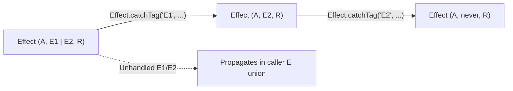

In `voltaire-effect`, expected failures occupy the `E` channel of `Effect<A, E, R>`. Every error carries a readonly `_tag` discriminant so TypeScript tracks recovery and enforces exhaustive handling.



## Schema Validation Errors

Decoding invalid input fails with `ParseError`, containing a human-readable `message` and structured `issue` tree:

```typescript
import * as Effect from 'effect/Effect'
import * as S from 'effect/Schema'
import * as Address from 'voltaire-effect/primitives/Address'
import * as A from '@tevm/voltaire/Address'

const parseWithFallback = (input: string) =>
  S.decode(Address.Hex)(input).pipe(
    Effect.catchTag('ParseError', (e) => {
      console.error(e.message, e.issue)
      return Effect.succeed(A.zero())
    })
  )
```

For synchronous branching without an Effect runtime, use `S.decodeEither`:

```typescript
import * as S from 'effect/Schema'
import * as Either from 'effect/Either'
import * as Address from 'voltaire-effect/primitives/Address'

const result = S.decodeEither(Address.Hex)(input)
if (Either.isRight(result)) {
  // result.right is AddressType
} else {
  // result.left is ParseError
}
```

## Error Accumulation in `Effect.gen`

Yielding multiple fallible operations produces the union of their error channels automatically:

```typescript
import * as Effect from 'effect/Effect'
import * as S from 'effect/Schema'
import * as Address from 'voltaire-effect/primitives/Address'
import { getBalance } from 'voltaire-effect'

// Inferred: Effect<bigint, ParseError | GetBalanceError, ProviderService>
const fetchBalance = (rawAddress: string) =>
  Effect.gen(function* () {
    const addr = yield* S.decode(Address.Hex)(rawAddress)
    return yield* getBalance(addr)
  })
```

Handle specific tags with `Effect.catchTag` or `Effect.catchTags`:

```typescript
import { getBlock, withTimeout } from 'voltaire-effect'

const latestOrNull = getBlock({ blockTag: 'latest' }).pipe(
  withTimeout('5 seconds'),
  Effect.catchTags({
    ProviderNotFoundError: () => Effect.succeed(null),
    ProviderTimeoutError: () => Effect.succeed(null)
  })
)
```

## Retry with `Schedule`

Attach exponential backoff with jitter per request via `withRetrySchedule` or around any Effect via `Effect.retry`:

```typescript
import * as Schedule from 'effect/Schedule'
import { getBalance, withRetrySchedule } from 'voltaire-effect'

const retrySchedule = Schedule.exponential('500 millis').pipe(
  Schedule.jittered,
  Schedule.compose(Schedule.recurs(5))
)

const balance = getBalance(addr).pipe(withRetrySchedule(retrySchedule))
```

## Error Taxonomy

| Error Class | `_tag` | Source |
| --- | --- | --- |
| `ParseError` | `ParseError` | Effect Schema decoding/encoding failures |
| `TransportError` | `TransportError` | HTTP/WebSocket network errors, timeouts, JSON-RPC errors |
| `ProviderResponseError` | `ProviderResponseError` | Malformed or unexpected RPC payload |
| `ProviderNotFoundError` | `ProviderNotFoundError` | Missing block, transaction, or receipt |
| `ProviderValidationError` | `ProviderValidationError` | Invalid argument passed to provider method |
| `ProviderTimeoutError` | `ProviderTimeoutError` | Provider operation exceeded deadline |
| `ProviderStreamError` | `ProviderStreamError` | Subscription or watch stream failure |
| `ProviderReceiptPendingError` | `ProviderReceiptPendingError` | Transaction receipt not yet mined |
| `ProviderConfirmationsPendingError` | `ProviderConfirmationsPendingError` | Required block confirmations not yet reached |
| `SignerError` | `SignerError` | Signing, nonce, fee, or broadcast failure |
| `ContractCallError` | `ContractCallError` | Read/simulate call revert or ABI decode error |
| `ContractWriteError` | `ContractWriteError` | Write preparation or transaction submission error |
| `BlockStreamError` | `BlockStreamError` | Block stream backfill or watch failure |
| `EventStreamError` | `EventStreamError` | Event stream backfill or watch failure |
| `CryptoError` | `CryptoError` | Cryptographic primitive failure |

Provider functions also export method-specific unions (such as `GetBalanceError`, `GetBlockError`, and `WaitForTransactionReceiptError`) that combine `TransportError` with the exact provider errors that method can emit.

## `Either` for Partial Batch Failures

`Effect` short-circuits on the first error. When a batch (such as `aggregate3` multicall) can partially succeed, represent per-item outcomes with `Either`:

```typescript
import { Effect, Either, Array } from 'effect'
import { aggregate3 } from 'voltaire-effect'

const program = Effect.gen(function* () {
  const rawResults = yield* aggregate3(calls)

  const results = rawResults.map((r, index) =>
    r.success
      ? Either.right({ index, data: r.returnData })
      : Either.left({ index, message: 'Call reverted' })
  )

  const [failures, successes] = Array.partition(results, Either.isLeft)

  const summary = results.map((entry) =>
    Either.match(entry, {
      onLeft: (err) => ({ balance: null, error: err.message }),
      onRight: (ok) => ({ balance: BigInt(ok.data), error: null })
    })
  )

  return { summary, successes, failures }
})
```

| Pattern | Use `Either` | Use `Effect` |
| --- | --- | --- |
| Mixed-outcome batches (multicall) | Yes | No (short-circuits) |
| Sync schema decode without runtime | `S.decodeEither` | `S.decode` |
| Async I/O, retries, timeouts, DI | No | Yes |

## See Also

- [Stream Errors](/stream) — `BlockRangeTooLargeError` and `UnrecoverableReorgError`
- [Provider Service](/services/provider) — Method-specific error unions
- [Debugging Guide](/guides/debugging) — Inspecting `Cause` and fiber traces
- [Effect Error Management](https://effect.website/docs/error-management/two-error-types/)
