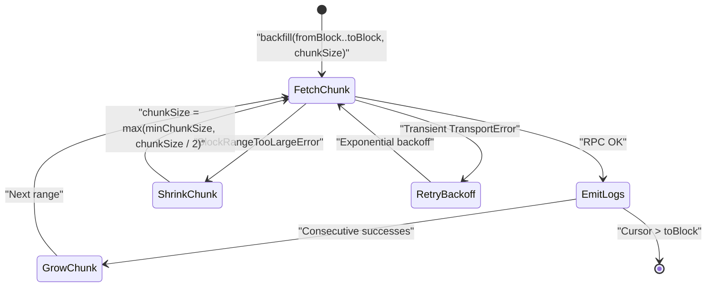

`makeEventStream()` produces an Effect-native event streamer requiring `TransportService`. It provides two modes: `backfill` for historical block ranges with adaptive chunk sizing, and `watch` for deduplicated live polling.



## Quick Start

```typescript
import { Effect, Stream } from 'effect'
import { makeEventStream, HttpTransport } from 'voltaire-effect'

const transferEvent = {
  type: 'event',
  name: 'Transfer',
  inputs: [
    { name: 'from', type: 'address', indexed: true },
    { name: 'to', type: 'address', indexed: true },
    { name: 'value', type: 'uint256', indexed: false }
  ]
} as const

const program = Effect.gen(function* () {
  const eventStream = yield* makeEventStream()

  yield* Stream.runForEach(
    eventStream.backfill({
      address: '0xA0b86991c6218b36c1d19D4a2e9Eb0cE3606eB48',
      event: transferEvent,
      fromBlock: 18_000_000n,
      toBlock: 18_001_000n
    }),
    ({ log }) =>
      Effect.log(`Transfer ${log.args.value} at block ${log.blockNumber}`)
  )
}).pipe(Effect.provide(HttpTransport('https://eth.llamarpc.com')))
```

## Backfill Options & Adaptive Chunking

`backfill` automatically reduces its chunk span when an RPC rejects a range as too large (`BlockRangeTooLargeError`) and scales back up after consecutive clean responses:

```typescript
const historical = eventStream.backfill({
  address: contractAddress,
  event: transferEvent,
  filter: { from: senderAddress }, // Optional indexed topic filter
  fromBlock: 18_000_000n,
  toBlock: 19_000_000n,
  chunkSize: 500,                  // Initial span (default: 100)
  minChunkSize: 10,                // Floor after reductions (default: 10)
  retry: {
    maxRetries: 5,                 // Default: 3
    initialDelay: 500,             // Default: 1000 ms
    maxDelay: 60_000               // Default: 30000 ms
  }
})
```

## Live Polling (`watch`)

`watch` polls for new logs from `fromBlock` (or current head when omitted) and deduplicates overlapping polls:

```typescript
const live = eventStream.watch({
  address: contractAddress,
  event: approvalEvent,
  fromBlock: 18_000_000n,
  pollingInterval: 1_000 // ms (default: 1000)
})

yield* Stream.runForEach(
  Stream.take(live, 10),
  ({ log }) => Effect.log(`Approval spender: ${log.args.spender}`)
)
```

## Yielded Element Shape (`EventStreamResult`)

```typescript
interface EventStreamResult<TEvent> {
  readonly log: {
    readonly eventName: string
    readonly args: InferredEventArgs<TEvent> // Typed from const ABI
    readonly blockNumber: bigint
    readonly blockHash: Uint8Array
    readonly transactionHash: Uint8Array
    readonly logIndex: number
  }
  readonly metadata: {
    readonly chainHead: bigint
    readonly fromBlock: bigint
    readonly toBlock: bigint
  }
}
```

## Error Handling

Stream failures surface as `EventStreamError` in the error channel:

```typescript
program.pipe(
  Effect.catchTag('EventStreamError', (e) =>
    Effect.logError(`EventStream failed: ${e.message}`)
  )
)
```

## See Also

- [Tutorial: Building a Resilient Event Indexer](/tutorials/resilient-event-indexer) — Combining `EventStream`, `RateLimiter`, and `BlockStream`
- [Stream Errors](/stream) — Underlying stream error types
- [BlockStream](/services/block-stream) — Reorg-aware block streaming
