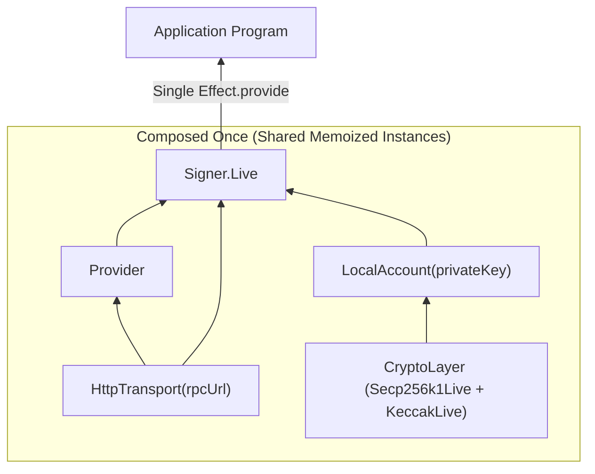

Compose all service layers into a single dependency graph before calling `Effect.provide`. Chaining multiple `Effect.provide` calls constructs independent layer scopes and defeats Effect's automatic layer memoization.



## The Core Rule

```typescript
// Wrong: separate Effect.provide calls bypass shared memoization
program.pipe(
  Effect.provide(Signer.Live),
  Effect.provide(Provider),
  Effect.provide(HttpTransport(rpcUrl))
)

// Right: compose the graph, then provide once at the entry point
const AppLayer = Layer.mergeAll(Signer.Live, Provider).pipe(
  Layer.provide(HttpTransport(rpcUrl))
)

program.pipe(Effect.provide(AppLayer))
```

## Three Composition Operators

| Operator | Semantics | Example |
| --- | --- | --- |
| `Layer.mergeAll(A, B, C)` | Combine independent layers | `Layer.mergeAll(Secp256k1Live, KeccakLive, AesGcmLive)` |
| `A.pipe(Layer.provide(B))` | Satisfy `A`'s input from `B`; output only `A` | `Provider.pipe(Layer.provide(HttpTransport(url)))` |
| `A.pipe(Layer.provideMerge(B))` | Satisfy `A`'s input from `B`; output both `A` and `B` | Expose `LocalAccount` alongside `Signer.Live` |

## Shared Layer Module Pattern

Centralize layer builders in a single module (`src/layers.ts`) so CLI commands, HTTP handlers, and tests share identical wiring:

```typescript
// src/layers.ts
import { Layer } from 'effect'
import { Provider, HttpTransport, Signer, LocalAccount } from 'voltaire-effect'
import { Secp256k1Live, KeccakLive } from 'voltaire-effect/crypto'

export const CryptoLayer = Layer.mergeAll(Secp256k1Live, KeccakLive)

export const makeProviderLayer = (rpcUrl: string) =>
  Provider.pipe(Layer.provide(HttpTransport(rpcUrl)))

export const makeSignerLayer = (privateKey: Uint8Array, rpcUrl: string) => {
  const transportLayer = HttpTransport(rpcUrl)
  const providerLayer = Provider.pipe(Layer.provide(transportLayer))

  return Layer.mergeAll(Signer.Live, CryptoLayer, providerLayer).pipe(
    Layer.provideMerge(LocalAccount(privateKey))
  )
}
```

Consume the composed layer at the entry point:

```typescript
// src/main.ts
import { Effect } from 'effect'
import { makeSignerLayer } from './layers'

const layer = makeSignerLayer(myPrivateKey, 'https://eth.llamarpc.com')
await Effect.runPromise(program.pipe(Effect.provide(layer)))
```

## Test Layer Substitution

Replace the entire production graph with deterministic stubs without touching application code:

```typescript
import { Effect, Layer } from 'effect'
import { ProviderService } from 'voltaire-effect'
import { CryptoTest } from 'voltaire-effect/crypto'

const MockProvider = Layer.succeed(ProviderService, {
  request: (method: string) => {
    if (method === 'eth_blockNumber') return Effect.succeed('0x3039')
    return Effect.succeed(null)
  }
})

const TestLayer = Layer.mergeAll(MockProvider, CryptoTest)
await Effect.runPromise(program.pipe(Effect.provide(TestLayer)))
```

## Anti-Patterns to Avoid

1. **Duplicate sibling provides:** Passing `KeccakLive` twice in chained `Effect.provide` calls instantiates two separate services. Build `CryptoLayer = Layer.mergeAll(Secp256k1Live, KeccakLive)` once and feed it with `Layer.provide`.
2. **Order-sensitive chains:** Stacking `Effect.provide(A)`, `Effect.provide(B)`, `Effect.provide(C)` breaks silently when dependencies shift. Express edges explicitly (`BLayer = B.pipe(Layer.provide(A))`).

## See Also

- [Architecture & Layers](/layers) — Schema, Effect, and Service overview
- [Dependency Injection](/concepts/dependency-injection) — Service tags and FiberRef overrides
- [Testing](/testing) — `TestTransport` and `CryptoTest`
