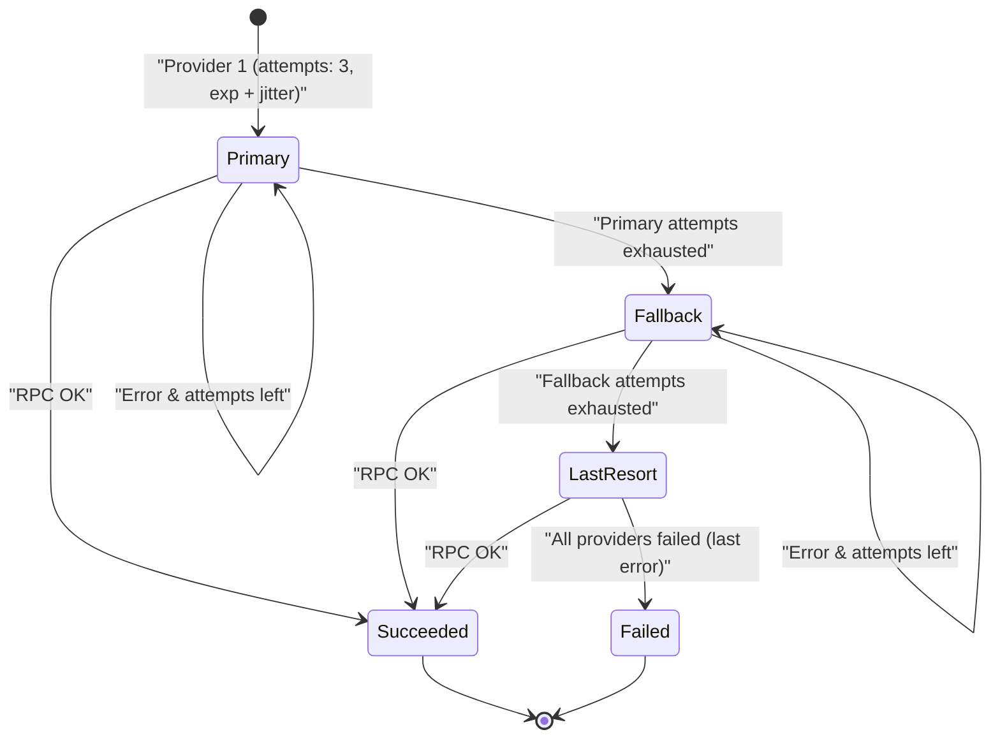

`makeProviderPlan` and `makeResilientProviderPlan` construct an Effect `ExecutionPlan` that sequences retries across ordered RPC endpoints. When a primary provider exhausts its retry budget, execution fails over automatically to the next endpoint.



<Note>
`ExecutionPlan` is an experimental Effect API (requires Effect 3.16+).
</Note>

## Custom Fallback Plan (`makeProviderPlan`)

```typescript
import { Effect, Schedule } from 'effect'
import { makeProviderPlan, getBlockNumber } from 'voltaire-effect'

const ProviderPlan = makeProviderPlan([
  {
    url: process.env.INFURA_URL!,
    attempts: 2,
    schedule: Schedule.spaced('1 second')
  },
  {
    url: process.env.ALCHEMY_URL!,
    attempts: 3,
    schedule: Schedule.exponential('500 millis').pipe(Schedule.jittered)
  },
  {
    url: 'https://eth.llamarpc.com' // Single attempt last resort
  }
])

const program = getBlockNumber().pipe(
  Effect.withExecutionPlan(ProviderPlan),
  Effect.catchTag('TransportError', (error) => {
    console.error('All RPC providers failed:', error.message)
    return Effect.succeed(0n)
  })
)

await Effect.runPromise(program)
```

## Pre-Configured Resilient Plan (`makeResilientProviderPlan`)

`makeResilientProviderPlan(primaryUrl, fallbackUrl, lastResortUrl?)` wires a three-tier default:

| Tier | Attempts | Schedule |
| --- | --- | --- |
| Primary | 3 | 200 ms exponential backoff + jitter |
| Fallback | 2 | 500 ms fixed delay |
| Last resort | 1 | None (immediate fail on error) |

```typescript
import { Effect } from 'effect'
import { makeResilientProviderPlan, getBalance } from 'voltaire-effect'

const ResilientPlan = makeResilientProviderPlan(
  process.env.INFURA_URL!,
  process.env.ALCHEMY_URL!,
  'https://eth.llamarpc.com'
)

const balance = yield* getBalance(address).pipe(
  Effect.withExecutionPlan(ResilientPlan)
)
```

## Applying Fallback Plans to Streams

Attach any provider plan to a `Stream` via `Stream.withExecutionPlan`:

```typescript
import { Stream } from 'effect'
import { makeBlockStream, makeProviderPlan } from 'voltaire-effect'

const wsPlan = makeProviderPlan([
  { url: process.env.PRIMARY_WS!, attempts: 2 },
  { url: process.env.FALLBACK_WS! }
])

const blockStream = yield* makeBlockStream()
const resilientBlocks = blockStream.watch({ include: 'transactions' }).pipe(
  Stream.withExecutionPlan(wsPlan)
)
```

## Signatures

```typescript
interface ProviderStepConfig {
  readonly url: string
  readonly attempts?: number   // Default: 1
  readonly schedule?: Schedule // Default: no delay
}

const makeProviderPlan: (
  configs: readonly [ProviderStepConfig, ...ProviderStepConfig[]]
) => ExecutionPlan

const makeResilientProviderPlan: (
  primaryUrl: string,
  fallbackUrl: string,
  lastResortUrl?: string
) => ExecutionPlan
```

## Operational Guidelines

- Order endpoints from highest SLA / highest rate limit to lowest.
- Always apply `Schedule.jittered` on primary exponential backoff to avoid synchronized retry storms during RPC outages.
- Cap public last-resort endpoints to `attempts: 1` so aggressive 429 rate limits fail fast instead of burning timeout budget.

## See Also

- [RateLimiter Service](/services/rate-limiter) — Per-method RPC request budgets
- [Provider Service](/services/provider) — Transports and free functions
- [Layer Composition Guide](/guides/layers) — Composing production and test layers
