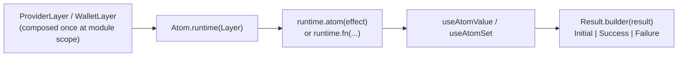

`@effect-atom/atom-react` connects `voltaire-effect` Layers to React state through `Atom.runtime`, observable atoms, and the `Result` state machine (`Initial` | `Success` | `Failure`).



## Install & Provider Setup

```bash
npm install @effect-atom/atom-react voltaire-effect effect
```

Wrap the root tree in `RegistryProvider`:

```tsx
import { RegistryProvider } from '@effect-atom/atom-react'

export function App() {
  return (
    <RegistryProvider>
      <YourApp />
    </RegistryProvider>
  )
}
```

## Reading Chain State

Create the composed `Layer` and `Atom.runtime` once at module scope (never inside a component render):

```tsx
import { Atom, useAtomValue, Result } from '@effect-atom/atom-react'
import { Layer } from 'effect'
import { getBalance, Provider, HttpTransport } from 'voltaire-effect'

const ProviderLayer = Provider.pipe(
  Layer.provide(HttpTransport('https://eth.llamarpc.com'))
)
const runtime = Atom.runtime(ProviderLayer)

const balanceAtom = Atom.family((address: `0x${string}`) =>
  runtime.atom(getBalance(address, 'latest'))
)

export function Balance({ address }: { address: `0x${string}` }) {
  const result = useAtomValue(balanceAtom(address))

  return Result.builder(result)
    .onInitial(() => <div>Loading...</div>)
    .onSuccess((balance) => <div>{(Number(balance) / 1e18).toFixed(4)} ETH</div>)
    .onSuccessWaiting((balance) => <div>{(Number(balance) / 1e18).toFixed(4)} ETH (refreshing)</div>)
    .onFailure((cause) => <div>Error: {String(cause)}</div>)
    .render()
}
```

### `Result` States

| State | Meaning |
| --- | --- |
| `Initial` | Fiber has not produced a value yet |
| `Success<A>` | Resolved value; `waiting: true` during background refresh |
| `Failure<E>` | Failed with typed `Cause<E>` |

## Derived Atoms & Wallet Connection

```tsx
import { Atom, useAtom, useAtomValue, Result } from '@effect-atom/atom-react'
import { Effect, Layer } from 'effect'
import { getBalance, getBlockNumber, Provider, HttpTransport } from 'voltaire-effect'

const ProviderLayer = Provider.pipe(
  Layer.provide(HttpTransport(process.env.NEXT_PUBLIC_RPC_URL!))
)
const runtime = Atom.runtime(ProviderLayer)

const addressAtom = Atom.make<`0x${string}` | null>(null)

const connectedBalanceAtom = Atom.make((get) => {
  const address = get(addressAtom)
  if (!address) return Effect.succeed(null)
  return get.result(runtime.atom(getBalance(address, 'latest')))
})

const blockNumberAtom = runtime.atom(getBlockNumber()).pipe(
  Atom.refreshOnWindowFocus,
  Atom.keepAlive
)
```

## Mutations (`runtime.fn` + `useAtomSet`)

Wrap transactions in `runtime.fn` and invoke with `{ mode: 'promiseExit' }` to inspect `Exit.Success` / `Exit.Failure` without throwing:

```tsx
import { Atom, useAtomSet } from '@effect-atom/atom-react'
import { Effect, Exit } from 'effect'
import { SignerService } from 'voltaire-effect'

const sendTxAtom = walletRuntime.fn(
  Effect.fnUntraced(function* (params: { to: `0x${string}`; value: bigint }) {
    const signer = yield* SignerService
    return yield* signer.sendTransaction(params)
  })
)

export function SendButton() {
  const sendTx = useAtomSet(sendTxAtom, { mode: 'promiseExit' })

  const handleSend = async () => {
    const exit = await sendTx({
      to: '0x742d35Cc6634C0532925a3b844Bc9e7595f1E5B3',
      value: 100_000_000_000_000_000n
    })

    if (Exit.isSuccess(exit)) {
      console.log('TX Hash:', exit.value)
    } else {
      console.error('Failed:', exit.cause)
    }
  }

  return <button onClick={handleSend}>Send 0.1 ETH</button>
}
```

## Hooks Reference

| Hook | Behavior |
| --- | --- |
| `useAtomValue(atom)` | Subscribes to atom; returns `Result<A, E>` for async atoms |
| `useAtomSet(atom, opts?)` | Returns setter or mutation invoker (`mode: 'promiseExit'`) |
| `useAtom(atom)` | Returns `[value, setter]` tuple |
| `useAtomRefresh(atom)` | Returns a callback that forces re-execution |
| `useAtomSuspense(atom)` | Integrates with React `<Suspense>` |

## Next.js App Router Setup

1. Create `lib/atoms.ts` exporting the module-level `Atom.runtime(ProviderLayer)` (or `Atom.runtime(WalletLayer)`).
2. Create a `'use client'` `app/providers.tsx` wrapping `{children}` in `<RegistryProvider>`.
3. Mount `<Providers>` in `app/layout.tsx`.

## Operational Rules

- Instantiate `Atom.runtime(...)` once at module level; recreating runtimes on render leaks scopes and cancels in-flight RPCs.
- Use `Atom.family` for parameterized queries (address, token pair) so each key caches independently.
- Add `Atom.keepAlive` for global subscriptions (`blockNumberAtom`) that should survive component unmounts.

## See Also

- [Layer Composition Guide](/guides/layers) — Composing `ProviderLayer` and `WalletLayer`
- [Provider Service](/services/provider) — JSON-RPC free functions
- [Signer Service](/services/signer) — Browser and local signers
