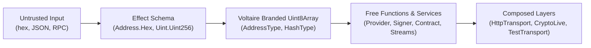

`voltaire-effect` wraps [Voltaire](https://voltaire.tevm.sh) Ethereum primitives, cryptographic operations, JSON-RPC providers, signers, contracts, and event streams in [Effect](https://effect.website). Every operation returns an `Effect<A, E, R>`: typed return values, tagged error unions, and explicit service dependencies resolved via Layers.



## Explicit Control vs Implicit Defaults

Compare reading two ERC-20 balances with explicit retry, timeout, and dependency wiring:

<Tabs>
  <Tab title="voltaire-effect">
```typescript
import { Effect, Layer } from 'effect'
import { makeContractRegistry, Provider, HttpTransport } from 'voltaire-effect'

const Contracts = makeContractRegistry({
  USDC: { abi: erc20Abi, address: '0xA0b86991c6218b36c1d19D4a2e9Eb0cE3606eB48' },
  WETH: { abi: erc20Abi, address: '0xC02aaA39b223FE8D0A0e5C4F27eAD9083C756Cc2' }
})

const ProviderLayer = Provider.pipe(
  Layer.provide(HttpTransport('https://eth.llamarpc.com'))
)
const AppLayer = Contracts.layer.pipe(Layer.provide(ProviderLayer))

const program = Effect.gen(function* () {
  const { USDC, WETH } = yield* Contracts.Service
  const usdcBalance = yield* USDC.read.balanceOf(userAddress)
  const wethBalance = yield* WETH.read.balanceOf(userAddress)
  return { usdcBalance, wethBalance }
}).pipe(
  Effect.retry({ times: 3 }),
  Effect.timeout('10 seconds'),
  Effect.provide(AppLayer)
)

const { usdcBalance, wethBalance } = await Effect.runPromise(program)
```
  </Tab>
  <Tab title="viem">
```typescript
import { createPublicClient, http } from 'viem'

const client = createPublicClient({
  transport: http('https://eth.llamarpc.com', { retryCount: 3 })
})

const balance = await client.readContract({
  address: '0xA0b86991c6218b36c1d19D4a2e9Eb0cE3606eB48',
  abi: erc20Abi,
  functionName: 'balanceOf',
  args: [userAddress]
})
```

viem retries 3 times implicitly inside transport configuration and throws untyped exceptions on failure. `voltaire-effect` exposes retries, timeouts, and error tags in the program's type signature.
  </Tab>
</Tabs>

## Branded Primitives

`AddressType` and `BytecodeType` are distinct branded `Uint8Array` types at compile time. Passing bytecode where an address is expected fails typechecking instead of failing on-chain.

<Tabs>
  <Tab title="voltaire">
```typescript
import * as Address from '@tevm/voltaire/Address'
import * as Bytecode from '@tevm/voltaire/Bytecode'

const address = Address.from('0xA0b86991c6218b36c1d19D4a2e9Eb0cE3606eB48')
const bytecode = Bytecode.from('0x608060405234801561001057600080fd5b50')

// Compile-time error: BytecodeType is not assignable to AddressType
readContract({ address: bytecode, abi: erc20Abi, functionName: 'balanceOf', args: [address] })
```
  </Tab>
  <Tab title="viem">
```typescript
import { type Address, type Hex } from 'viem'

const address: Address = '0xA0b86991c6218b36c1d19D4a2e9Eb0cE3606eB48'
const bytecode: Hex = '0x608060405234801561001057600080fd5b50'

// Compiles without error: both Address and Hex resolve to `0x${string}`
await client.readContract({
  address: bytecode,
  abi: erc20Abi,
  functionName: 'balanceOf',
  args: [address]
})
```
  </Tab>
</Tabs>

## WASM-Backed ABI Encoding & Keccak-256

Selector hashing uses Voltaire's Zig-compiled WASM Keccak-256 while surfacing encoding failures as typed errors:

<Tabs>
  <Tab title="voltaire-effect">
```typescript
import { Effect } from 'effect'
import { encodeFunctionData } from 'voltaire-effect/primitives/Abi'

const calldata = await Effect.runPromise(
  encodeFunctionData(erc20Abi, 'transfer', [recipient, amount])
)
// Effect<Hex, AbiItemNotFoundError | AbiEncodingError>
```
  </Tab>
  <Tab title="voltaire">
```typescript
import * as Abi from '@tevm/voltaire/Abi'

const calldata = Abi.encodeFunction(erc20Abi, 'transfer', [recipient, amount])
```
  </Tab>
  <Tab title="viem">
```typescript
import { encodeFunctionData } from 'viem'

// Throws an untyped exception if the function name or arguments are invalid
const calldata = encodeFunctionData({
  abi: erc20Abi,
  functionName: 'transfer',
  args: [recipient, amount]
})
```
  </Tab>
</Tabs>

| Operation | viem (`@noble/hashes`) | Voltaire (WASM Zig) | Speedup |
| --- | --- | --- | --- |
| `keccak256` (32 B) | 3.22 us | 349 ns | 9.2x |
| `keccak256` (256 B) | 6.23 us | 571 ns | 10.9x |
| `keccak256` (1 KB) | 24.4 us | 1.87 us | 13.0x |

<Note>
Measured on Apple M3 Max, Bun 1.3.4.
</Note>

## Install

<CodeGroup>
```bash pnpm
pnpm add voltaire-effect @tevm/voltaire effect
```

```bash npm
npm install voltaire-effect @tevm/voltaire effect
```

```bash bun
bun add voltaire-effect @tevm/voltaire effect
```
</CodeGroup>

## Core Guarantees

<Accordion title="Typed Errors" icon="shield-check">
Recoverable failures carry a `_tag` discriminant and appear in the `E` type parameter:

```typescript
import { Effect } from 'effect'
import * as S from 'effect/Schema'
import * as Address from 'voltaire-effect/primitives/Address'
import * as A from '@tevm/voltaire/Address'

const parsed = S.decode(Address.Hex)(input).pipe(
  Effect.catchTag('ParseError', () => Effect.succeed(A.zero()))
)
// Effect<AddressType, never, never>
```
</Accordion>

<Accordion title="Swappable Layers" icon="flask">
Business logic depends on service tags, never concrete clients. Swap live layers for test layers at the entry point:

```typescript
// Production
await Effect.runPromise(program.pipe(Effect.provide(MainLayer)))

// Unit test: deterministic, zero network
await Effect.runPromise(program.pipe(Effect.provide(TestLayer)))
```
</Accordion>

<Accordion title="Composable Resilience" icon="puzzle-piece">
Retries, timeouts, and fallbacks compose directly on any Effect value:

```typescript
import { Effect, Schedule, Duration } from 'effect'
import { getBlockNumber } from 'voltaire-effect'

const blockNumber = getBlockNumber().pipe(
  Effect.retry(Schedule.exponential('100 millis').pipe(Schedule.recurs(5))),
  Effect.timeout(Duration.seconds(10)),
  Effect.orElse(() => getBlockNumber().pipe(Effect.provide(FallbackLayer)))
)
```
</Accordion>

## Start Here

<CardGroup cols={2}>
  <Card title="Getting Started" icon="rocket" href="/getting-started">
    Install packages and run your first typed RPC call.
  </Card>
  <Card title="Tutorials" icon="graduation-cap" href="/tutorials/index">
    Hands-on walkthroughs for typed errors, layers, and resilient event indexing.
  </Card>
  <Card title="Effect Primer" icon="book-open" href="/concepts/effect-primer">
    Concise introduction to `Effect<A, E, R>`, Schema, and Layers.
  </Card>
  <Card title="Cheatsheet" icon="bolt" href="/cheatsheet">
    Copy-paste reference for schemas, services, layers, and tests.
  </Card>
</CardGroup>
