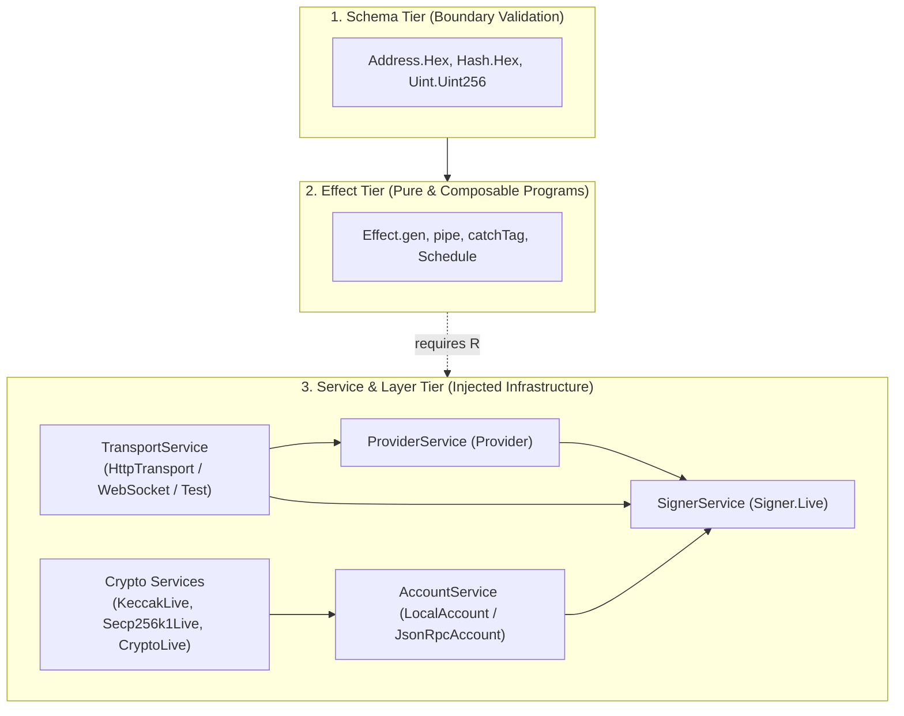

`voltaire-effect` separates validation, computation, and stateful infrastructure into three tiers.



| Tier | Responsibility | Primary APIs |
| --- | --- | --- |
| **Schema** | Boundary parsing and encoding to branded `Uint8Array` types | `S.decode`, `S.decodeSync`, `S.encode`, `Address.Hex` |
| **Effect** | Composition, typed error recovery, timeouts, retries, concurrency | `Effect.gen`, `Effect.catchTag`, `Effect.all`, `Schedule` |
| **Services** | Injectable transports, RPC providers, accounts, signers, crypto | `Provider`, `Signer`, `HttpTransport`, `CryptoLive` |

## 1. Schema Tier

Schemas validate untrusted input and return Voltaire branded types directly:

```typescript
import * as S from 'effect/Schema'
import * as Address from 'voltaire-effect/primitives/Address'
import * as Hex from 'voltaire-effect/primitives/Hex'

const addr = S.decodeSync(Address.Hex)('0x742d35Cc6634C0532925a3b844Bc9e7595f251e3')
const fromBytes = S.decodeSync(Address.Bytes)(new Uint8Array(20))
const hex = S.decodeSync(Hex.String)('0x1234')
```

## 2. Effect Tier

`S.decode` lifts validation into an `Effect` whose error channel is `ParseError`:

```typescript
import { Effect } from 'effect'
import * as S from 'effect/Schema'
import * as Address from 'voltaire-effect/primitives/Address'
import * as A from '@tevm/voltaire/Address'

const program = Effect.gen(function* () {
  const addr = yield* S.decode(Address.Hex)(rawInput)
  return addr
}).pipe(
  Effect.catchTag('ParseError', () => Effect.succeed(A.zero()))
)
```

## 3. Service Tier

Services decouple program logic from network transports, signing keys, and cryptographic backends.

| Service Tag | Live Layer(s) | Purpose |
| --- | --- | --- |
| `TransportService` | `HttpTransport`, `WebSocketTransport`, `BrowserTransport`, `TestTransport` | Raw JSON-RPC request transport |
| `ProviderService` | `Provider` | Request layer consumed by provider free functions |
| `AccountService` | `LocalAccount`, `JsonRpcAccount`, `MnemonicAccount` | EIP-191, EIP-712, and raw transaction signing |
| `SignerService` | `Signer.Live`, `Signer.fromProvider`, `Signer.fromPrivateKey` | Nonce/gas/chainId auto-fill + broadcast |
| `DebugService` | `Debug` | `debug_*` tracing and raw block inspection |
| `EngineApiService` | `EngineApi` | `engine_*` execution/consensus RPCs |
| Crypto services | `CryptoLive`, `CryptoTest`, `KeccakLive`, `Secp256k1Live` | Hashing, ECDSA, BLS, KZG, HD wallet |

```typescript
import { Effect, Layer, Schedule } from 'effect'
import { getBlock, Provider, HttpTransport, withTimeout } from 'voltaire-effect'

const ProviderLayer = Provider.pipe(
  Layer.provide(
    HttpTransport({
      url: 'https://eth.llamarpc.com',
      timeout: '30 seconds',
      retrySchedule: Schedule.exponential('500 millis').pipe(
        Schedule.jittered,
        Schedule.compose(Schedule.recurs(3))
      )
    })
  )
)

const program = Effect.gen(function* () {
  return yield* getBlock({ blockTag: 'latest' }).pipe(withTimeout('5 seconds'))
})

await Effect.runPromise(program.pipe(Effect.provide(ProviderLayer)))
```

## Layer Composition Rules

Compose all layers into a single application layer first, then call `Effect.provide` once at the edge.

```typescript
// Wrong: chained Effect.provide builds intermediate scopes separately
program.pipe(
  Effect.provide(Signer.Live),
  Effect.provide(Provider),
  Effect.provide(HttpTransport(rpcUrl))
)

// Right: compose the layer graph once, then provide once
const AppLayer = Layer.mergeAll(
  Signer.Live,
  Provider
).pipe(Layer.provide(HttpTransport(rpcUrl)))

program.pipe(Effect.provide(AppLayer))
```

| Combinator | Behavior | Use When |
| --- | --- | --- |
| `Layer.mergeAll(A, B, C)` | Combines outputs of independent layers | Sibling services (`Secp256k1Live`, `KeccakLive`) |
| `A.pipe(Layer.provide(B))` | Feeds `B`'s output into `A`'s input, exposing only `A` | Satisfying a dependency (`Provider` needs `HttpTransport`) |
| `Layer.provideMerge(A, B)` | Feeds `B` into `A` and exposes both `A` and `B` | Downstream code needs both layers |

### Convenience Signer Constructors

`Signer.fromPrivateKey` and `Signer.fromProvider` wire `Provider` and an `AccountService` into `Signer.Live`:

```typescript
import { Effect, Layer } from 'effect'
import { SignerService, Signer, Provider, LocalAccount, HttpTransport } from 'voltaire-effect'
import { Secp256k1Live, KeccakLive } from 'voltaire-effect/crypto'
import { Hex } from '@tevm/voltaire'

const privateKey = Hex.fromHex('0xac0974bec...')

const BaseDeps = Layer.mergeAll(
  Secp256k1Live,
  KeccakLive,
  HttpTransport('https://eth.llamarpc.com')
)

const SignerLayer = Signer.fromPrivateKey(privateKey, Provider).pipe(
  Layer.provide(BaseDeps)
)
// Equivalent to:
// Signer.fromProvider(Provider, LocalAccount(privateKey)).pipe(Layer.provide(BaseDeps))

const program = Effect.gen(function* () {
  const signer = yield* SignerService
  return yield* signer.sendTransaction({ to, value })
})

await Effect.runPromise(program.pipe(Effect.provide(SignerLayer)))
```

### Full Wallet Stack (Mnemonic)

```typescript
import { Effect, Layer } from 'effect'
import { Signer, Provider, HttpTransport } from 'voltaire-effect'
import { MnemonicAccount } from 'voltaire-effect/native'
import { Secp256k1Live, KeccakLive } from 'voltaire-effect/crypto'

const CryptoLayer = Layer.mergeAll(Secp256k1Live, KeccakLive)
const TransportLayer = HttpTransport('https://eth.llamarpc.com')
const ProviderLayer = Provider.pipe(Layer.provide(TransportLayer))
const AccountLayer = MnemonicAccount(mnemonic).pipe(Layer.provide(CryptoLayer))

const WalletLayer = Signer.Live.pipe(
  Layer.provideMerge(Layer.mergeAll(AccountLayer, ProviderLayer, TransportLayer, CryptoLayer))
)

await Effect.runPromise(program.pipe(Effect.provide(WalletLayer)))
```

## See Also

- [Layer Composition Guide](/guides/layers) — Reusable layer modules and common mistakes
- [Dependency Injection](/concepts/dependency-injection) — Service tags and test substitution
- [Provider Service](/services/provider) — Transports and JSON-RPC free functions
- [Signer Service](/services/signer) — Transaction signing and auto-fill
