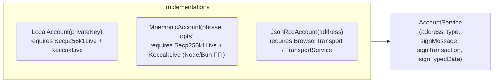

`AccountService` abstracts raw cryptographic signing (EIP-191 messages, unsigned transactions, EIP-712 typed data) without performing RPC gas estimation or nonce lookups. Use `AccountService` directly for offline signing, or compose it into [SignerService](/services/signer) for full transaction preparation and broadcast.



<Note>
For node-managed RPC account methods (`eth_accounts`, `eth_coinbase`, `eth_sign`), use the Provider free functions (`getAccounts`, `getCoinbase`, `sign`, `signTransaction`) from [Provider Service](/services/provider).
</Note>

## Local Account (Private Key)

```typescript
import { Effect, Layer } from 'effect'
import { AccountService, LocalAccount, withTimeout } from 'voltaire-effect'
import { Secp256k1Live, KeccakLive } from 'voltaire-effect/crypto'
import { Hex } from '@tevm/voltaire'

const privateKey = Hex.fromHex('0xac0974bec...')
const CryptoLayer = Layer.mergeAll(Secp256k1Live, KeccakLive)
const AccountLayer = LocalAccount(privateKey).pipe(Layer.provide(CryptoLayer))

const program = Effect.gen(function* () {
  const account = yield* AccountService
  return yield* account.signMessage(Hex.fromString('Hello!')).pipe(
    withTimeout('10 seconds')
  )
}).pipe(Effect.provide(AccountLayer))
```

## Browser Wallet Account (`JsonRpcAccount`)

Delegates signing to an EIP-1193 provider (`window.ethereum`):

```typescript
import { Effect, Layer } from 'effect'
import { AccountService, JsonRpcAccount, BrowserTransport, withTimeout } from 'voltaire-effect'

const BrowserAccountLayer = JsonRpcAccount(userAddress).pipe(
  Layer.provide(BrowserTransport)
)

const program = Effect.gen(function* () {
  const account = yield* AccountService
  // Allow user confirmation time in wallet popup
  return yield* account.signMessage(messageHex).pipe(withTimeout('2 minutes'))
}).pipe(Effect.provide(BrowserAccountLayer))
```

## HD Wallet Account (`MnemonicAccount`)

Derives a local account from a BIP-39 mnemonic (requires Node.js/Bun native FFI):

```typescript
import { Effect, Layer } from 'effect'
import { AccountService } from 'voltaire-effect'
import { MnemonicAccount } from 'voltaire-effect/native'
import { Secp256k1Live, KeccakLive } from 'voltaire-effect/crypto'

const CryptoLayer = Layer.mergeAll(Secp256k1Live, KeccakLive)
const AccountLayer = MnemonicAccount(mnemonic, { index: 0 }).pipe(
  Layer.provide(CryptoLayer)
)

const program = Effect.gen(function* () {
  const account = yield* AccountService
  return account.address
}).pipe(Effect.provide(AccountLayer))
```

## Signing Operations

### `signMessage` (EIP-191)

```typescript
const signature = yield* account.signMessage(Hex.fromString('Hello!'))
```

### `signTransaction` (Fully Specified Unsigned Tx)

Unlike `SignerService.signTransaction`, `AccountService.signTransaction` performs no RPC calls; all required transaction fields must be supplied:

```typescript
const signature = yield* account.signTransaction({
  to: recipientAddress,
  value: 1_000_000_000_000_000_000n,
  nonce: 5n,
  gasLimit: 21_000n,
  gasPrice: 20_000_000_000n,
  chainId: 1n
})
```

### `signTypedData` (EIP-712)

Supports flat structs, nested structs, and arrays of primitives or structs:

```typescript
const signature = yield* account.signTypedData({
  domain: { name: 'Batch', version: '1', chainId: 1n },
  primaryType: 'BatchTransfer',
  types: {
    Person: [
      { name: 'name', type: 'string' },
      { name: 'wallet', type: 'address' }
    ],
    BatchTransfer: [
      { name: 'recipients', type: 'Person[]' },
      { name: 'amounts', type: 'uint256[]' }
    ]
  },
  message: {
    recipients: [
      { name: 'Alice', wallet: '0xCD2a3d9F938E13CD947Ec05AbC7FE734Df8DD826' },
      { name: 'Bob', wallet: '0xbBbBBBBbbBBBbbbBbbBbbbbBBbBbbbbBbBbbBBbB' }
    ],
    amounts: [1_000_000_000_000_000_000n, 2_000_000_000_000_000_000n]
  }
})
```

## Service Interface & Errors

```typescript
type AccountShape = {
  readonly address: AddressType
  readonly type: 'local' | 'json-rpc' | 'hardware'
  readonly signMessage: (message: HexType) => Effect.Effect<SignatureType, AccountError>
  readonly signTransaction: (tx: UnsignedTransaction) => Effect.Effect<SignatureType, AccountError>
  readonly signTypedData: (typedData: TypedDataType) => Effect.Effect<SignatureType, AccountError>
}
```

Handle failures via `Effect.catchTag('AccountError', ...)`.

## See Also

- [Signer Service](/services/signer) — Auto-filling nonce, gas, fees, and broadcasting
- [HD Wallet Guide](/guides/hd-wallet) — Derivation paths and passphrases
- [EIP-712](/crypto/eip712) — Typed data hashing details
