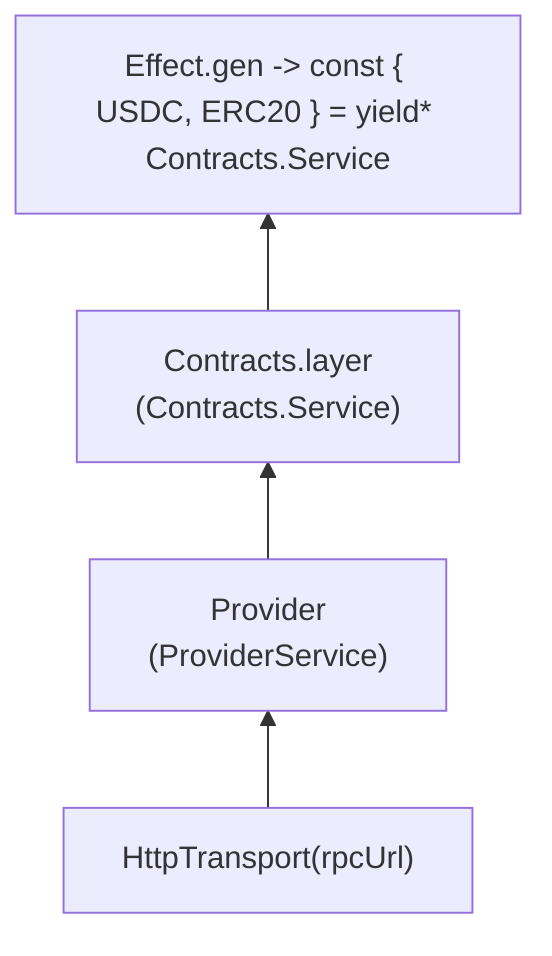

`makeContractRegistry(config)` turns a declarative map of contract definitions into an Effect `Service` tag and a `Layer` requiring `ProviderService`. Entries with an `address` become ready-to-use `ContractInstance` values; entries without an `address` become `ContractFactory` values with `.at(address)`.



## Quick Start

```typescript
import { Effect, Layer } from 'effect'
import { makeContractRegistry, Provider, HttpTransport } from 'voltaire-effect'

const erc20Abi = [
  {
    type: 'function',
    name: 'balanceOf',
    stateMutability: 'view',
    inputs: [{ type: 'address', name: 'account' }],
    outputs: [{ type: 'uint256' }]
  },
  {
    type: 'function',
    name: 'transfer',
    stateMutability: 'nonpayable',
    inputs: [
      { type: 'address', name: 'to' },
      { type: 'uint256', name: 'amount' }
    ],
    outputs: [{ type: 'bool' }]
  }
] as const

export const Contracts = makeContractRegistry({
  USDC: { abi: erc20Abi, address: '0xA0b86991c6218b36c1d19D4a2e9Eb0cE3606eB48' },
  WETH: { abi: erc20Abi, address: '0xC02aaA39b223FE8D0A0e5C4F27eAD9083C756Cc2' }
})

const ProviderLayer = Provider.pipe(
  Layer.provide(HttpTransport('https://eth.llamarpc.com'))
)
const AppLayer = Contracts.layer.pipe(Layer.provide(ProviderLayer))

const program = Effect.gen(function* () {
  const { USDC, WETH } = yield* Contracts.Service
  const usdcBalance = yield* USDC.read.balanceOf(userAddress)
  const wethBalance = yield* WETH.read.balanceOf(userAddress)
  return { usdcBalance, wethBalance }
}).pipe(Effect.provide(AppLayer))
```

## Addressed Mode, Factory Mode, and Mixed Mode

| Definition | Resolved Type in `Contracts.Service` | Usage |
| --- | --- | --- |
| `{ abi, address }` | `ContractInstance<TAbi>` | Call `USDC.read.*` / `USDC.write.*` directly |
| `{ abi }` (no `address`) | `ContractFactory<TAbi>` | Bind dynamically via `const token = yield* ERC20.at(addr)` |

Mix fixed protocol addresses and dynamic factories in a single registry:

```typescript
const Contracts = makeContractRegistry({
  // Fixed instances
  USDC: { abi: erc20Abi, address: '0xA0b86991c6218b36c1d19D4a2e9Eb0cE3606eB48' },
  WETH: { abi: wethAbi, address: '0xC02aaA39b223FE8D0A0e5C4F27eAD9083C756Cc2' },
  // Dynamic factories
  ERC20: { abi: erc20Abi },
  ERC721: { abi: erc721Abi }
})

const program = Effect.gen(function* () {
  const { USDC, ERC721 } = yield* Contracts.Service

  const usdcBalance = yield* USDC.read.balanceOf(account)
  const nft = yield* ERC721.at(nftAddress)
  const owner = yield* nft.read.ownerOf(tokenId)

  return { usdcBalance, owner }
})
```

## `ContractInstance<TAbi>` Interface

```typescript
interface ContractInstance<TAbi> {
  readonly address: AddressType
  readonly abi: TAbi
  readonly read: {
    [fn: string]: (...args: any[]) => Effect.Effect<any, ContractCallError, ProviderService>
  }
  readonly write: {
    [fn: string]: (...args: any[]) => Effect.Effect<HashType, ContractWriteError, SignerService>
  }
  readonly simulate: {
    [fn: string]: (...args: any[]) => Effect.Effect<any, ContractCallError, ProviderService>
  }
  readonly getEvents: (
    eventName: string,
    filter?: EventFilter
  ) => Effect.Effect<DecodedEvent[], ContractEventError, ProviderService>
}
```

## Chain-Specific Registries

Swap deployment addresses per network by selecting the registry layer at startup:

```typescript
const mainnetContracts = makeContractRegistry({
  USDC: { abi: erc20Abi, address: '0xA0b86991c6218b36c1d19D4a2e9Eb0cE3606eB48' }
})

const arbitrumContracts = makeContractRegistry({
  USDC: { abi: erc20Abi, address: '0xaf88d065e77c8cC2239327C5EDb3A432268e5831' }
})

const ContractsLayer = isMainnet
  ? mainnetContracts.layer
  : arbitrumContracts.layer
```

## See Also

- [Tutorial: Escaping try/catch Roulette](/tutorials/typed-errors-and-layers) — End-to-end registry + `TestTransport` walkthrough
- [Contract Factory](/services/contract) — One-off `Contract(address, abi)` usage
- [Block Explorer API](/services/block-explorer-api) — Fetch verified ABIs from Sourcify, Etherscan, or Blockscout
- [Provider Service](/services/provider) — Underlying RPC layer
