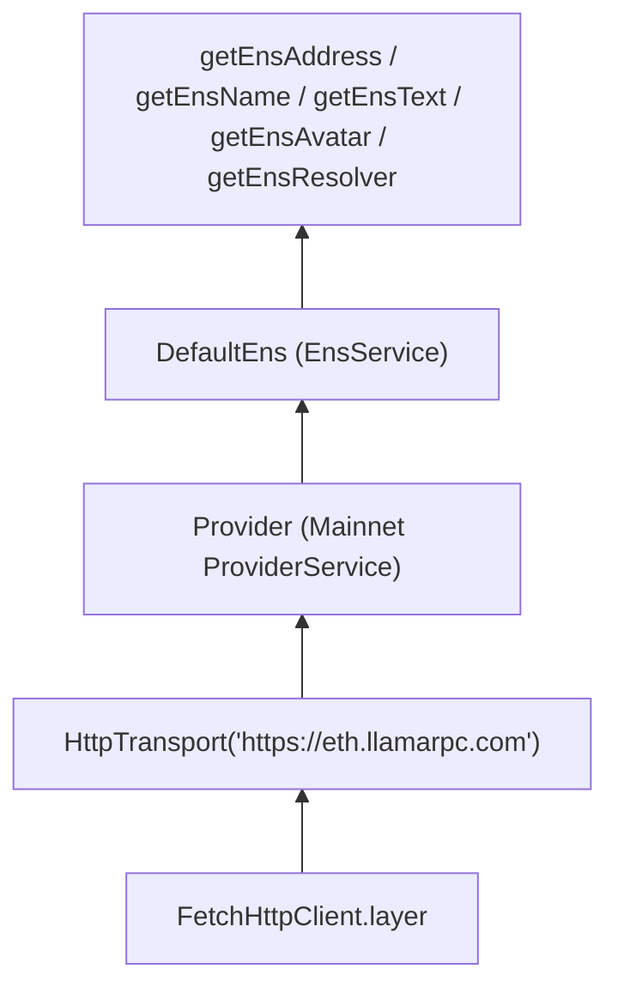

`EnsService` resolves Ethereum Name Service records through an injectable service backed by `DefaultEns` and `ProviderService`. Every operation is also exported as a standalone free function requiring `ProviderService` directly.



## Service Usage (`EnsService` + `DefaultEns`)

Compose the transport, provider, and `DefaultEns` into one layer before providing it. The default ENS registry contracts live on Ethereum mainnet:

```typescript
import { FetchHttpClient } from '@effect/platform'
import { Effect, Layer } from 'effect'
import { DefaultEns, EnsService, HttpTransport, Provider } from 'voltaire-effect'

const TransportLayer = HttpTransport('https://eth.llamarpc.com').pipe(
  Layer.provide(FetchHttpClient.layer)
)
const ProviderLayer = Provider.pipe(Layer.provide(TransportLayer))
const EnsLayer = DefaultEns.pipe(Layer.provide(ProviderLayer))

const program = Effect.gen(function* () {
  const ens = yield* EnsService
  return yield* ens.getEnsAddress({ name: 'vitalik.eth' })
}).pipe(Effect.provide(EnsLayer))

const address = await Effect.runPromise(program)
// `0x${string}` | null
```

## Operations

All operations fail with `EnsError` on resolution failure and return `null` when no record is set.

| Operation | Parameters | Return Value |
| --- | --- | --- |
| `getEnsAddress` | `{ name: string }` | Address hex string or `null` |
| `getEnsName` | `{ address: \`0x${string}\` }` | Reverse ENS name or `null` |
| `getEnsText` | `{ name: string; key: string }` | Text record string or `null` |
| `getEnsAvatar` | `{ name: string }` | Avatar URL/URI or `null` |
| `getEnsResolver` | `{ name: string }` | Resolver address or `null` |

## Free Functions

When you do not need `EnsService` indirection, call the free functions directly with `ProviderLayer`:

```typescript
import { FetchHttpClient } from '@effect/platform'
import { Effect, Layer } from 'effect'
import { getEnsText, HttpTransport, Provider } from 'voltaire-effect'

const ProviderLayer = Provider.pipe(
  Layer.provide(
    HttpTransport('https://eth.llamarpc.com').pipe(
      Layer.provide(FetchHttpClient.layer)
    )
  )
)

const url = await Effect.runPromise(
  getEnsText({ name: 'vitalik.eth', key: 'url' }).pipe(
    Effect.provide(ProviderLayer)
  )
)
```

For offline ENSIP-15 normalization, validation, `namehash`, and `labelhash` without an RPC provider, use the [ENS primitive](/primitives/ens).

## See Also

- [ENS Primitive](/primitives/ens) — Offline normalization and hashing
- [Provider Service](/services/provider) — Mainnet transport and provider setup
- [Layer Composition Guide](/guides/layers) — Composing service dependency graphs
