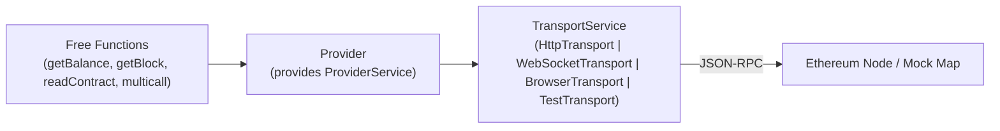

`ProviderService` is a thin request layer wrapping Ethereum JSON-RPC. Every provider operation (`getBlockNumber`, `getBalance`, `readContract`, `multicall`, `simulateContract`, `getLogs`, etc.) is exported as a **free function** that requires `ProviderService` in its `R` channel and returns a typed error union.



## Quick Start

```typescript
import { Effect, Schedule, Layer } from 'effect'
import {
  getBlockNumber, getBalance, getBlock,
  Provider, HttpTransport,
  withTimeout, withRetrySchedule
} from 'voltaire-effect'

const ProviderLayer = Provider.pipe(
  Layer.provide(
    HttpTransport({
      url: 'https://eth.llamarpc.com',
      timeout: '30 seconds',
      retrySchedule: Schedule.exponential('1 second').pipe(
        Schedule.jittered,
        Schedule.compose(Schedule.recurs(3))
      )
    })
  )
)

const program = Effect.gen(function* () {
  const blockNum = yield* getBlockNumber()
  const balance = yield* getBalance('0xd8dA6BF26964aF9D7eEd9e03E53415D37aA96045').pipe(
    withTimeout('5 seconds')
  )
  const block = yield* getBlock({ blockTag: 'latest' }).pipe(
    withRetrySchedule(
      Schedule.exponential('500 millis').pipe(
        Schedule.jittered,
        Schedule.compose(Schedule.recurs(5))
      )
    )
  )
  return { blockNum, balance, block }
}).pipe(Effect.provide(ProviderLayer))
```

## Transports

`Provider` has type `Layer.Layer<ProviderService, never, TransportService>`. Supply one of four transports:

| Transport | Underlying Mechanism | Typical Use |
| --- | --- | --- |
| `HttpTransport(url \| options)` | HTTP POST JSON-RPC with optional batching, timeout, retry schedule | Backend services, indexers, scripts |
| `WebSocketTransport(url)` | Persistent WebSocket connection | Real-time `eth_subscribe` / `watchBlocks` |
| `BrowserTransport` | `window.ethereum` (EIP-1193) | Browser dApps |
| `TestTransport(map \| handlers)` | In-memory method-to-response or `TransportError` map | Deterministic unit tests |

### `HttpTransport` & Automatic Batching

```typescript
import { Schedule } from 'effect'
import { HttpTransport } from 'voltaire-effect'

const transport = HttpTransport({
  url: 'https://eth.llamarpc.com',
  headers: { 'X-Api-Key': 'secret' },
  timeout: '60 seconds', // Effect DurationInput (default: "30 seconds")
  retrySchedule: Schedule.exponential('500 millis').pipe(
    Schedule.jittered,
    Schedule.compose(Schedule.recurs(5))
  ),
  batch: {
    batchSize: 50, // Flush when 50 requests queue (default: 100)
    wait: 10       // Flush after 10 ms (default: 0)
  }
})
```

Concurrent requests under a batched `HttpTransport` are coalesced into a single JSON-RPC batch array and matched back by request ID. A failure in one item fails only that Effect; sibling items still resolve.

### `WebSocketTransport`, `BrowserTransport`, and `TestTransport`

```typescript
import {
  WebSocketTransport,
  BrowserTransport,
  TestTransport,
  TransportError
} from 'voltaire-effect'

const wsLayer = WebSocketTransport('wss://eth.llamarpc.com')
const browserLayer = BrowserTransport

const testLayer = TestTransport(
  new Map<string, unknown>([
    ['eth_blockNumber', '0x1234'],
    ['eth_chainId', '0x1'],
    ['eth_call', new TransportError({ code: -32000, message: 'execution reverted' })]
  ])
)
```

### Per-Request Overrides (`FiberRef`)

```typescript
import { Schedule } from 'effect'
import {
  getBalance, getBlockNumber,
  withTimeout, withRetrySchedule, withoutCache, withTracing
} from 'voltaire-effect'

const balance = yield* getBalance(addr).pipe(withTimeout('5 seconds'))
const blockNum = yield* getBlockNumber().pipe(withRetrySchedule(Schedule.recurs(1)))
const freshHead = yield* getBlockNumber().pipe(withoutCache)
const tracedBalance = yield* getBalance(addr).pipe(withTracing())
```

## Core RPC Queries

```typescript
import {
  getBlockNumber, getBlock, getBlockReceipts, getUncleCount,
  getBalance, getTransactionCount, getCode, getStorageAt,
  getTransaction, getTransactionReceipt, waitForTransactionReceipt,
  call, estimateGas, getLogs, getGasPrice, getMaxPriorityFeePerGas, getFeeHistory
} from 'voltaire-effect'

// Blocks
const head = yield* getBlockNumber()
const block = yield* getBlock({ blockTag: 'latest', includeTransactions: true })
const blockByHash = yield* getBlock({ blockHash: '0x...' })
const receipts = yield* getBlockReceipts({ blockTag: 'latest' })
const uncles = yield* getUncleCount({ blockTag: 'latest' })

// Account state
const wei = yield* getBalance('0x...', 'latest')
const nonce = yield* getTransactionCount('0x...')
const code = yield* getCode('0x...')
const slot = yield* getStorageAt('0x...', '0x0')

// Transactions & confirmation
const tx = yield* getTransaction('0x...')
const receipt = yield* getTransactionReceipt('0x...')
const confirmed = yield* waitForTransactionReceipt('0x...', { confirmations: 3 }).pipe(
  withTimeout('60 seconds')
)

// Low-level call, gas, logs, fees
const rawReturn = yield* call({ to: '0x...', data: '0x...' })
const gas = yield* estimateGas({ to: '0x...', data: '0x...', value: 10n ** 18n })
const logs = yield* getLogs({ address: '0x...', topics: ['0xddf252ad...'], fromBlock: '0x100000', toBlock: 'latest' })
const gasPrice = yield* getGasPrice()
const tip = yield* getMaxPriorityFeePerGas()
const feeHistory = yield* getFeeHistory(10, 'latest', [25, 50, 75])
```

## Contract Helpers (`readContract`, `multicall`, `simulateContract`)

### `readContract`

Executes a typed view/pure call without instantiating a `Contract`:

```typescript
import { readContract } from 'voltaire-effect'

const erc20Abi = [
  {
    type: 'function',
    name: 'balanceOf',
    stateMutability: 'view',
    inputs: [{ name: 'account', type: 'address' }],
    outputs: [{ type: 'uint256' }]
  }
] as const

const balance = yield* readContract({
  address: '0x6B175474E89094C44Da98b954EecdEfaE6E286AB',
  abi: erc20Abi,
  functionName: 'balanceOf',
  args: ['0x1234567890123456789012345678901234567890'],
  blockTag: 'finalized'
})
```

### `multicall`

Batches multiple reads through Multicall3 (`0xcA11bde05977b3631167028862bE2a173976CA11`) in a single `eth_call`:

```typescript
import { multicall } from 'voltaire-effect'

// allowFailure defaults to true -> [{ status: 'success', result } | { status: 'failure', error }]
const results = yield* multicall({
  contracts: [
    { address: daiAddress, abi: erc20Abi, functionName: 'balanceOf', args: [user] },
    { address: usdcAddress, abi: erc20Abi, functionName: 'balanceOf', args: [user] }
  ],
  allowFailure: true,
  blockTag: 'finalized'
})

// Set allowFailure: false to unwrap results directly and fail the Effect if any subcall reverts
const balances = yield* multicall({
  contracts: [
    { address: daiAddress, abi: erc20Abi, functionName: 'balanceOf', args: [user] },
    { address: usdcAddress, abi: erc20Abi, functionName: 'balanceOf', args: [user] }
  ],
  allowFailure: false
})
```

### `simulateContract`

Dry-runs a state-changing call under a specific `account` (`msg.sender`) and returns `{ result, request }` ready for signing:

```typescript
import { simulateContract } from 'voltaire-effect'

const { result, request } = yield* simulateContract({
  address: tokenAddress,
  abi: erc20Abi,
  functionName: 'transfer',
  args: [recipient, amount],
  account: senderAddress
})

if (result) {
  const hash = yield* signer.sendTransaction({
    to: request.to,
    data: request.data,
    value: request.value
  })
}
```

## Simulation, Subscriptions & Node-Dependent RPCs

```typescript
import {
  simulateV1, simulateV2,
  watchBlocks, subscribe, unsubscribe,
  sendTransaction, sign, signTransaction,
  getSyncing, getAccounts, getCoinbase, netVersion
} from 'voltaire-effect'

// Node simulation RPCs
const sim1 = yield* simulateV1({ blockStateCalls: [{ calls: [{ to: tokenAddress, data: '0x...' }] }] })
const sim2 = yield* simulateV2({ calls: [{ to: tokenAddress }] })

// Pub/sub (requires WebSocketTransport)
const blockStream = watchBlocks()
const subId = yield* subscribe('newHeads')
yield* unsubscribe(subId as `0x${string}`)
```

For local signing rather than node-managed accounts, use [AccountService](/services/account) and [SignerService](/services/signer).

## Free Functions Reference

| Category | Functions |
| --- | --- |
| **Blocks** | `getBlockNumber`, `getBlock`, `getBlockTransactionCount`, `getBlockReceipts`, `getUncle`, `getUncleCount` |
| **Accounts** | `getBalance`, `getTransactionCount`, `getCode`, `getStorageAt`, `getProof` |
| **Transactions** | `getTransaction`, `getTransactionReceipt`, `getTransactionByBlockHashAndIndex`, `getTransactionByBlockNumberAndIndex`, `sendRawTransaction`, `waitForTransactionReceipt`, `getTransactionConfirmations` |
| **Calls & Contracts** | `call`, `estimateGas`, `createAccessList`, `readContract`, `multicall`, `simulateContract`, `simulateV1`, `simulateV2` |
| **Logs & Filters** | `getLogs`, `createEventFilter`, `createBlockFilter`, `createPendingTransactionFilter`, `getFilterChanges`, `getFilterLogs`, `uninstallFilter` |
| **Network & Fees** | `getChainId`, `getGasPrice`, `getMaxPriorityFeePerGas`, `getFeeHistory`, `getBlobBaseFee`, `getSyncing`, `getAccounts`, `getCoinbase`, `netVersion`, `getProtocolVersion`, `getMining`, `getHashrate`, `getWork`, `submitWork`, `submitHashrate` |
| **Streaming** | `watchBlocks`, `backfillBlocks`, `subscribe`, `unsubscribe` |
| **Node Account** | `sendTransaction`, `sign`, `signTransaction` |

## XOR Type Contracts & Error Handling

Arguments that are mutually exclusive in Ethereum JSON-RPC are enforced via XOR unions:

```typescript
type AddressInput = AddressType | `0x${string}`
type HashInput = HashType | `0x${string}`
type BlockTag = 'latest' | 'earliest' | 'pending' | 'safe' | 'finalized' | `0x${string}`

type GetBlockArgs =
  | { blockTag?: BlockTag; includeTransactions?: boolean; blockHash?: never }
  | { blockHash: HashInput; includeTransactions?: boolean; blockTag?: never }

type LogFilter =
  | { blockHash: HashInput; fromBlock?: never; toBlock?: never; address?: AddressInput | AddressInput[]; topics?: unknown[] }
  | { blockHash?: never; fromBlock?: BlockTag; toBlock?: BlockTag; address?: AddressInput | AddressInput[]; topics?: unknown[] }
```

Handle provider failures with `Effect.catchTags`:

```typescript
program.pipe(
  Effect.catchTags({
    TransportError: (e) => Effect.succeed(0n),
    ProviderResponseError: (e) => Effect.succeed(0n),
    ProviderNotFoundError: (e) => Effect.succeed(0n)
  })
)
```

## Chain-Specific Extensions (OP Stack)

Merge chain extension layers with `Provider` before providing the transport:

```typescript
import { Effect, Layer } from 'effect'
import {
  getBlockNumber, OpStackActionsService, OpStackActions,
  Provider, HttpTransport
} from 'voltaire-effect'

const OpStackLayer = Layer.merge(Provider, OpStackActions).pipe(
  Layer.provide(HttpTransport('https://mainnet.optimism.io'))
)

const program = Effect.gen(function* () {
  const opStack = yield* OpStackActionsService
  const block = yield* getBlockNumber()
  const l1BaseFee = yield* opStack.getL1BaseFee()
  return { block, l1BaseFee }
}).pipe(Effect.provide(OpStackLayer))
```

## See Also

- [Signer Service](/services/signer) — Transaction signing and broadcast
- [Provider Fallback Strategies](/guides/provider-fallback) — Multi-RPC failover with `ExecutionPlan`
- [RateLimiter Service](/services/rate-limiter) — Per-method RPC throttling
- [Debug Service](/services/debug) — `debug_*` tracing RPCs
