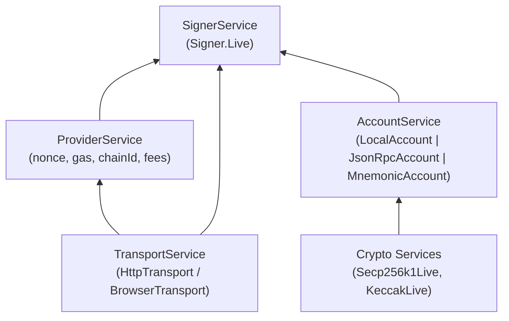

`SignerService` signs messages, typed data, and transactions, automatically populating missing `nonce`, `gasLimit`, `chainId`, and EIP-1559 fees via `ProviderService` before broadcasting through `TransportService`.



## Quick Start

```typescript
import { Effect, Schedule, Layer } from 'effect'
import {
  SignerService, Signer, Provider,
  HttpTransport, withTimeout
} from 'voltaire-effect'
import { Secp256k1Live, KeccakLive } from 'voltaire-effect/crypto'
import { Hex } from '@tevm/voltaire'

const privateKey = Hex.fromHex('0xac0974bec...')

const BaseDeps = Layer.mergeAll(
  Secp256k1Live,
  KeccakLive,
  HttpTransport({
    url: 'https://eth.llamarpc.com',
    timeout: '30 seconds',
    retrySchedule: Schedule.exponential('1 second').pipe(
      Schedule.jittered,
      Schedule.compose(Schedule.recurs(3))
    )
  })
)

const SignerLayer = Signer.fromPrivateKey(privateKey, Provider).pipe(
  Layer.provide(BaseDeps)
)

const program = Effect.gen(function* () {
  const signer = yield* SignerService
  return yield* signer.sendTransaction({
    to: recipientAddress,
    value: 1_000_000_000_000_000_000n
  }).pipe(withTimeout('30 seconds'))
}).pipe(Effect.provide(SignerLayer))
```

## Constructors

| Constructor | Dependencies Required After Construction | Use Case |
| --- | --- | --- |
| `Signer.fromPrivateKey(privateKey, Provider)` | `TransportService`, `Secp256k1Service`, `KeccakService` | Local key signing (backend, scripts) |
| `Signer.fromProvider(Provider, accountLayer)` | `TransportService` (+ account's dependencies) | Custom `LocalAccount`, `JsonRpcAccount`, or `MnemonicAccount` |
| `Signer.Live` | `ProviderService \| AccountService \| TransportService` | Explicit full-graph layer wiring |

### Browser Wallet Signer (`JsonRpcAccount` + `BrowserTransport`)

```typescript
import { Effect, Layer } from 'effect'
import { SignerService, Signer, Provider, JsonRpcAccount, BrowserTransport } from 'voltaire-effect'

const BrowserSignerLayer = Signer.fromProvider(
  Provider,
  JsonRpcAccount(userAddress)
).pipe(Layer.provide(BrowserTransport))

const program = Effect.gen(function* () {
  const signer = yield* SignerService
  const accounts = yield* signer.requestAddresses()
  const txHash = yield* signer.sendTransaction({ to, value })
  return { accounts, txHash }
}).pipe(Effect.provide(BrowserSignerLayer))
```

## Service Interface (`SignerShape`)

```typescript
type SignerShape = {
  readonly signMessage: (message: HexType) => Effect.Effect<SignatureType, SignerError>
  readonly signTransaction: (tx: TransactionRequest) => Effect.Effect<HexType, SignerError>
  readonly signTypedData: (typedData: TypedDataType) => Effect.Effect<SignatureType, SignerError>
  readonly sendTransaction: (tx: TransactionRequest) => Effect.Effect<HashType, SignerError>
  readonly sendRawTransaction: (signedTx: HexType) => Effect.Effect<HashType, SignerError>
  readonly requestAddresses: () => Effect.Effect<AddressType[], SignerError>
  readonly switchChain: (chainId: number) => Effect.Effect<void, SignerError>
}
```

| Method | Standard / RPC | Behavior |
| --- | --- | --- |
| `signMessage(hex)` | EIP-191 `personal_sign` | Signs raw message bytes with Ethereum prefix |
| `signTransaction(tx)` | Local or JSON-RPC | Auto-fills nonce, gas, chainId, fees; returns signed RLP `HexType` without broadcasting |
| `signTypedData(data)` | EIP-712 | Signs structured typed data |
| `sendTransaction(tx)` | `eth_sendRawTransaction` / `eth_sendTransaction` | Signs and broadcasts; returns 32-byte `HashType` |
| `sendRawTransaction(hex)` | `eth_sendRawTransaction` | Broadcasts pre-signed transaction bytes |
| `requestAddresses()` | `eth_requestAccounts` | Requests connected wallet accounts |
| `switchChain(chainId)` | `wallet_switchEthereumChain` | Switches active network on EIP-1193 wallets |

## `TransactionRequest` & Auto-Detection

```typescript
type AddressInput = AddressType | `0x${string}`

type TransactionRequest = {
  readonly to?: AddressInput | null        // null = contract deployment
  readonly value?: bigint
  readonly data?: HexType
  readonly nonce?: bigint                  // auto-filled via getTransactionCount('pending')
  readonly gasLimit?: bigint               // auto-estimated via estimateGas
  readonly gasPrice?: bigint               // type 0 / 1
  readonly maxFeePerGas?: bigint           // type 2 / 3 / 4
  readonly maxPriorityFeePerGas?: bigint
  readonly chainId?: bigint                // auto-detected via eth_chainId
  readonly accessList?: Array<{ address: AddressInput; storageKeys: Array<`0x${string}`> }>
  readonly type?: 0 | 1 | 2 | 3 | 4
  readonly blobVersionedHashes?: readonly `0x${string}`[]  // EIP-4844 (type 3)
  readonly maxFeePerBlobGas?: bigint
  readonly authorizationList?: readonly {                  // EIP-7702 (type 4)
    chainId: bigint
    address: `0x${string}`
    nonce: bigint
    yParity: number
    r: `0x${string}`
    s: `0x${string}`
  }[]
}
```

### Supported Transaction Types

| Type | EIP | Distinguishing Fields |
| --- | --- | --- |
| `0` | Legacy | `gasPrice` |
| `1` | EIP-2930 | `gasPrice` + `accessList` |
| `2` | EIP-1559 | `maxFeePerGas` + `maxPriorityFeePerGas` |
| `3` | EIP-4844 | `blobVersionedHashes` + `maxFeePerBlobGas` |
| `4` | EIP-7702 | `authorizationList` |

When `type` is omitted, detection resolves in strict precedence order:
1. `authorizationList` present -> type `4` (EIP-7702)
2. `blobVersionedHashes` present -> type `3` (EIP-4844)
3. `maxFeePerGas` or `maxPriorityFeePerGas` present -> type `2` (EIP-1559)
4. `accessList` + `gasPrice` present -> type `1` (EIP-2930)
5. `gasPrice` only -> type `0` (Legacy)
6. No fee fields: type `2` if the latest block includes `baseFeePerGas`, otherwise type `0`.

### Default EIP-1559 Fee Formula

When `maxFeePerGas` is omitted on an EIP-1559 network, it is computed in integer arithmetic with a 20% base-fee buffer:

```typescript
maxFeePerGas = (baseFeePerGas * 12n) / 10n + maxPriorityFeePerGas
```

Example: `baseFeePerGas = 30 gwei`, `maxPriorityFeePerGas = 2 gwei` -> `maxFeePerGas = 38 gwei`.

### Nonce Concurrency

`sendTransaction` fetches the `pending` nonce via `getTransactionCount(address, 'pending')`. Sequential calls are safe, but firing multiple `sendTransaction` calls concurrently can fetch the same pending nonce and collide. For parallel broadcasts, serialize submissions or pass explicit `nonce` values (see [NonceManager](/services/nonce-manager)).

## Error Handling

All signer methods fail with `SignerError`:

```typescript
import { Effect } from 'effect'

program.pipe(
  Effect.catchTag('SignerError', (e) => {
    if (e.message.includes('insufficient funds')) return Effect.fail(e)
    return Effect.fail(e)
  })
)
```

## See Also

- [Account Service](/services/account) — Low-level `LocalAccount`, `JsonRpcAccount`, and `MnemonicAccount`
- [Provider Service](/services/provider) — Transports and JSON-RPC queries
- [NonceManager Service](/services/nonce-manager) — Coordinated nonces for concurrent sends
- [HD Wallet Guide](/guides/hd-wallet) — Deriving signers from BIP-39 mnemonics
