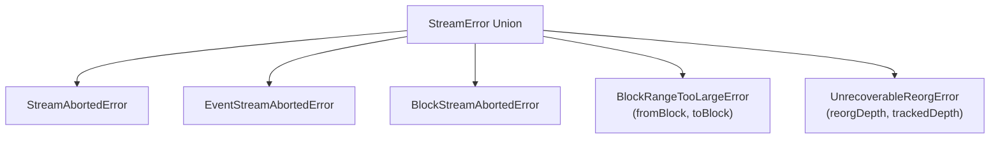

`voltaire-effect/stream` exports typed error classes used by `EventStream` and `BlockStream`. Each error extends Voltaire's base stream errors and carries a `_tag` discriminant for `Effect.catchTag` and exhaustive `Match` dispatch.



## Error Classes

| Error Class | Key Fields | Cause & Typical Recovery |
| --- | --- | --- |
| `StreamAbortedError` | `message` | Base abort error triggered by `AbortSignal` / scope close |
| `EventStreamAbortedError` | `message` | `EventStream` cancelled; treat as graceful shutdown |
| `BlockStreamAbortedError` | `message` | `BlockStream` cancelled; treat as graceful shutdown |
| `BlockRangeTooLargeError` | `fromBlock: bigint`, `toBlock: bigint` | RPC rejected log/block range; bisect range and retry |
| `UnrecoverableReorgError` | `reorgDepth: bigint`, `trackedDepth: bigint` | Reorg deeper than tracked block history; resync from finalized checkpoint |

```typescript
import * as Stream from 'voltaire-effect/stream'

const aborted = new Stream.StreamAbortedError('Shutdown requested')
const eventAborted = new Stream.EventStreamAbortedError()
const blockAborted = new Stream.BlockStreamAbortedError()
const tooLarge = new Stream.BlockRangeTooLargeError(18_000_000n, 19_000_000n)
const deepReorg = new Stream.UnrecoverableReorgError(100n, 50n)
```

## Handling with `Effect.catchTag`

```typescript
import { Effect, pipe } from 'effect'

const recovered = pipe(
  someStreamOperation(),
  Effect.catchTag('BlockRangeTooLargeError', (error) =>
    Effect.gen(function* () {
      yield* Effect.logWarning(`Range ${error.fromBlock}-${error.toBlock} exceeded RPC limit`)
      return yield* retryWithSmallerRange(error.fromBlock, error.toBlock)
    })
  ),
  Effect.catchTag('UnrecoverableReorgError', (error) =>
    Effect.gen(function* () {
      yield* Effect.logError(
        `Deep reorg: depth ${error.reorgDepth} exceeds tracked depth ${error.trackedDepth}`
      )
      return yield* resyncFromCheckpoint()
    })
  ),
  Effect.catchTag('BlockStreamAbortedError', () =>
    Effect.logInfo('Block stream cancelled')
  ),
  Effect.catchTag('EventStreamAbortedError', () =>
    Effect.logInfo('Event stream cancelled')
  )
)
```

## Exhaustive Dispatch Over `StreamError`

```typescript
import { Effect, Match } from 'effect'
import * as Stream from 'voltaire-effect/stream'

const handleStreamError = (error: Stream.StreamError) =>
  Match.value(error).pipe(
    Match.tag('BlockRangeTooLargeError', (e) =>
      Effect.logWarning(`Range ${e.fromBlock}-${e.toBlock} too large`)
    ),
    Match.tag('UnrecoverableReorgError', (e) =>
      Effect.logError(`Deep reorg depth ${e.reorgDepth}`)
    ),
    Match.tag('BlockStreamAbortedError', () => Effect.log('Block stream aborted')),
    Match.tag('EventStreamAbortedError', () => Effect.log('Event stream aborted')),
    Match.tag('StreamAbortedError', () => Effect.log('Stream aborted')),
    Match.exhaustive
  )
```

## See Also

- [EventStream](/event-stream) — Adaptive backfill and live event streaming
- [BlockStream](/services/block-stream) — Continuous block streaming with reorg detection
- [Transaction Streaming](/transaction) — Pending and confirmed transaction tracking
- [Error Handling](/concepts/error-handling) — Full `voltaire-effect` error taxonomy
