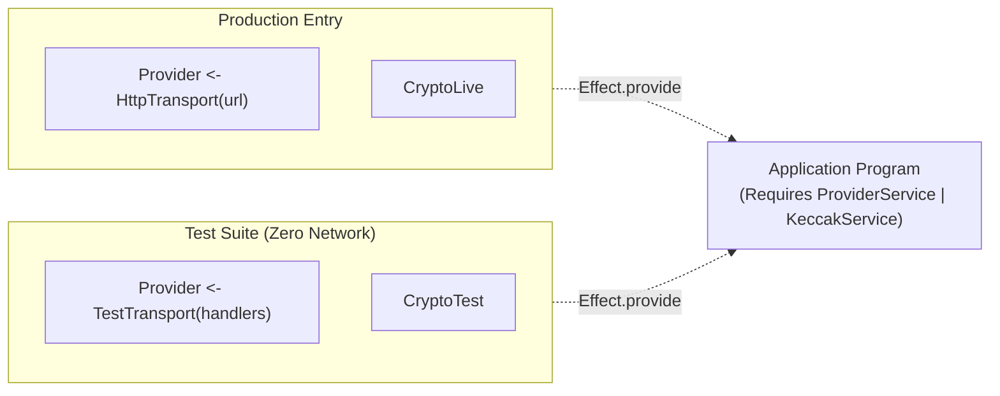

Because `voltaire-effect` injects transports, providers, signers, and crypto through Effect Layers, unit tests execute production code paths with deterministic, offline layers.



## 1. Pure Schema Tests

Schema decoding and encoding are synchronous and pure when no service is required:

```typescript
import { describe, it, expect } from 'vitest'
import * as S from 'effect/Schema'
import * as Either from 'effect/Either'
import * as Address from 'voltaire-effect/primitives/Address'

describe('Address.Hex', () => {
  it('decodes a 20-byte hex address', () => {
    const addr = S.decodeSync(Address.Hex)(
      '0x742d35Cc6634C0532925a3b844Bc9e7595f251e3'
    )
    expect(addr).toBeInstanceOf(Uint8Array)
    expect(addr.length).toBe(20)
  })

  it('returns Left(ParseError) for invalid hex without throwing', () => {
    const result = S.decodeEither(Address.Hex)('0x123')
    expect(Either.isLeft(result)).toBe(true)
  })
})
```

## 2. Mocking RPC Responses with `TestTransport`

`TestTransport` maps JSON-RPC method names to static values, handler functions, or `TransportError` instances. Compose it beneath `Provider` exactly like `HttpTransport`:

```typescript
import { describe, it, expect } from 'vitest'
import { Effect, Layer } from 'effect'
import { getBalance, Provider, TestTransport } from 'voltaire-effect'

describe('getBalance', () => {
  it('decodes hex wei balance into bigint', async () => {
    const TestLayer = Provider.pipe(
      Layer.provide(
        TestTransport({
          eth_getBalance: '0xde0b6b3a7640000', // 1 ETH
          eth_blockNumber: '0x1234',
          eth_chainId: '0x1'
        })
      )
    )

    const balance = await Effect.runPromise(
      getBalance('0xd8dA6BF26964aF9D7eEd9e03E53415D37aA96045').pipe(
        Effect.provide(TestLayer)
      )
    )

    expect(balance).toBe(1_000_000_000_000_000_000n)
  })
})
```

## 3. Injecting Typed Failures

Pass a `TransportError` in `TestTransport` to verify retry, fallback, and `catchTag` branches:

```typescript
import { Effect, Layer } from 'effect'
import { getBalance, Provider, TestTransport, TransportError } from 'voltaire-effect'

it('recovers from TransportError via catchTag', async () => {
  const FailingLayer = Provider.pipe(
    Layer.provide(
      TestTransport({
        eth_getBalance: new TransportError({ code: -32000, message: 'timeout' })
      })
    )
  )

  const program = getBalance('0xd8dA6BF26964aF9D7eEd9e03E53415D37aA96045').pipe(
    Effect.catchTag('TransportError', () => Effect.succeed(0n))
  )

  const result = await Effect.runPromise(program.pipe(Effect.provide(FailingLayer)))
  expect(result).toBe(0n)
})
```

## 4. Deterministic Crypto with `CryptoTest`

`CryptoTest` provides deterministic stub implementations for every crypto service bundled in `CryptoLive` (Keccak256, Secp256k1, SHA256, Blake2, Ripemd160, BLS12-381, Ed25519, P256, KZG, HDWallet, BN254, BIP-39, HMAC, EIP-712, ChaCha20Poly1305, Keystore):

```typescript
import { Effect } from 'effect'
import { CryptoTest, keccak256 } from 'voltaire-effect'

it('returns a 32-byte deterministic digest under CryptoTest', async () => {
  const digest = await Effect.runPromise(
    keccak256(new Uint8Array([1, 2, 3])).pipe(Effect.provide(CryptoTest))
  )
  expect(digest.length).toBe(32)
})
```

## 5. Composing Multi-Service Test Layers

Merge `TestTransport`-backed `Provider` with `CryptoTest` into a single reusable test layer:

```typescript
import { Effect, Layer } from 'effect'
import { TestTransport, Provider, CryptoTest, getBalance, keccak256 } from 'voltaire-effect'

const TestLayer = Layer.mergeAll(
  Provider.pipe(Layer.provide(TestTransport({ eth_getBalance: '0x0' }))),
  CryptoTest
)

const program = Effect.gen(function* () {
  const balance = yield* getBalance('0xd8dA6BF26964aF9D7eEd9e03E53415D37aA96045')
  const hash = yield* keccak256(new Uint8Array([1, 2, 3]))
  return { balance, hash }
})

const result = await Effect.runPromise(program.pipe(Effect.provide(TestLayer)))
```

## 6. Integration Tests Against Live RPC

Swap only the layer when running integration suites:

```typescript
import { Effect, Layer } from 'effect'
import { HttpTransport, Provider, CryptoLive, getBlock } from 'voltaire-effect'

const IntegrationLayer = Layer.mergeAll(
  Provider.pipe(Layer.provide(HttpTransport('https://eth.llamarpc.com'))),
  CryptoLive
)

it('fetches latest block from live RPC', async () => {
  const block = await Effect.runPromise(
    getBlock({ blockTag: 'latest' }).pipe(Effect.provide(IntegrationLayer))
  )
  expect(block.number).toBeDefined()
})
```

## See Also

- [Tutorial: Escaping try/catch Roulette](/tutorials/typed-errors-and-layers) — End-to-end test walkthrough
- [Dependency Injection](/concepts/dependency-injection) — Service tag mechanics
- [Debugging Guide](/guides/debugging) — Inspecting `Exit` and `Cause`
