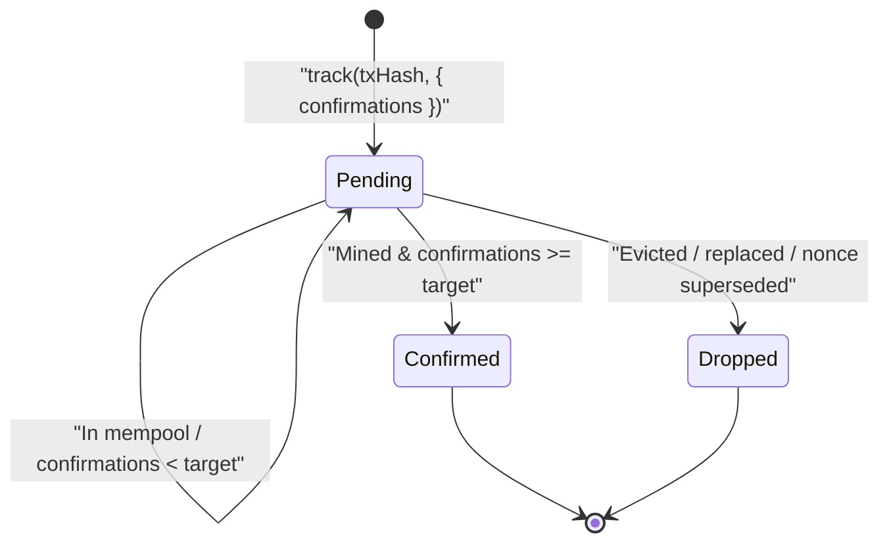

`makeTransactionStream()` creates an Effect-native transaction streamer requiring `TransportService`. It supports mempool watching (`watchPending`), confirmation-gated streaming (`watchConfirmed`), and single-transaction lifecycle tracking (`track`). Confirmation depth is monitored internally via `BlockStream`.



## Quick Start

```typescript
import { Effect, Stream } from 'effect'
import { makeTransactionStream, HttpTransport } from 'voltaire-effect/services'

const program = Effect.gen(function* () {
  const txStream = yield* makeTransactionStream()

  yield* Stream.runForEach(
    txStream.watchConfirmed({ confirmations: 3 }),
    (event) => Effect.log(`Confirmed: ${event.transaction.hash}`)
  )
}).pipe(Effect.provide(HttpTransport('https://eth.llamarpc.com')))
```

## Streaming Modes

| Method | Purpose | Key Options |
| --- | --- | --- |
| `watchPending(opts?)` | Stream mempool transactions | `filter?: { from?, to? }` |
| `watchConfirmed(opts?)` | Stream transactions meeting confirmation depth | `filter?: { from?, to? }`, `confirmations?: number` |
| `track(txHash, opts?)` | Follow one hash across `pending`, `confirmed`, `dropped` | `confirmations?: number` |

### Watching Pending & Confirmed Transactions

```typescript
const txStream = yield* makeTransactionStream()

// Filtered pending mempool stream (WebSocketTransport recommended)
const pending = txStream.watchPending({ filter: { to: usdcAddress } })

// High-value confirmation threshold (12 blocks)
const settled = txStream.watchConfirmed({
  filter: { from: treasuryAddress },
  confirmations: 12
})
```

### Tracking a Single Transaction

```typescript
const trackTransaction = (txHash: string) =>
  Effect.gen(function* () {
    const txStream = yield* makeTransactionStream()

    yield* Stream.runForEach(
      txStream.track(txHash, { confirmations: 3 }),
      (event) => {
        if (event.type === 'confirmed') {
          return Effect.log(`Confirmed in block ${event.transaction.blockNumber}`)
        }
        if (event.type === 'dropped') {
          return Effect.logWarning(`Dropped: ${event.reason}`)
        }
        return Effect.log('Pending...')
      }
    )
  })
```

## Error Handling

All stream methods fail with `TransactionStreamError` (`_tag: 'TransactionStreamError'`), preserving the underlying `cause` and `context`:

```typescript
import { Effect, pipe } from 'effect'

const program = pipe(
  trackTransaction(txHash),
  Effect.catchTag('TransactionStreamError', (error) =>
    Effect.logError(`Transaction stream failed: ${error.message}`)
  )
)
```

## Transport Selection

- **`WebSocketTransport`:** Preferred for `watchPending` and low-latency mempool events.
- **`HttpTransport`:** Supported for `watchConfirmed` and `track` via polling.

## See Also

- [TransactionStream Reference](/services/transaction-stream) — Full service API
- [BlockStream](/services/block-stream) — Underlying confirmation tracker
- [Provider Service](/services/provider) — One-shot `waitForTransactionReceipt`
- [Stream Errors](/stream) — Shared stream error types
