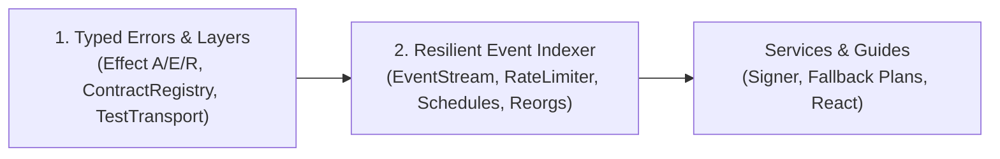

These tutorials teach `voltaire-effect` by putting you inside real production failure modes and walking step by step to an Effect-native solution. Each tutorial opens with broken imperative code, diagrams the data and layer flow, and ends with verified tests that run without a network connection.



## Learning Path

<CardGroup cols={2}>
  <Card title="1. Escaping try/catch Roulette" icon="shield-halved" href="/tutorials/typed-errors-and-layers">
    Replace untyped exceptions and global RPC clients with `Effect<A, E, R>`, composable Layers, `makeContractRegistry`, and deterministic `TestTransport` tests.
  </Card>
  <Card title="2. Building a Resilient Event Indexer" icon="wave-pulse" href="/tutorials/resilient-event-indexer">
    Build a rate-limited, retrying ERC-20 `Transfer` indexer with adaptive chunking, structured concurrency, and reorg-safe block correlation.
  </Card>
</CardGroup>

## Prerequisites

- TypeScript 5.4+ with `strict: true`
- Node.js 20+ or Bun 1.1+
- Familiarity with `async`/`await` and basic Ethereum JSON-RPC calls (no prior Effect experience required — read the [Effect Primer](/concepts/effect-primer) alongside Tutorial 1 if you want a quick syntax reference)

<CodeGroup>
```bash pnpm
pnpm add voltaire-effect @tevm/voltaire effect
```

```bash npm
npm install voltaire-effect @tevm/voltaire effect
```

```bash bun
bun add voltaire-effect @tevm/voltaire effect
```
</CodeGroup>
