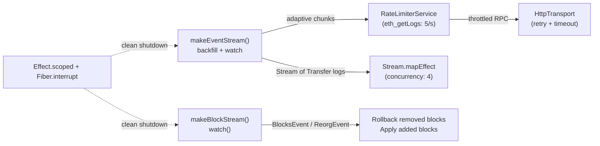

You need to index every USDC `Transfer` event from block `18,000,000` to head, then stay synced in real time. Your first prototype uses a `for` loop over `eth_getLogs` followed by a `setInterval` poller. Within 90 seconds of launch, three things go wrong simultaneously:

1. Your RPC node rejects `fromBlock: 18000000, toBlock: 18500000` with `-32005: query returned more than 10000 results`.
2. Tightening the loop to 100-block chunks triggers `429 Too Many Requests` after 2 seconds.
3. Calling `SIGINT` leaves half-finished timers and orphaned HTTP sockets dangling in memory.

## Spot the Bug Before Scrolling

Look at this naive backfill-and-poll script:

```typescript
// indexer-broken.ts
async function indexTransfers(fromBlock: bigint) {
  // Bug 1: unbounded range blows past RPC log limits
  const logs = await provider.getLogs({
    address: USDC,
    fromBlock,
    toBlock: 'latest'
  })
  for (const log of logs) await saveTransfer(log)

  // Bug 2: overlapping setInterval polls have no backpressure, no rate limit, and no cleanup
  setInterval(async () => {
    const latest = await provider.getBlockNumber()
    const fresh = await provider.getLogs({ address: USDC, fromBlock: latest - 1n, toBlock: latest })
    for (const log of fresh) await saveTransfer(log)
  }, 1000)
}
```

<Accordion title="Check your understanding: what happens during a 2-block chain reorg?">
The `setInterval` poller blindly queries `latest - 1` to `latest` and inserts rows into the database. When a 2-block reorg replaces blocks `N` and `N+1`, the orphaned transfers stay in your database forever, and any duplicate transfers emitted on the new fork get double-counted.
</Accordion>

## Architecture of the Resilient Pipeline

Instead of hand-rolling chunk loops and `setInterval` timers, we compose four Effect building blocks:



- **`makeEventStream().backfill`** shrinks chunk size automatically on `BlockRangeTooLargeError` and grows it back after consecutive successes.
- **`DefaultRateLimiter`** enforces both a global budget and a stricter per-method cap on expensive `eth_getLogs` calls.
- **`Stream.mapEffect(..., { concurrency: 4 })`** applies backpressure automatically — the indexer never pulls the next chunk faster than your storage sink can persist.
- **`Effect.fork` + `Fiber.interrupt` inside `Effect.scoped`** guarantees every open poller and rate-limiter resource shuts down cleanly on cancellation.

## Build the Indexer

<Steps>
  <Step title="Define the ERC-20 Transfer ABI and persistence sink">
    Start with a `const` event definition so `EventStream` infers `log.args.from`, `log.args.to`, and `log.args.value` with exact types. Define a small `TransferStore` service so storage is injectable and testable.

    ```typescript
    // store.ts
    import { Context, Effect, Layer } from 'effect'

    export const USDC_ADDRESS = '0xA0b86991c6218b36c1d19D4a2e9Eb0cE3606eB48' as const

    export const transferEvent = {
      type: 'event',
      name: 'Transfer',
      inputs: [
        { name: 'from', type: 'address', indexed: true },
        { name: 'to', type: 'address', indexed: true },
        { name: 'value', type: 'uint256', indexed: false }
      ]
    } as const

    export interface IndexedTransfer {
      readonly blockNumber: bigint
      readonly blockHash: Uint8Array
      readonly txHash: Uint8Array
      readonly logIndex: number
      readonly from: string
      readonly to: string
      readonly value: bigint
    }

    export class TransferStore extends Context.Tag('TransferStore')<
      TransferStore,
      {
        readonly upsert: (row: IndexedTransfer) => Effect.Effect<void>
        readonly rollbackBlock: (blockNumber: bigint) => Effect.Effect<void>
      }
    >() {}

    export const InMemoryTransferStore = Layer.sync(TransferStore, () => {
      const rows = new Map<string, IndexedTransfer>()
      return {
        upsert: (row) =>
          Effect.sync(() => {
            const key = `${row.blockNumber}:${row.logIndex}`
            rows.set(key, row)
          }),
        rollbackBlock: (blockNumber) =>
          Effect.sync(() => {
            for (const [key, row] of rows) {
              if (row.blockNumber === blockNumber) rows.delete(key)
            }
          })
      }
    })
    ```
  </Step>

  <Step title="Backfill historical logs with adaptive chunking and rate limiting">
    `makeEventStream()` requires `TransportService`. Wrap persistence with `RateLimiterService` and configure `backfill` with an initial `chunkSize`, a floor `minChunkSize`, and retry bounds.

    ```typescript
    // backfill.ts
    import { Effect, Stream } from 'effect'
    import { makeEventStream, RateLimiterService } from 'voltaire-effect'
    import { TransferStore, USDC_ADDRESS, transferEvent } from './store'

    export const backfillTransfers = (fromBlock: bigint, toBlock: bigint) =>
      Effect.gen(function* () {
        const eventStream = yield* makeEventStream()
        const rateLimiter = yield* RateLimiterService
        const store = yield* TransferStore

        const stream = eventStream.backfill({
          address: USDC_ADDRESS,
          event: transferEvent,
          fromBlock,
          toBlock,
          chunkSize: 500,
          minChunkSize: 10,
          retry: {
            maxRetries: 5,
            initialDelay: 500,
            maxDelay: 30_000
          }
        })

        // Persist up to 4 decoded events concurrently with automatic backpressure
        let count = 0
        yield* stream.pipe(
          Stream.mapEffect(
            ({ log }) =>
              rateLimiter.withRateLimit(
                'eth_getLogs',
                store.upsert({
                  blockNumber: log.blockNumber,
                  blockHash: log.blockHash,
                  txHash: log.transactionHash,
                  logIndex: log.logIndex,
                  from: log.args.from,
                  to: log.args.to,
                  value: log.args.value
                })
              ),
            { concurrency: 4 }
          ),
          Stream.runForEach(() =>
            Effect.sync(() => {
              count += 1
            })
          )
        )

        yield* Effect.log(`Backfilled ${count} transfers across blocks ${fromBlock}..${toBlock}`)
        return count
      })
    ```

    <Note>
    If the RPC responds with a block-range error on a 500-block chunk, `EventStream.backfill` catches `BlockRangeTooLargeError` internally, halves the chunk size down to `minChunkSize`, and resumes without losing progress.
    </Note>
  </Step>

  <Step title="Stream live transfers alongside reorg detection">
    After backfill reaches `toBlock`, run two fibers concurrently under structured concurrency:
    1. **`eventStream.watch`** tails new `Transfer` logs starting at `toBlock + 1n`.
    2. **`blockStream.watch`** monitors chain head ancestry and emits a `reorg` event whenever a parent hash diverges.

    ```typescript
    // live-sync.ts
    import { Effect, Fiber, Stream, Schedule } from 'effect'
    import { makeEventStream } from 'voltaire-effect'
    import { makeBlockStream } from 'voltaire-effect/services'
    import { TransferStore, USDC_ADDRESS, transferEvent } from './store'

    const streamRetry = Schedule.exponential('1 second').pipe(
      Schedule.jittered,
      Schedule.compose(Schedule.recurs(5))
    )

    export const watchLive = (startBlock: bigint) =>
      Effect.gen(function* () {
        const eventStream = yield* makeEventStream()
        const blockStream = yield* makeBlockStream()
        const store = yield* TransferStore

        const eventFiber = yield* Effect.fork(
          eventStream
            .watch({
              address: USDC_ADDRESS,
              event: transferEvent,
              fromBlock: startBlock,
              pollingInterval: 2_000
            })
            .pipe(
              Stream.retry(streamRetry),
              Stream.runForEach(({ log }) =>
                store.upsert({
                  blockNumber: log.blockNumber,
                  blockHash: log.blockHash,
                  txHash: log.transactionHash,
                  logIndex: log.logIndex,
                  from: log.args.from,
                  to: log.args.to,
                  value: log.args.value
                })
              )
            )
        )

        const reorgFiber = yield* Effect.fork(
          blockStream
            .watch({ include: 'header', fromBlock: startBlock })
            .pipe(
              Stream.retry(streamRetry),
              Stream.runForEach((event) => {
                if (event.type !== 'reorg') return Effect.void
                return Effect.gen(function* () {
                  yield* Effect.logWarning(
                    `Reorg detected at common ancestor ${event.commonAncestor.number}: ` +
                      `rolling back ${event.removed.length} block(s)`
                  )
                  // Undo removed blocks newest-first
                  for (const removed of event.removed) {
                    yield* store.rollbackBlock(removed.number)
                  }
                })
              })
            )
        )

        return { eventFiber, reorgFiber }
      })
    ```

    Why fork both streams inside `Effect.gen`? When the parent scope closes (or you call `Fiber.interruptAll([eventFiber, reorgFiber])`), Effect cancels both polling loops deterministically — no dangling `setInterval` timers.
  </Step>

  <Step title="Compose the Layer stack and handle typed stream errors">
    Combine `HttpTransport`, `DefaultRateLimiter`, and `InMemoryTransferStore` into one `IndexerLayer`. Because `DefaultRateLimiter` manages scoped background state, wrap execution in `Effect.scoped`.

    ```typescript
    // index.ts
    import { Effect, Fiber, Layer, Schedule, Duration } from 'effect'
    import { HttpTransport, DefaultRateLimiter } from 'voltaire-effect'
    import { InMemoryTransferStore } from './store'
    import { backfillTransfers } from './backfill'
    import { watchLive } from './live-sync'

    const TransportLayer = HttpTransport({
      url: process.env.RPC_URL ?? 'https://eth.llamarpc.com',
      timeout: '30 seconds',
      retrySchedule: Schedule.exponential('500 millis').pipe(
        Schedule.jittered,
        Schedule.compose(Schedule.recurs(3))
      )
    })

    const RateLimitLayer = DefaultRateLimiter({
      global: { limit: 15, interval: '1 seconds', algorithm: 'token-bucket' },
      methods: {
        eth_getLogs: { limit: 4, interval: '1 seconds' }
      },
      behavior: 'delay'
    })

    const IndexerLayer = Layer.mergeAll(
      TransportLayer,
      RateLimitLayer,
      InMemoryTransferStore
    )

    const program = Effect.gen(function* () {
      const fromBlock = 18_000_000n
      const backfillEnd = 18_001_000n

      // Phase 1: Historical backfill
      yield* backfillTransfers(fromBlock, backfillEnd)

      // Phase 2: Live tail + reorg watcher
      const { eventFiber, reorgFiber } = yield* watchLive(backfillEnd + 1n)

      // Run for 60 seconds in this demo, then shut down cleanly
      yield* Effect.sleep(Duration.seconds(60))
      yield* Fiber.interruptAll([eventFiber, reorgFiber])
      yield* Effect.log('Indexer stopped cleanly')
    }).pipe(
      Effect.catchTags({
        EventStreamError: (e) => Effect.logError(`Event stream halted: ${e.message}`),
        BlockStreamError: (e) => Effect.logError(`Block stream halted: ${e.message}`),
        RateLimitError: (e) => Effect.logWarning(`Rate limit exceeded on ${e.method}`)
      }),
      Effect.scoped,
      Effect.provide(IndexerLayer)
    )

    await Effect.runPromise(program)
    ```

    **Checkpoint:** When the 60-second timer expires, both fibers interrupt without unhandled rejections:
    ```text
    timestamp=... level=INFO message="Backfilled 4218 transfers across blocks 18000000..18001000"
    timestamp=... level=INFO message="Indexer stopped cleanly"
    ```
  </Step>
</Steps>

<Accordion title="Check your understanding: what changes if you swap behavior: 'delay' for behavior: 'fail' on DefaultRateLimiter?">
With `behavior: 'delay'`, requests wait in queue until tokens replenish and `RateLimitError` is never emitted. With `behavior: 'fail'`, excess calls immediately fail with `RateLimitError`, letting your `Effect.catchTags` handler route traffic to a secondary RPC or shed load.
</Accordion>

## What You Built

- Adaptive historical log indexing with `makeEventStream().backfill`, surviving RPC block-range caps without manual chunk math.
- Token-bucket throttling (`DefaultRateLimiter`) with a dedicated budget for `eth_getLogs`.
- Bounded persistence concurrency (`Stream.mapEffect(..., { concurrency: 4 })`) with automatic backpressure.
- Structured concurrency (`Effect.fork` + `Fiber.interruptAll` + `Effect.scoped`) running live event tailing and reorg rollback side by side with clean teardown.

## Next Steps

- Add multi-provider failover across Infura, Alchemy, and public RPCs with [Provider Fallback Strategies](/guides/provider-fallback).
- Inspect all stream error tags (`BlockRangeTooLargeError`, `UnrecoverableReorgError`) in [Stream Errors](/stream).
- Explore the full [BlockStream](/services/block-stream) and [EventStream](/event-stream) references.
