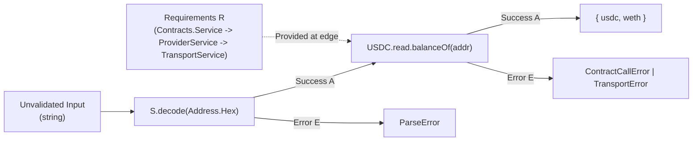

It is 02:14 UTC. Your treasury monitor pages you: *"USDC balance dropped to 0."* You open the dashboard, heart pounding, only to realize the treasury still holds $4.2M. Nothing moved on-chain. Your balance-check job hit an Infura 429 rate limit, fell into a catch-all `catch (e)` block, and quietly returned `0n` so the UI "wouldn't crash."

Sound familiar? Let's look at the code that caused the outage.

## Spot the Bug Before Scrolling

Read this treasury balance checker carefully. Count how many distinct failure modes are hidden behind a single `Promise<{ usdc: bigint; weth: bigint }>`:

```typescript
// treasury-broken.ts
import { createPublicClient, http } from 'viem'

const client = createPublicClient({
  transport: http(process.env.RPC_URL)
})

export async function getTreasurySnapshot(vaultInput: string) {
  try {
    const [usdc, weth] = await Promise.all([
      client.readContract({
        address: '0xA0b86991c6218b36c1d19D4a2e9Eb0cE3606eB48',
        abi: erc20Abi,
        functionName: 'balanceOf',
        args: [vaultInput as `0x${string}`]
      }),
      client.readContract({
        address: '0xC02aaA39b223FE8D0A0e5C4F27eAD9083C756Cc2',
        abi: erc20Abi,
        functionName: 'balanceOf',
        args: [vaultInput as `0x${string}`]
      })
    ])
    return { usdc, weth }
  } catch (e) {
    console.error('Snapshot failed:', e)
    return { usdc: 0n, weth: 0n }
  }
}
```

<Accordion title="Check your understanding: what are the 4 bugs hiding here?">
1. **Unvalidated cast (`vaultInput as \`0x${string}\``).** A typo or missing `0x` prefix slips past TypeScript and fails only after hitting the RPC node.
2. **Error erasure (`catch (e)` returns `0n`).** An invalid input, a 429 rate limit, a node timeout, and an ABI revert all collapse into `unknown` and trigger a false zero-balance alert.
3. **Hard-coded module singleton (`client`).** You cannot unit-test the retry or alert logic without monkey-patching `fetch` or spinning up a local node.
4. **Hidden retries and no timeout.** Transport retries happen implicitly with no bounded deadline, so a hung node can stall the cron worker indefinitely.
</Accordion>

## Mental Model: Three Channels Instead of One

A `Promise<A>` has one visible channel (`A`) and an untyped trapdoor (`unknown`). An `Effect<A, E, R>` splits every operation into three compiler-checked channels:



| Channel | Type Parameter | Meaning |
| --- | --- | --- |
| Success | `A` | Value produced when the computation succeeds |
| Failure | `E` | Exact tagged union of recoverable errors (`ParseError \| ContractCallError \| TransportError`) |
| Requirements | `R` | Services that must be provided before running (`Contracts.Service`, `ProviderService`) |

The compiler will refuse to call `Effect.runPromise` until `R` is `never` (every dependency provided), and `Effect.catchTag` lets you handle each failure class differently instead of guessing with `e.message.includes(...)`.

## Build the Typed Treasury Monitor

<Steps>
  <Step title="Define the Contract Registry once">
    Instead of repeating addresses and ABIs across call sites, declare both tokens in a single `makeContractRegistry`. When you include `address`, the registry creates typed `ContractInstance` entries ready to read.

    ```typescript
    // contracts.ts
    import { makeContractRegistry } from 'voltaire-effect'

    export const erc20Abi = [
      {
        type: 'function',
        name: 'balanceOf',
        stateMutability: 'view',
        inputs: [{ name: 'account', type: 'address' }],
        outputs: [{ name: 'balance', type: 'uint256' }]
      }
    ] as const

    export const TreasuryContracts = makeContractRegistry({
      USDC: {
        abi: erc20Abi,
        address: '0xA0b86991c6218b36c1d19D4a2e9Eb0cE3606eB48'
      },
      WETH: {
        abi: erc20Abi,
        address: '0xC02aaA39b223FE8D0A0e5C4F27eAD9083C756Cc2'
      }
    })
    ```

    `TreasuryContracts` exposes two values:
    - `TreasuryContracts.Service` — the tag your business logic yields.
    - `TreasuryContracts.layer` — a `Layer` that builds the instances once `ProviderService` is provided.
  </Step>

  <Step title="Validate at the boundary, read in parallel">
    Decode the raw string into a branded 20-byte `AddressType` with `S.decode(Address.Hex)`. Then fetch both balances concurrently using `Effect.all` with object notation.

    ```typescript
    // snapshot.ts
    import { Effect, Schedule } from 'effect'
    import * as S from 'effect/Schema'
    import * as Address from 'voltaire-effect/primitives/Address'
    import { withTimeout, withRetrySchedule } from 'voltaire-effect'
    import { TreasuryContracts } from './contracts'

    const retryPolicy = Schedule.exponential('250 millis').pipe(
      Schedule.jittered,
      Schedule.compose(Schedule.recurs(3))
    )

    export const getTreasurySnapshot = (vaultInput: string) =>
      Effect.gen(function* () {
        // 1. Validate once at the boundary -> ParseError if malformed
        const vault = yield* S.decode(Address.Hex)(vaultInput)

        // 2. Pull typed contract instances from the Effect context
        const { USDC, WETH } = yield* TreasuryContracts.Service

        // 3. Read both balances in parallel with explicit timeout + retry
        const { usdc, weth } = yield* Effect.all(
          {
            usdc: USDC.read.balanceOf(vault),
            weth: WETH.read.balanceOf(vault)
          },
          { concurrency: 'unbounded' }
        ).pipe(
          withTimeout('5 seconds'),
          withRetrySchedule(retryPolicy)
        )

        return { vault, usdc, weth }
      })
    ```

    Hover `getTreasurySnapshot` in your editor. Notice that you wrote zero manual return annotations, yet TypeScript inferred:
    - **Success:** `{ vault: AddressType; usdc: bigint; weth: bigint }`
    - **Errors:** `ParseError | ContractCallError | TransportError`
    - **Requirements:** `typeof TreasuryContracts.Service` (and `ProviderService`)

    **Checkpoint:** Try passing `vaultInput` directly to a function expecting `HashType` — TypeScript rejects it at compile time because `AddressType` is a branded `Uint8Array`.
  </Step>

  <Step title="Handle each error tag by its actual severity">
    Now separate **caller mistakes** (`ParseError`), **contract reverts** (`ContractCallError`), and **transient RPC outages** (`TransportError`). Never fabricate `0n` on a network failure.

    ```typescript
    // monitor.ts
    import { Effect } from 'effect'
    import { getTreasurySnapshot } from './snapshot'

    export type SnapshotOutcome =
      | { readonly status: 'ok'; readonly usdc: bigint; readonly weth: bigint }
      | { readonly status: 'invalid-address'; readonly reason: string }
      | { readonly status: 'rpc-unavailable'; readonly reason: string }
      | { readonly status: 'contract-error'; readonly reason: string }

    export const checkTreasury = (vaultInput: string) =>
      getTreasurySnapshot(vaultInput).pipe(
        Effect.map(({ usdc, weth }): SnapshotOutcome => ({
          status: 'ok',
          usdc,
          weth
        })),
        Effect.catchTags({
          ParseError: (err) =>
            Effect.succeed<SnapshotOutcome>({
              status: 'invalid-address',
              reason: err.message
            }),
          TransportError: (err) =>
            Effect.succeed<SnapshotOutcome>({
              status: 'rpc-unavailable',
              reason: err.message
            }),
          ContractCallError: (err) =>
            Effect.succeed<SnapshotOutcome>({
              status: 'contract-error',
              reason: err.message
            })
        })
      )
    ```

    Look at the resulting error channel of `checkTreasury`: it is now `never`. Every failure class was explicitly converted into a domain outcome. An RPC outage reports `rpc-unavailable` instead of paging on-call with a fake zero balance.
  </Step>

  <Step title="Wire the production Layer graph once at the edge">
    Layers form a dependency graph from transport up to contracts. Compose the entire graph once, then provide it in a single `Effect.provide(AppLayer)` call.

    ```mermaid
    flowchart BT
      T["HttpTransport(rpcUrl)"] --> P["Provider"]
      P --> C["TreasuryContracts.layer"]
      C --> App["checkTreasury(vaultInput)"]
    ```

    ```typescript
    // main.ts
    import { Effect, Layer } from 'effect'
    import { Provider, HttpTransport } from 'voltaire-effect'
    import { TreasuryContracts } from './contracts'
    import { checkTreasury } from './monitor'

    const ProviderLayer = Provider.pipe(
      Layer.provide(
        HttpTransport({
          url: process.env.RPC_URL ?? 'https://eth.llamarpc.com',
          timeout: '15 seconds'
        })
      )
    )

    const AppLayer = Layer.mergeAll(
      ProviderLayer,
      TreasuryContracts.layer.pipe(Layer.provide(ProviderLayer))
    )

    const outcome = await Effect.runPromise(
      checkTreasury('0xd8dA6BF26964aF9D7eEd9e03E53415D37aA96045').pipe(
        Effect.provide(AppLayer)
      )
    )

    console.log(outcome)
    // { status: 'ok', usdc: 1250000000n, weth: 4000000000000000000n }
    ```

    <Warning>
    Do not chain `Effect.provide(A)` followed by `Effect.provide(B)` on your program. Composing layers first with `Layer.provide` and `Layer.mergeAll` ensures `Provider` is built once and shared by every contract in the registry.
    </Warning>
  </Step>

  <Step title="Test success, bad input, and RPC outages with zero network">
    Because `checkTreasury` only asks for `TreasuryContracts.Service` and `ProviderService`, swapping `HttpTransport` for `TestTransport` tests the exact same code path deterministically in milliseconds.

    ```typescript
    // monitor.test.ts
    import { describe, it, expect } from 'vitest'
    import { Effect, Layer } from 'effect'
    import { Provider, TestTransport, TransportError } from 'voltaire-effect'
    import { TreasuryContracts } from './contracts'
    import { checkTreasury } from './monitor'

    const makeTestLayer = (transport: ReturnType<typeof TestTransport>) => {
      const providerLayer = Provider.pipe(Layer.provide(transport))
      return Layer.mergeAll(
        providerLayer,
        TreasuryContracts.layer.pipe(Layer.provide(providerLayer))
      )
    }

    const VALID_VAULT = '0xd8dA6BF26964aF9D7eEd9e03E53415D37aA96045'
    // ABI-encoded uint256(1000)
    const ONE_THOUSAND_HEX =
      '0x00000000000000000000000000000000000000000000000000000000000003e8'

    describe('checkTreasury', () => {
      it('returns ok balances when RPC responds', async () => {
        const layer = makeTestLayer(
          TestTransport({ eth_call: ONE_THOUSAND_HEX })
        )

        const result = await Effect.runPromise(
          checkTreasury(VALID_VAULT).pipe(Effect.provide(layer))
        )

        expect(result).toEqual({ status: 'ok', usdc: 1000n, weth: 1000n })
      })

      it('rejects malformed addresses without touching RPC', async () => {
        const layer = makeTestLayer(
          TestTransport({
            eth_call: new TransportError({ code: -32000, message: 'should not be called' })
          })
        )

        const result = await Effect.runPromise(
          checkTreasury('not-an-address').pipe(Effect.provide(layer))
        )

        expect(result.status).toBe('invalid-address')
      })

      it('reports rpc-unavailable instead of fake zero balances on 429', async () => {
        const layer = makeTestLayer(
          TestTransport({
            eth_call: new TransportError({ code: 429, message: 'Too Many Requests' })
          })
        )

        const result = await Effect.runPromise(
          checkTreasury(VALID_VAULT).pipe(Effect.provide(layer))
        )

        expect(result.status).toBe('rpc-unavailable')
      })
    })
    ```

    **Checkpoint:** Run `vitest run monitor.test.ts`. All three assertions pass offline with no mocks or module patching:
    ```text
    ✓ checkTreasury > returns ok balances when RPC responds
    ✓ checkTreasury > rejects malformed addresses without touching RPC
    ✓ checkTreasury > reports rpc-unavailable instead of fake zero balances on 429
    ```
  </Step>
</Steps>

<Accordion title="Check your understanding: why did test 2 pass even though eth_call was wired to fail?">
`S.decode(Address.Hex)('not-an-address')` runs before `USDC.read.balanceOf`. Because `yield*` short-circuits immediately on `ParseError`, execution jumps straight to `Effect.catchTags` without ever invoking the transport layer.
</Accordion>

## What You Built

- Validated external hex input once at the boundary into a branded 20-byte `AddressType`.
- Declared reusable typed contracts via `makeContractRegistry`.
- Separated `ParseError`, `ContractCallError`, and `TransportError` via `Effect.catchTags`, eliminating false zero-balance alerts.
- Wired `HttpTransport -> Provider -> TreasuryContracts.layer` once at the edge and swapped `HttpTransport` for `TestTransport` in unit tests without modifying a line of business logic.

## Next Tutorial

Your snapshot service is type-safe and testable. Next, build a long-running indexing pipeline that survives RPC range limits, rate limits, and chain reorganizations in [Building a Resilient Event Indexer](/tutorials/resilient-event-indexer).
