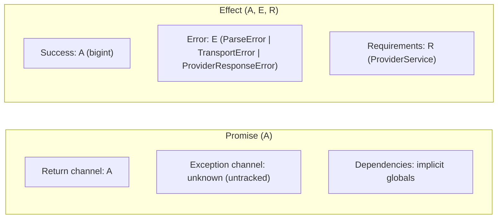

Standard Ethereum libraries represent every asynchronous call as `Promise<T>`. That signature hides every failure mode and every implicit dependency behind runtime exceptions and module-level globals.

## The Failure Channel Problem

Consider a typical balance lookup:

```typescript
// Declared type
function getBalance(address: string): Promise<bigint>

// Actual runtime failure modes (invisible to TypeScript):
// - InvalidAddressError
// - TransportError (timeout, DNS, HTTP 429)
// - JsonRpcError (-32000, -32603)
// - ProviderResponseError (malformed payload)
```

Callers are forced into string-matching inside `catch (e: unknown)`:

```typescript
try {
  const balance = await provider.getBalance(addr)
  return balance
} catch (e) {
  if (e instanceof Error && e.message.includes('rate limit')) {
    // retry with backoff?
  } else if (e instanceof Error && e.message.includes('timeout')) {
    // fail over to backup RPC?
  }
  throw e
}
```

When a function adds a new failure mode, TypeScript reports zero errors at call sites.

## Promise vs `Effect<A, E, R>`

`voltaire-effect` models every fallible or effectful operation with three explicit type parameters:



```typescript
import * as Effect from 'effect/Effect'
import * as S from 'effect/Schema'
import * as Address from 'voltaire-effect/primitives/Address'
import { getBalance } from 'voltaire-effect'

const program = Effect.gen(function* () {
  const addr = yield* S.decode(Address.Hex)(input)
  const balance = yield* getBalance(addr)
  return { addr, balance }
})
// Inferred type:
// Effect<{ addr: AddressType; balance: bigint }, ParseError | GetBalanceError, ProviderService>
```

The compiler tracks both what can fail (`ParseError | GetBalanceError`) and what must be provided (`ProviderService`).

## Four Concrete Gains

### 1. Exhaustive Error Dispatch

Every error carries a `_tag` literal. `Effect.catchTags` narrows each branch and shrinks the remaining error union:

```typescript
program.pipe(
  Effect.catchTags({
    ParseError: () => Effect.succeed(defaultResult),
    TransportError: () => retryWithBackoff(program),
    ProviderResponseError: () => program.pipe(Effect.provide(FallbackProviderLayer))
  })
)
```

### 2. Composable Retries, Timeouts, and Fallbacks

Resilience policies are ordinary Effect combinators, not hidden transport flags:

```typescript
import { Effect, Schedule, Duration } from 'effect'
import { getBlockNumber } from 'voltaire-effect'

const resilientBlockNumber = getBlockNumber().pipe(
  Effect.retry(Schedule.exponential('100 millis').pipe(Schedule.recurs(5))),
  Effect.timeout(Duration.seconds(10)),
  Effect.orElse(() =>
    getBlockNumber().pipe(Effect.provide(FallbackProviderLayer))
  )
)
```

### 3. Dependency Injection Without Mocking Frameworks

Functions declare service requirements in `R` instead of importing singleton clients. Production and test runs wire different layers into the same program:

```typescript
// Production
await Effect.runPromise(program.pipe(Effect.provide(MainnetLayer)))

// Unit test: zero network, deterministic responses
await Effect.runPromise(program.pipe(Effect.provide(TestLayer)))
```

### 4. Validate Once at the Boundary

Schemas decode untrusted input directly into Voltaire's branded `Uint8Array` types:

```typescript
import * as S from 'effect/Schema'
import * as Address from 'voltaire-effect/primitives/Address'
import * as Uint from 'voltaire-effect/primitives/Uint'

const TransferRequest = S.Struct({
  to: Address.Hex,
  value: Uint.Uint256
})

const req = S.decodeSync(TransferRequest)(userInput)
// req.to: AddressType (20-byte Uint8Array), req.value: Uint256Type
```

## Before and After

```typescript
// Imperative: untyped exceptions, implicit signer dependency
async function transfer(to: string, amount: string) {
  try {
    const addr = parseAddress(to)
    const value = parseBigInt(amount)
    const tx = await signer.sendTransaction({ to: addr, value })
    return await tx.wait()
  } catch (e) {
    console.error('Transfer failed:', e)
    throw e
  }
}

// voltaire-effect: tracked errors, explicit SignerService + ProviderService
const transfer = (to: string, amount: string) =>
  Effect.gen(function* () {
    const addr = yield* S.decode(Address.Hex)(to)
    const value = yield* S.decode(Uint.Uint256)(amount)
    const signer = yield* SignerService
    const hash = yield* signer.sendTransaction({ to: addr, value })
    return yield* waitForTransactionReceipt(hash)
  })
```

## Trade-Offs

| Cost | Benefit |
| --- | --- |
| ~15 KB gzipped Effect runtime overhead | Compiler-verified error handling via `_tag` unions |
| Learning curve for `Effect.gen`, `Layer`, and `Schedule` | Built-in retries, timeouts, concurrency, and cancellation |
| Extra boilerplate for one-off CLI scripts | Deterministic testing by swapping layers instead of patching modules |

Use [base Voltaire](https://voltaire.tevm.sh) for minimal scripts where throwing exceptions is acceptable. Use `voltaire-effect` for services, indexers, signers, and dApps where failure modes must be explicit.

## See Also

- [Effect Primer](/concepts/effect-primer) — Core Effect types and operators
- [Tutorial: Escaping try/catch Roulette](/tutorials/typed-errors-and-layers) — Hands-on walkthrough
- [Comparisons](/comparisons) — Side-by-side matrix against base Voltaire, viem, and ethers.js
- [Error Handling](/concepts/error-handling) — Complete error tag reference
