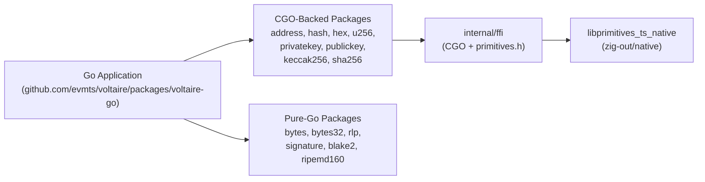

# voltaire-go

Go bindings for [Voltaire](https://github.com/evmts/voltaire/tree/main/packages/voltaire-go) Ethereum primitives and cryptography.

Module path (`go.mod`): `github.com/evmts/voltaire/packages/voltaire-go` (Go `1.22+`). Core primitives and Keccak/SHA-256 hashing call Voltaire's Zig-compiled native library (`libprimitives_ts_native`) through CGO (`internal/ffi`); RLP, Signatures, Bytes/Bytes32, BLAKE2b, and RIPEMD-160 are pure Go.

## CGO Architecture



## Requirements

- Go `1.22+` with `CGO_ENABLED=1` for CGO-backed packages
- Zig `0.15.1+` and the libwally-core submodule (`git submodule update --init packages/voltaire-zig/lib/libwally-core`) to build `libprimitives_ts_native`

## Building and Installing

Build the native library from the Voltaire repository root (`https://github.com/evmts/voltaire`):

```bash
# -> zig-out/native/libprimitives_ts_native.{dylib,so}
zig build build-ts-native -Dwith-c-api=true
```

Then build or test `packages/voltaire-go`. The Zig steps rebuild the native library and pass its path to CGO:

```bash
zig build build-go -Dwith-c-api=true   # go build ./...
zig build test-go -Dwith-c-api=true    # go test -v ./...

# Or, once the native library exists:
cd packages/voltaire-go
make test-quick  # runs go test with DYLD_LIBRARY_PATH/LD_LIBRARY_PATH set
```

Import packages via the module path declared in `go.mod`:

```go
import (
    "github.com/evmts/voltaire/packages/voltaire-go/primitives/address"
    "github.com/evmts/voltaire/packages/voltaire-go/crypto/keccak256"
)
```

## Quick Start

```go
package main

import (
    "fmt"
    "log"

    "github.com/evmts/voltaire/packages/voltaire-go/crypto/keccak256"
    "github.com/evmts/voltaire/packages/voltaire-go/primitives/address"
)

func main() {
    addr, err := address.FromHex("0xd8da6bf26964af9d7eed9e03e53415d37aa96045")
    if err != nil {
        log.Fatal(err)
    }
    fmt.Println("Checksum:", addr.ChecksumHex()) // 0xd8dA6BF26964aF9D7eEd9e03E53415D37aA96045

    digest := keccak256.HashString("hello")
    fmt.Println("Keccak256:", digest.Hex())
}
```

## Packages

| Package | Backend | Summary |
|---------|---------|---------|
| `primitives/address` | CGO | 20-byte `Address`, EIP-55 checksum, JSON/Text marshaling |
| `primitives/bytes` | Pure Go | Safe `Slice`, `Concat`, `PadLeft`/`PadRight`, `TrimLeft`/`TrimRight`, constant-time `Equal` |
| `primitives/bytes32` | Pure Go | Fixed `[32]byte` with hex/JSON/Text codecs, `Equal`, and `Compare` |
| `primitives/hash` | CGO | 32-byte `Hash` with constant-time equality and JSON/Text marshaling |
| `primitives/hex` | CGO | `Encode`, `Decode`, `MustDecode`, `HasPrefix`, `TrimPrefix`, `AddPrefix` |
| `primitives/privatekey` | CGO + `dcrd/secp256k1` | 32-byte secp256k1 private key, key generation, `Sign`, `SignMessage`, `Address` |
| `primitives/publickey` | CGO | 65-byte internal secp256k1 public key, compressed/uncompressed codecs, `Address` |
| `primitives/rlp` | Pure Go | Canonical RLP `Encode`, `EncodeUint64`, `EncodeBigInt`, `EncodeList`, `DecodeBytes`, `IsCanonical` |
| `primitives/signature` | Pure Go | 65-byte ECDSA `Signature`, EIP-2 `IsLowS`/`ToLowS`, `RecoveryID`/`YParity` |
| `primitives/u256` | CGO | 32-byte big-endian `U256`, `big.Int`/`uint64` conversion, JSON/Text marshaling |
| `crypto/keccak256` | CGO | `Hash`, `HashString`, `Sum` returning `hash.Hash` |
| `crypto/sha256` | CGO | `Hash`, `HashString`, `Sum`, `DoubleHash` |
| `crypto/blake2` | Pure Go (`x/crypto`) | BLAKE2b-256 and BLAKE2b-512 one-shot and `hash.Hash` |
| `crypto/ripemd160` | Pure Go (`x/crypto`) | RIPEMD-160 and Bitcoin `Hash160` (`RIPEMD160(SHA256(x))`) |

## Documentation

See [`docs/index.md`](docs/index.md) and module guides in `docs/primitives/` and `docs/crypto/`.

## License

MIT
