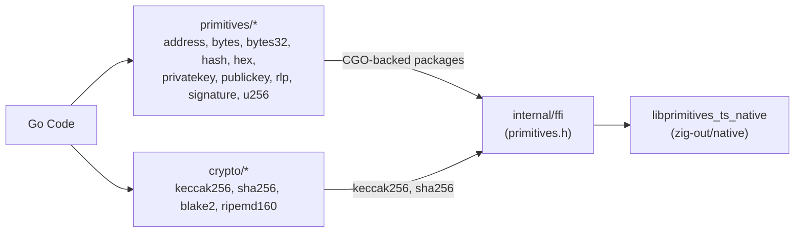

`voltaire-go` (`module github.com/voltaire-labs/voltaire-go`, Go `1.22+`) wraps Voltaire's Zig-compiled native library (`libprimitives_ts_native`) through CGO while implementing RLP, signatures, byte utilities, BLAKE2b, and RIPEMD-160 in pure Go.

## Architecture



## Setup

Build the native Zig library from the Voltaire repository root (`https://github.com/evmts/voltaire`):

```bash
zig build build-ts-native
```

Ensure `CGO_ENABLED=1` and that `zig-out/native` is on `DYLD_LIBRARY_PATH` (macOS) or `LD_LIBRARY_PATH` (Linux):

```bash
cd packages/voltaire-go
make test
```

## Quick Start

```go
package main

import (
    "fmt"
    "log"

    "github.com/voltaire-labs/voltaire-go/crypto/keccak256"
    "github.com/voltaire-labs/voltaire-go/primitives/address"
)

func main() {
    addr, err := address.FromHex("0xd8da6bf26964af9d7eed9e03e53415d37aa96045")
    if err != nil {
        log.Fatal(err)
    }

    fmt.Println(addr.ChecksumHex()) // 0xd8dA6BF26964aF9D7eEd9e03E53415D37aA96045

    digest := keccak256.Hash([]byte("hello world"))
    fmt.Println(digest.Hex())
}
```

## Module Map

- **Primitives**: [Address](primitives/address.md) · [Bytes](primitives/bytes.md) · [Bytes32](primitives/bytes32.md) · [PrivateKey](primitives/privatekey.md) · [PublicKey](primitives/publickey.md) · `primitives/hash` · `primitives/hex` · `primitives/rlp` · `primitives/signature` · `primitives/u256`
- **Cryptography**: [Keccak-256](crypto/keccak256.md) · [BLAKE2b](crypto/blake2.md) · [RIPEMD-160](crypto/ripemd160.md) · `crypto/sha256`
- **Dependencies** (`go.mod`): `github.com/decred/dcrd/dcrec/secp256k1/v4`, `golang.org/x/crypto`
