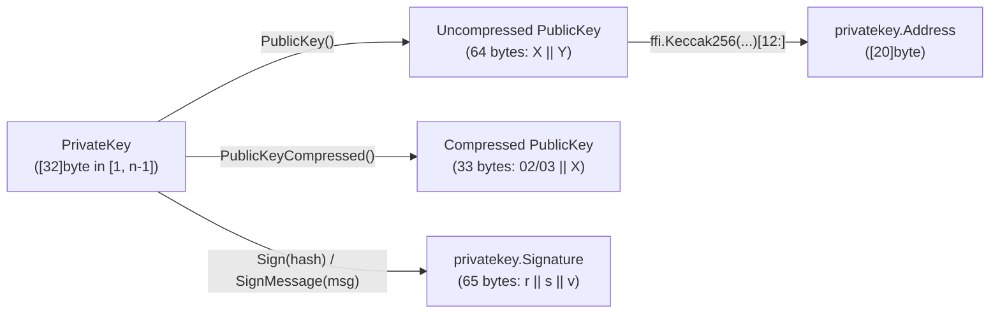

Package `github.com/evmts/voltaire/packages/voltaire-go/primitives/privatekey` defines `PrivateKey` (`[32]byte`), using `github.com/decred/dcrd/dcrec/secp256k1/v4` for secp256k1 point arithmetic/signing and Voltaire's CGO FFI (`internal/ffi`) for Keccak-256 address derivation and hex formatting.

## Derivation Pipeline



## Types and Constants

```go
const Size = 32

type PrivateKey [Size]byte
type Signature []byte   // 65 bytes (r || s || v)
type Address [20]byte   // 20-byte Ethereum address
```

## API Reference

| Symbol | Signature | Behavior |
|--------|-----------|----------|
| `Generate` | `() (PrivateKey, error)` | Generates a valid random key in `[1, n-1]` via `crypto/rand` |
| `FromHex` | `(s string) (PrivateKey, error)` | Parses 64 hex chars (optional `0x`) and validates range `[1, n-1]` |
| `FromBytes` | `(b []byte) (PrivateKey, error)` | Copies 32 bytes and validates range `[1, n-1]` |
| `MustFromHex` | `(s string) PrivateKey` | Calls `FromHex`, panics on error |
| `(PrivateKey).Hex` | `() string` | Lowercase `"0x"`-prefixed hex (sensitive secret material) |
| `(PrivateKey).Bytes` | `() []byte` | Returns 32-byte slice |
| `(PrivateKey).IsValid` | `() bool` | True iff scalar is in `[1, secp256k1_n - 1]` |
| `(PrivateKey).PublicKey` | `() []byte` | Derives 64-byte uncompressed `X \|\| Y` (no `0x04` prefix) |
| `(PrivateKey).PublicKeyCompressed` | `() []byte` | Derives 33-byte SEC1 compressed `02/03 \|\| X` |
| `(PrivateKey).Address` | `() Address` | Returns `keccak256(PublicKey())[12:]` as `privatekey.Address` |
| `(PrivateKey).Sign` | `(hash [32]byte) (Signature, error)` | Signs a 32-byte digest; returns 65-byte `r \|\| s \|\| v` |
| `(PrivateKey).SignMessage` | `(msg []byte) (Signature, error)` | Hashes `msg` with Keccak-256 and signs the digest |

## Example

```go
package main

import (
    "fmt"
    "log"

    "github.com/evmts/voltaire/packages/voltaire-go/crypto/keccak256"
    "github.com/evmts/voltaire/packages/voltaire-go/primitives/privatekey"
)

func main() {
    // Hardhat/Anvil test account #0 (never use in production)
    pk, err := privatekey.FromHex(
        "0xac0974bec39a17e36ba4a6b4d238ff944bacb478cbed5efcae784d7bf4f2ff80",
    )
    if err != nil {
        log.Fatal(err)
    }

    digest := keccak256.HashString("hello")
    sig, err := pk.Sign([32]byte(digest))
    if err != nil {
        log.Fatal(err)
    }

    fmt.Printf("Address: 0x%x\n", pk.Address())
    fmt.Printf("Sig len: %d bytes\n", len(sig))

    // Zero sensitive key bytes after use
    for i := range pk {
        pk[i] = 0
    }
}
```
