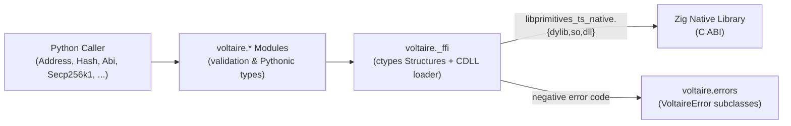

# voltaire-py

Python 3.10+ bindings for [Voltaire](https://github.com/evmts/voltaire/tree/main/packages/voltaire-py) Ethereum primitives and cryptography.

`voltaire` wraps Voltaire's Zig-compiled C shared library (`libprimitives_ts_native` / `libprimitives`) through Python's standard-library `ctypes` with zero third-party runtime dependencies (`dependencies = []`).

## ctypes FFI Architecture



Library search order in `voltaire._ffi`:
1. `VOLTAIRE_LIB_PATH` environment variable
2. `src/voltaire/lib/` inside the installed package
3. Repository build directories (`zig-out/native/`, `zig-out/lib/`, `packages/voltaire-zig/zig-out/lib/`)
4. System shared-library search paths

## Building and Installing

Build the native library from the Voltaire repository root (`https://github.com/evmts/voltaire`):

```bash
zig build build-ts-native
export VOLTAIRE_LIB_PATH="$PWD/zig-out/native/libprimitives_ts_native.dylib" # .so on Linux

cd packages/voltaire-py
pip install -e ".[dev]"
pytest
```

## Quick Start

```python
from voltaire import Address, Abi, Secp256k1, Signature, keccak256

# Parse and checksum an Ethereum address
addr = Address.from_hex("0x742d35Cc6634C0532925a3b844Bc9e7595f2bD20")
print(addr.to_checksum())

# Hash data with Keccak-256
digest = keccak256(b"hello world")
print(digest.to_hex())

# Encode ERC-20 transfer calldata
calldata = Abi.encode_function_data(
    "transfer(address,uint256)",
    [addr.to_checksum(), 10**18],
)

# Generate a keypair and derive its Ethereum address
privkey = Secp256k1.generate_private_key()
pubkey = Secp256k1.public_key_from_private(privkey)
derived = Address.from_bytes(keccak256(pubkey).to_bytes()[12:])
```

Note: `Secp256k1.recover_address` and `Secp256k1.recover_public_key` take raw 32-byte `bytes` for `message_hash` (pass `digest.to_bytes()`, not a `Hash` instance).

## Top-Level Exports (`from voltaire import ...`)

| Category | Exports |
|----------|---------|
| **Primitives** | `Address`, `Hash`, `Hex`, `hex_encode`, `hex_decode`, `Uint256`, `Rlp`, `rlp_encode`, `Abi` |
| **Transactions & EVM** | `Transaction`, `TransactionType`, `LegacyTransaction`, `EIP2930Transaction`, `EIP1559Transaction`, `EIP4844Transaction`, `EIP7702Transaction`, `decode_transaction`, `AccessList`, `AccessListEntry`, `Authorization`, `EventLog`, `LogFilter`, `filter_logs`, `sort_logs`, `Blob`, `Bytecode` |
| **Hashing** | `keccak256`, `sha256`, `eip191_hash_message`, `blake2b`, `ripemd160`, `solidity_keccak256`, `solidity_sha256` |
| **Cryptography** | `Secp256k1`, `Signature`, `SignatureComponents`, `SignatureUtils` |
| **Errors** | `VoltaireError`, `InvalidHexError`, `InvalidLengthError`, `InvalidChecksumError`, `InvalidSignatureError`, `InvalidInputError`, `InvalidAuthorizationError` (plus `OutOfMemoryError`, `InvalidSelectorError`, `UnsupportedTypeError`, `MaxLengthExceededError`, `InvalidAccessListError`, `InvalidValueError` in `voltaire.errors`) |

## Documentation

Full module reference: [`docs/index.md`](docs/index.md) · Website: [voltaire.tevm.sh](https://voltaire.tevm.sh) · Source: [evmts/voltaire](https://github.com/evmts/voltaire/tree/main/packages/voltaire-py).

## License

MIT
