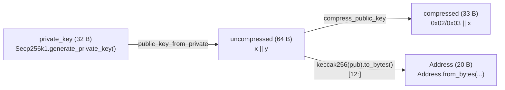

# Key Generation and Compression

Private key generation, public key derivation, SEC1 compression, and Ethereum address derivation via `Secp256k1`, `keccak256`, and `Address`.

## Key Derivation Flow



## Example

```python
from voltaire import Address, Secp256k1, keccak256

# 1. Generate CSPRNG private key in [1, SECP256K1_N - 1]
private_key = Secp256k1.generate_private_key()
assert len(private_key) == 32

# 2. Derive 64-byte uncompressed public key (x || y, no 0x04 prefix)
public_key = Secp256k1.public_key_from_private(private_key)
assert len(public_key) == 64

# 3. Compress to 33-byte SEC1 format (0x02 if y even, 0x03 if y odd)
compressed = Secp256k1.compress_public_key(public_key)
assert len(compressed) == 33 and compressed[0] in (0x02, 0x03)

# 4. Derive Ethereum address: last 20 bytes of keccak256(public_key)
addr = Address.from_bytes(keccak256(public_key).to_bytes()[12:])
print(addr.to_checksum())
```

## Methods

- `Secp256k1.generate_private_key() -> bytes`: Returns 32 bytes from OS CSPRNG guaranteed in `[1, N - 1]`.
- `Secp256k1.public_key_from_private(private_key: bytes) -> bytes`: Returns 64-byte `x || y`; raises `InvalidLengthError` if `len != 32` or `InvalidInputError` if out of range.
- `Secp256k1.compress_public_key(uncompressed: bytes) -> bytes`: Compresses 64-byte `x || y` to 33-byte `0x02/0x03 || x`; raises `InvalidLengthError` if `len != 64`.
