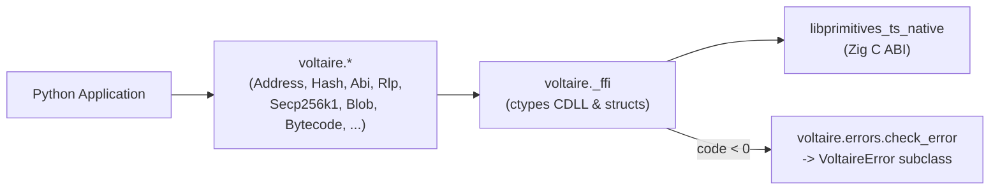

# voltaire-py Documentation

Python 3.10+ `ctypes` bindings for Voltaire's Zig/C Ethereum primitives and cryptography library (`libprimitives_ts_native`). Zero third-party runtime dependencies.

## FFI Architecture



## Installation from Source

```bash
# 1. Build the native library from the Voltaire repo root
zig build build-ts-native -Dwith-c-api=true

# 2. Point ctypes at the library (optional if built in-tree)
export VOLTAIRE_LIB_PATH="$PWD/zig-out/native/libprimitives_ts_native.dylib" # .so on Linux

# 3. Install in editable mode and run tests
cd packages/voltaire-py
pip install -e ".[dev]"
pytest
```

## Quick Start

```python
from voltaire import Address, keccak256, Secp256k1, Signature

addr = Address.from_hex("0x742d35Cc6634C0532925a3b844Bc9e7595f2bD20")
print(addr.to_checksum())

digest = keccak256(b"hello world")
print(digest.to_hex())

# Recover signer address (pass raw 32-byte digest.to_bytes())
sig = Signature(r=r_bytes, s=s_bytes, v=27)
signer = Secp256k1.recover_address(digest.to_bytes(), sig)
```

## Module Reference

### Primitives

| Module | Summary |
|--------|---------|
| [Address](primitives/address.md) | 20-byte Ethereum address, EIP-55 checksum, CREATE/CREATE2 |
| [Hash](primitives/hash.md) | `Hash`, `keccak256`, `sha256`, `blake2b`, `ripemd160`, `eip191_hash_message`, `solidity_*` |
| [Hex](primitives/hex.md) | `Hex.encode`, `Hex.decode`, `Hex.is_valid`, `hex_encode`, `hex_decode` |
| [Uint256](primitives/uint256.md) | Big-endian 256-bit unsigned integer with comparison and conversions |
| [RLP](primitives/rlp.md) | Recursive Length Prefix encoding (`Rlp`, `rlp_encode`) |
| [ABI](primitives/abi.md) | Selectors, parameter/calldata encoding & decoding, packed encoding, gas estimation |
| [Transaction](primitives/transaction.md) | Type detection, CREATE/CREATE2, typed transaction dataclasses |
| [AccessList](primitives/access_list.md) | EIP-2930 `AccessList` and `AccessListEntry` gas calculation |
| [Authorization](primitives/authorization.md) | EIP-7702 delegation tuple hashing, validation, signer recovery |
| [EventLog](primitives/eventlog.md) | `EventLog`, `LogFilter`, `filter_logs`, `sort_logs` |
| [Blob](primitives/blob.md) | EIP-4844 128 KiB blob encoding and blob fee market math |
| [Bytecode](primitives/bytecode.md) | EVM `JUMPDEST` analysis, boundary checks, `PUSH` validation |

### Cryptography

| Module | Summary |
|--------|---------|
| [Secp256k1](crypto/secp256k1.md) | `Signature`, public key/address recovery, key derivation, validation |
| [Keys](crypto/keys.md) | CSPRNG private key generation and SEC1 public key compression |
| [Signature](crypto/signature.md) | `SignatureComponents`, `SignatureUtils` (EIP-2 low-`s`, parse, serialize) |

## Error Hierarchy (`voltaire.errors`)

| C Code | Exception Class | Exported at top level |
|--------|-----------------|-----------------------|
| Base | `VoltaireError` | Yes |
| `-1` | `InvalidHexError` | Yes |
| `-2` | `InvalidLengthError` | Yes |
| `-3` | `InvalidChecksumError` | Yes |
| `-4` | `OutOfMemoryError` | `voltaire.errors` |
| `-5` | `InvalidInputError` | Yes |
| `-6` | `InvalidSignatureError` | Yes |
| `-7` | `InvalidSelectorError` | `voltaire.errors` |
| `-8` | `UnsupportedTypeError` | `voltaire.errors` |
| `-9` | `MaxLengthExceededError` | `voltaire.errors` |
| `-10` | `InvalidAccessListError` | `voltaire.errors` |
| `-11` | `InvalidAuthorizationError` | Yes |
| Python | `InvalidValueError` | `voltaire.errors` |

## Constants

Top-level constants re-exported from `voltaire`:
- **EIP-2930**: `ADDRESS_COST` (`2400`), `STORAGE_KEY_COST` (`1900`), `COLD_ACCOUNT_ACCESS_COST` (`2600`), `COLD_STORAGE_ACCESS_COST` (`2100`), `WARM_STORAGE_ACCESS_COST` (`100`)
- **EIP-4844**: `BLOB_SIZE` (`131072`), `FIELD_ELEMENTS_PER_BLOB` (`4096`), `BYTES_PER_FIELD_ELEMENT` (`32`), `MAX_DATA_PER_BLOB` (`126972`), `GAS_PER_BLOB` (`131072`), `TARGET_BLOBS_PER_BLOCK` (`3`)
- **EIP-7702**: `MAGIC_BYTE` (`0x05`), `PER_AUTH_BASE_COST` (`12500`), `PER_EMPTY_ACCOUNT_COST` (`25000`), `SECP256K1_N`, `SECP256K1_HALF_N`

## Links

- Source: [github.com/evmts/voltaire](https://github.com/evmts/voltaire/tree/main/packages/voltaire-py)
- Docs site: [voltaire.tevm.sh](https://voltaire.tevm.sh)
