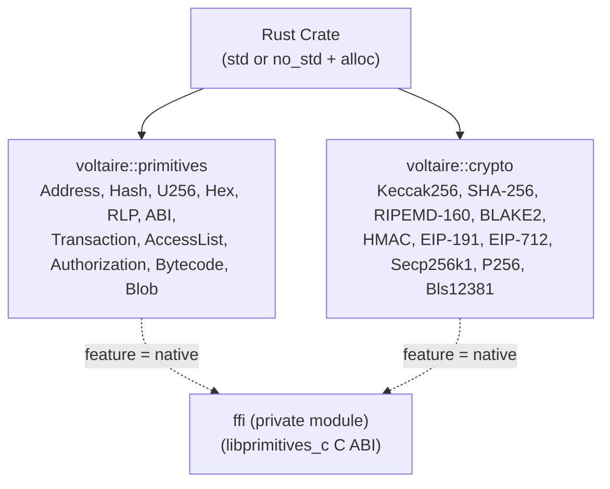

# voltaire-rs

Rust bindings for [Voltaire](https://github.com/evmts/voltaire) Ethereum primitives and cryptography.

`voltaire` provides stack-allocated, zero-copy newtypes (`Address([u8; 20])`, `Hash([u8; 32])`, `U256([u8; 32])`), pure-Rust hashing and serialization (`Keccak256`, `SHA-256`, `RIPEMD-160`, `BLAKE2`, `HMAC`, `P256`, `RLP`, `ABI`, `EIP-712`, `Transaction`, `Bytecode`, `Blob`), and an optional `native` feature that links against Voltaire's Zig C FFI library (`libprimitives_c`) for secp256k1 recovery and hardware-accelerated primitives.

## Architecture



## Installation

Add `voltaire` to `Cargo.toml` (MSRV: Rust `1.70`, edition `2021`):

```toml
[dependencies]
voltaire = "0.1"

# Optional: link native Zig libprimitives_c for secp256k1 recovery and FFI acceleration
# voltaire = { version = "0.1", features = ["native"] }

# Optional: no_std (requires alloc)
# voltaire = { version = "0.1", default-features = false }
```

## Feature Flags

| Feature | Default | Effect |
|---------|---------|--------|
| `std` | Yes | Enables standard library integration (`std::error::Error`, `P256::generate_keypair`, etc.); omit for `no_std` + `alloc` |
| `getrandom` | Yes | Enables OS randomness for `Hex::random` |
| `native` | No | Links the shared `libprimitives_c` via C FFI; required for `Secp256k1::recover_pubkey`, `Secp256k1::recover_address`, `Secp256k1::pubkey_from_private`, and `Address::create_address` |

The `native` feature needs the shared library. Build it from the repository root. `build.rs` reads `VOLTAIRE_LIB_DIR` (default `../../zig-out/lib` relative to this crate) and embeds it as an rpath:

```bash
zig build -Dwith-c-api=true
VOLTAIRE_LIB_DIR="$PWD/zig-out/lib" cargo test --manifest-path packages/voltaire-rs/Cargo.toml --features native
```

## Quick Start

```rust
use voltaire::prelude::*;

fn main() -> Result<()> {
    // Parse and checksum a 20-byte Ethereum address
    let addr: Address = "0xd8dA6BF26964aF9D7eEd9e03E53415D37aA96045".parse()?;
    assert!(!addr.is_zero());
    assert_eq!(addr.to_checksum(), "0xd8dA6BF26964aF9D7eEd9e03E53415D37aA96045");

    // One-shot and streaming Keccak-256
    let digest = keccak256(b"hello");
    println!("Keccak-256: {}", digest);

    // Big-endian 256-bit unsigned integer with checked arithmetic
    let one_eth = U256::from(1_000_000_000_000_000_000u64);
    let two_eth = one_eth.checked_add(one_eth).expect("no overflow");
    println!("2 ETH in hex: {}", two_eth);

    // Hex utilities
    let bytes = Hex::decode("0xdeadbeef")?;
    assert_eq!(Hex::encode(&bytes), "0xdeadbeef");

    Ok(())
}
```

## Crate Layout

Top-level re-exports: `Error`, `Result`, `Address`, `Hash`, `U256`, `Hex`, `abi`, `rlp`, `keccak256`, and `prelude`.

- `voltaire::primitives`: `Address`, `Hash`, `U256`, `Hex`, `AccessList`, `AccessListEntry`, `Authorization`, `SignedAuthorization`, `AuthorizationList`, `Transaction`, `TransactionType`, `LegacyTransaction`, `Eip2930Transaction`, `Eip1559Transaction`, `Eip4844Transaction`, `Eip7702Transaction`, plus submodules `abi`, `rlp`, `bytecode`, `blob`.
- `voltaire::crypto`: `keccak256`, `Keccak256`, `sha256`, `ripemd160`, `blake2b`, `blake2s`, `Blake2b`, `Blake2s`, `hmac_sha256`, `hmac_sha512`, `HmacSha256`, `HmacSha512`, `hash_message` (EIP-191), `Secp256k1`, `Signature`, `RecoveryId`, `CompactSignature`, `RsvSignature`, `P256`, `Bls12381`, and submodules `eip712`, `bls12_381`.
- `voltaire::error`: `#[non_exhaustive] pub enum Error` and `pub type Result<T> = core::result::Result<T, Error>`.

## Documentation

- [Primitives](docs/primitives.md) — `Address`, `Hash`, `U256`, `Hex`, `bytecode`, `blob`
- [ABI Encoding/Decoding](docs/abi.md) — selectors, event topics, parameter & calldata codecs
- [RLP](docs/rlp.md) — canonical RLP encoding, decoding, and streaming
- [Transactions](docs/transaction.md) — Legacy, EIP-2930, EIP-1559, EIP-4844, EIP-7702
- [Access Lists](docs/access-list.md) — EIP-2930 entries and gas costs
- [Authorizations](docs/authorization.md) — EIP-7702 code delegation tuples
- [Cryptography](docs/crypto.md) — Keccak-256, SHA-256, RIPEMD-160, EIP-191, secp256k1, P-256, BLS12-381
- [Signatures](docs/signatures.md) — `Signature`, `CompactSignature`, `RsvSignature`, EIP-2 normalization
- [EIP-712](docs/eip712.md) — typed structured data hashing
- [BLAKE2](docs/blake2.md) — BLAKE2b and BLAKE2s one-shot and streaming
- [HMAC](docs/hmac.md) — HMAC-SHA256 and HMAC-SHA512

Source repository: `https://github.com/evmts/voltaire/tree/main/packages/voltaire-rs`.

## License

MIT OR Apache-2.0
