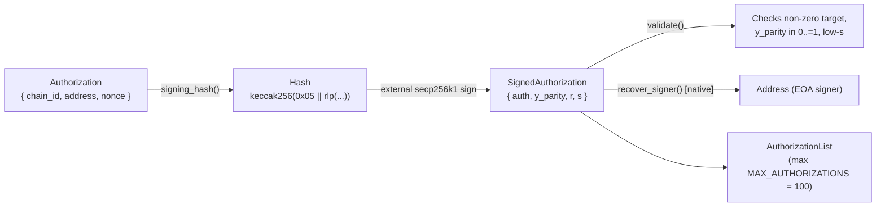

# Authorization (EIP-7702)

EIP-7702 EOA code delegation types (`Authorization`, `SignedAuthorization`, `AuthorizationList`) in `voltaire::primitives`.

## Lifecycle



## `Authorization`

Unsigned delegation tuple. `chain_id == 0` authorizes delegation on any chain.

```rust
use voltaire::primitives::{Authorization, Address};

let delegate: Address = "0xd8dA6BF26964aF9D7eEd9e03E53415D37aA96045".parse()?;

let mainnet_only = Authorization::for_chain(1, delegate, 0);
assert!(mainnet_only.is_chain_specific());
assert!(mainnet_only.is_valid_for_chain(1));
assert!(!mainnet_only.is_valid_for_chain(10));

let cross_chain = Authorization::for_any_chain(delegate, 0);
assert!(!cross_chain.is_chain_specific());
assert!(cross_chain.is_valid_for_chain(42161));

mainnet_only.validate()?; // rejects zero address
let digest = mainnet_only.signing_hash();
let _ = digest;
# Ok::<(), voltaire::Error>(())
```

## `SignedAuthorization`

Binds an `Authorization` to `(y_parity, r, s)`:

```rust
use voltaire::primitives::{Authorization, SignedAuthorization, Address};

let delegate: Address = "0xd8dA6BF26964aF9D7eEd9e03E53415D37aA96045".parse()?;
let auth = Authorization::new(1, delegate, 0);

let signed = SignedAuthorization::new(auth, 0, [1u8; 32], [1u8; 32]);
signed.validate()?; // checks non-zero target, y_parity <= 1, non-zero r/s, low-s (EIP-2)

assert_eq!(signed.chain_id(), 1);
assert_eq!(signed.recovery_id(), 0);
assert_eq!(signed.v(), 27);
let raw_sig: [u8; 65] = signed.signature_bytes(); // r || s || y_parity
let from_sig = SignedAuthorization::from_parts(auth, &raw_sig);
assert_eq!(from_sig, signed);

// Signer recovery requires the `native` feature
#[cfg(feature = "native")]
{
    let signer = signed.recover_signer()?;
    assert!(signed.verify_signer(&signer)?);
}
# Ok::<(), voltaire::Error>(())
```

## `AuthorizationList`

Collection of `SignedAuthorization` items bounded by `MAX_AUTHORIZATIONS` (`100`). Gas cost is computed at `25_000` gas per authorization (`PER_EMPTY_ACCOUNT_COST`).

```rust
use voltaire::primitives::{Authorization, SignedAuthorization, AuthorizationList, Address};

let delegate: Address = "0xd8dA6BF26964aF9D7eEd9e03E53415D37aA96045".parse()?;
let signed = SignedAuthorization::new(Authorization::new(1, delegate, 0), 0, [1u8; 32], [1u8; 32]);

let mut list = AuthorizationList::empty();
list.push(signed);
list.validate()?;

assert!(list.targets_address(&delegate));
assert_eq!(list.filter_for_chain(1).count(), 1);
assert_eq!(list.gas_cost(), 25_000);
# Ok::<(), voltaire::Error>(())
```
