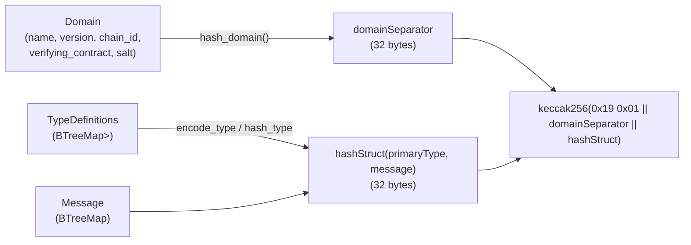

# EIP-712 Typed Structured Data

Pure-Rust implementation of [EIP-712](https://eips.ethereum.org/EIPS/eip-712) domain separation, recursive type encoding, struct hashing, and signing digest computation in `voltaire::crypto::eip712`.

## Digest Structure



## Quick Start

```rust
use voltaire::crypto::eip712::{Domain, TypedData, TypeProperty};
use voltaire::Address;

let contract: Address = "0xA0b86991c6218b36c1d19D4a2e9Eb0cE3606eB48".parse()?;
let domain = Domain::new()
    .name("USD Coin")
    .version("2")
    .chain_id(1)
    .verifying_contract(contract);

let types = vec![(
    "Permit".to_string(),
    vec![
        TypeProperty::new("owner", "address"),
        TypeProperty::new("spender", "address"),
        TypeProperty::new("value", "uint256"),
        TypeProperty::new("nonce", "uint256"),
        TypeProperty::new("deadline", "uint256"),
    ],
)];

let owner: Address = "0xd8dA6BF26964aF9D7eEd9e03E53415D37aA96045".parse()?;
let spender: Address = "0x0000000000000000000000000000000000000001".parse()?;

let permit = TypedData::new(domain, types, "Permit")
    .with_address("owner", owner)
    .with_address("spender", spender)
    .with_uint("value", 1_000_000)
    .with_uint("nonce", 0)
    .with_uint("deadline", 1_900_000_000);

permit.validate()?;
let digest = permit.hash();
let _ = digest;
# Ok::<(), voltaire::Error>(())
```

## Core Types and Builders

### `Domain`

All fields are optional; omitted fields are excluded from the synthesized `EIP712Domain` type string per EIP-712:

- `Domain::new()`
- `.name(impl Into<String>)`
- `.version(impl Into<String>)`
- `.chain_id(u64)`
- `.verifying_contract(Address)`
- `.salt(Hash)`
- `.hash(&self) -> Hash`

### `TypedData`

Fluent message builders:

- `.with_string(name, impl Into<String>)`
- `.with_uint(name, u128)` / `.with_uint256(name, [u8; 32])`
- `.with_bool(name, bool)`
- `.with_address(name, Address)`
- `.with_hash(name, Hash)`
- `.with_bytes(name, Vec<u8>)`
- `.with_struct(name, BTreeMap<String, MessageValue>)`
- `.with_array(name, Vec<MessageValue>)`
- `.with_value(name, MessageValue)`
- `.validate(&self) -> Result<()>` — verifies `primary_type` exists in `types` and every declared field is present in `message`.
- `.hash(&self) -> Hash` — computes `keccak256("\x19\x01" || hash_domain(&domain) || hash_struct(...))`.

## Low-Level Functions

| Function | Signature | Description |
|----------|-----------|-------------|
| `encode_type` | `(&str, &TypeDefinitions) -> Result<String>` | Encodes primary type followed by referenced struct types sorted alphabetically |
| `hash_type` | `(&str, &TypeDefinitions) -> Result<Hash>` | `keccak256(encode_type(...))` |
| `hash_struct` | `(&str, &BTreeMap<String, MessageValue>, &TypeDefinitions) -> Result<Hash>` | `keccak256(typeHash \|\| encodeData(s))` |
| `encode_value` | `(&str, &MessageValue, &TypeDefinitions) -> Result<[u8; 32]>` | Encodes a single typed field to its 32-byte EIP-712 word |
| `hash_domain` | `(&Domain) -> Hash` | Computes the `EIP712Domain` struct hash |
| `sign_typed_data` | `(&TypedData) -> Hash` | Equivalent to `typed_data.hash()` |

Supported Solidity types: `string`, `bytes`, `bytes1`..`bytes32`, `address`, `bool`, `uint8`..`uint256`, `int8`..`int256`, fixed/dynamic arrays (`T[N]`, `T[]`), and nested custom structs.
