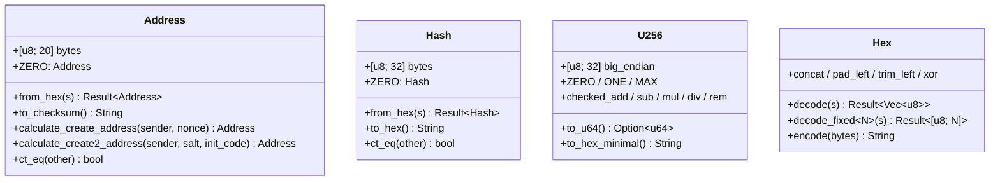

# Primitives

Core Ethereum value types in `voltaire::primitives`. Fixed-size types (`Address`, `Hash`, `U256`) are `Copy` stack-allocated byte-array newtypes implementing `Deref<Target = [u8; N]>`, `Display`, `FromStr`, `From`/`TryFrom`, and constant-time comparison where security-sensitive.

## Type Layout



## `Address`

A 20-byte Ethereum account address (`pub struct Address([u8; 20])`). Constants: `Address::ZERO`, `Address::LEN` (`20`), and module-level `ZERO_ADDRESS`.

```rust
use voltaire::primitives::{Address, sort_addresses, deduplicate_addresses};

// Parse (accepts optional 0x prefix, case-insensitive)
let addr: Address = "0xd8dA6BF26964aF9D7eEd9e03E53415D37aA96045".parse()?;
let from_slice = Address::from_slice(&[0u8; 20])?;
let zero = Address::new([0u8; 20]);

// Formatting & EIP-55 checksum
assert_eq!(addr.to_checksum(), "0xd8dA6BF26964aF9D7eEd9e03E53415D37aA96045");
assert!(Address::is_valid_checksum(&addr.to_checksum()));
let short = addr.to_short_hex(6, 4); // "0xd8dA...6045"

// Constant-time comparison & ABI 32-byte word conversion
assert!(!addr.is_zero());
assert!(!addr.ct_eq(&zero));
let abi_word: [u8; 32] = addr.to_abi_encoded();
assert_eq!(Address::from_abi_encoded(&abi_word)?, addr);

// Pure-Rust CREATE & CREATE2 derivation (no native feature needed)
let created = Address::calculate_create_address(&addr, 0);
let salt = [0u8; 32];
let created2 = Address::calculate_create2_address(&addr, &salt, &[0x60, 0x00]);
// Or with a precomputed init_code_hash:
let init_code_hash = voltaire::crypto::keccak256(&[0x60, 0x00]);
let created2_hash = Address::create2_address(&addr, &salt, init_code_hash.as_bytes());

// Derive from 64-byte uncompressed secp256k1 public key
let pubkey = [0u8; 64];
let derived = Address::from_public_key(&pubkey)?;

// Sort & deduplicate
let mut addrs = vec![addr, created, addr];
sort_addresses(&mut addrs);
let unique = deduplicate_addresses(addrs);
# Ok::<(), voltaire::Error>(())
```

`Address::create_address(&sender, nonce)` and `Address::from_private_key(&privkey)` require the `native` feature (the former calls Zig FFI directly; use `calculate_create_address` for pure Rust).

## `Hash`

A 32-byte digest (`pub struct Hash([u8; 32])`) used for Keccak-256 outputs, block hashes, transaction hashes, and storage keys. Constants: `Hash::ZERO`, `Hash::LEN` (`32`), `ZERO_HASH`.

```rust
use voltaire::Hash;

let zero = Hash::ZERO;
let h = Hash::from_hex("0x1c8aff950685c2ed4bc3174f3472287b56d9517b9c948127319a09a7a36deac8")?;
let from_slice = Hash::from_slice(h.as_bytes())?;

assert!(!h.is_zero());
assert!(h.ct_eq(&from_slice)); // constant-time comparison
assert_eq!(h.to_hex().len(), 66);
# Ok::<(), voltaire::Error>(())
```

## `U256`

A 256-bit unsigned integer stored in big-endian byte order (`pub struct U256([u8; 32])`). Constants: `U256::ZERO`, `U256::ONE`, `U256::MAX`, `U256::LEN` (`32`).

```rust
use voltaire::U256;

let a = U256::from(1000u64);
let b: U256 = "0x3e8".parse()?;
assert_eq!(a, b);

// Checked, saturating, and wrapping arithmetic
let sum = a.checked_add(b).expect("no overflow");
let diff = sum.checked_sub(a).expect("no underflow");
let prod = a.saturating_mul(U256::from(2u64));
let wrapped = U256::MAX.wrapping_add(U256::ONE);
assert_eq!(wrapped, U256::ZERO);

// Bitwise operations and shifts
let shifted = U256::ONE.shl(8);
assert_eq!(shifted.to_u64(), Some(256));
assert_eq!(shifted.leading_zeros(), 247);

// Byte order and hex formatting
let le: [u8; 32] = a.to_le_bytes();
assert_eq!(U256::from_le_bytes(le), a);
assert_eq!(a.to_hex_minimal(), "0x3e8");
assert_eq!(a.to_hex().len(), 66);
# Ok::<(), voltaire::Error>(())
```

## `Hex`

Zero-state namespace (`pub struct Hex`) for hexadecimal encoding, decoding, and byte manipulation.

| Method | Signature | Behavior |
|--------|-----------|----------|
| `Hex::decode` | `(&str) -> Result<Vec<u8>>` | Decodes hex with optional `0x` prefix |
| `Hex::decode_fixed` | `<const N: usize>(&str) -> Result<[u8; N]>` | Decodes into fixed-size array; errors on wrong length |
| `Hex::encode` | `(&[u8]) -> String` | Lowercase hex with `0x` prefix |
| `Hex::encode_raw` | `(&[u8]) -> String` | Lowercase hex without prefix |
| `Hex::is_valid` | `(&str) -> bool` | Checks valid even-length hex |
| `Hex::concat` / `concat_hex` | `(&[&[u8]]) -> Vec<u8>` / `(&[&str]) -> Result<Vec<u8>>` | Concatenates byte slices or hex strings |
| `Hex::pad_left` / `pad_right` | `(&[u8], usize) -> Vec<u8>` | Zero-pads to `target_len` |
| `Hex::trim_left` / `trim_right` | `(&[u8]) -> Vec<u8>` | Strips leading/trailing `0x00` bytes |
| `Hex::xor` | `(&[u8], &[u8]) -> Result<Vec<u8>>` | Equal-length bitwise XOR |
| `Hex::from_utf8` / `to_utf8` | `(&str) -> Vec<u8>` / `(&[u8]) -> Result<String>` | UTF-8 conversion |
| `Hex::random` | `(usize) -> Vec<u8>` | Cryptographic random bytes (requires `getrandom` feature) |

## Bytecode (`voltaire::primitives::bytecode`)

`Bytecode` precomputes valid `JUMPDEST` (`0x5b`) offsets while skipping `PUSH1`–`PUSH32` immediate payloads.

```rust
use voltaire::primitives::bytecode::{Bytecode, analyze_jumpdests, validate};

let code = vec![0x60, 0x5b, 0x5b, 0x00]; // PUSH1 0x5b, JUMPDEST, STOP
validate(&code)?;

let bc = Bytecode::new(code);
assert!(bc.is_push_data(1));
assert!(!bc.is_valid_jumpdest(1));
assert!(bc.is_valid_jumpdest(2));
assert_eq!(bc.jumpdests(), &[2]);
assert_eq!(analyze_jumpdests(bc.as_bytes()), vec![2]);
# Ok::<(), voltaire::Error>(())
```

## Blobs (`voltaire::primitives::blob`)

EIP-4844 blob encoding (`Blob = [u8; 131072]`, `BlobHash = [u8; 32]`) and blob fee market math:

- `blob_from_data(&[u8]) -> Result<Blob>` / `blob_to_data(&Blob) -> Result<Vec<u8>>`
- `is_valid_blob(&Blob) -> bool`
- `blob_to_versioned_hash(&Blob) -> BlobHash` / `validate_versioned_hash(&BlobHash) -> bool`
- `calculate_blob_gas(u32) -> u64`, `estimate_blob_count(usize) -> u32`
- `calculate_blob_gas_price(u64) -> u64`, `calculate_excess_blob_gas(u64, u64) -> u64`, `fake_exponential(u64, u64, u64) -> u64`
