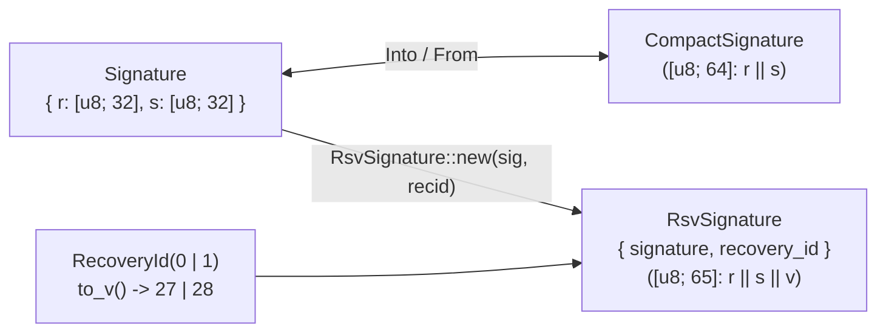

# Signatures

ECDSA secp256k1 signature representations, EIP-2 low-`s` normalization, and public-key recovery in `voltaire::crypto`.

## Signature Representations



| Type | Size | Fields / Layout | Recovery ID |
|------|------|-----------------|-------------|
| `Signature` | 64 bytes | `pub r: [u8; 32]`, `pub s: [u8; 32]` | External (`RecoveryId`) |
| `CompactSignature` | 64 bytes | `pub [u8; 64]` (`r \|\| s`) | External |
| `RsvSignature` | 65 bytes | `pub signature: Signature`, `pub recovery_id: RecoveryId` (`r \|\| s \|\| v`) | Embedded (`v` = `27` or `28`) |
| `RecoveryId` | 1 byte | `pub u8` (`0` or `1`) | `from_v(0\|1\|27\|28)`, `to_v() -> 27\|28` |

## Constructing and Converting Signatures

```rust
use voltaire::crypto::{Signature, CompactSignature, RsvSignature, RecoveryId};

let r = [0x11u8; 32];
let s = [0x22u8; 32];

// Signature <-> CompactSignature (64 bytes)
let sig = Signature::new(r, s);
let compact: CompactSignature = sig.into();
assert_eq!(compact.r(), &r);
assert_eq!(compact.s(), &s);
let back: Signature = compact.into();
assert_eq!(back, sig);

// RsvSignature (65 bytes, fallible v validation)
let rsv = RsvSignature::from_rsv(r, s, 27)?;
assert_eq!(rsv.v(), 27);
let raw_65: [u8; 65] = rsv.into();
let parsed = RsvSignature::try_from(raw_65)?;
assert_eq!(parsed, rsv);
# Ok::<(), voltaire::Error>(())
```

`Signature::from_bytes_with_recovery(&[u8; 65]) -> (Signature, RecoveryId)` defaults an unrecognized `v` byte to `RecoveryId(0)`; use `RsvSignature::from_bytes(&[u8; 65]) -> Result<RsvSignature>` when strict validation of `v` is required.

## EIP-2 Normalization and Canonical Checks

Ethereum (EIP-2) rejects malleable signatures with `s > secp256k1_n / 2`.

```rust
use voltaire::crypto::{Signature, RsvSignature};

let mut sig = Signature::new(r, s);
if !sig.is_normalized() {
    let changed: bool = sig.normalize(); // sets s = N - s
    let _ = changed;
}
assert!(sig.is_canonical()); // 1 <= r < N and 1 <= s <= N/2

// RsvSignature::normalize() also flips recovery_id (0 <-> 1, so v flips 27 <-> 28)
let mut rsv = RsvSignature::from_rsv(r, s, 27)?;
rsv.normalize();
assert!(rsv.is_canonical());
# Ok::<(), voltaire::Error>(())
```

## Public Key and Address Recovery (`native` feature)

```rust
use voltaire::crypto::{Secp256k1, Signature, RecoveryId};

#[cfg(feature = "native")]
{
    let sig = Signature::new(r, s);
    let recid = RecoveryId::from_v(27)?;
    let pubkey: [u8; 64] = Secp256k1::recover_pubkey(&msg_hash, &sig, recid)?;
    let addr = Secp256k1::recover_address(&msg_hash, &sig, recid)?;
    let _ = (pubkey, addr);
}
# Ok::<(), voltaire::Error>(())
```
