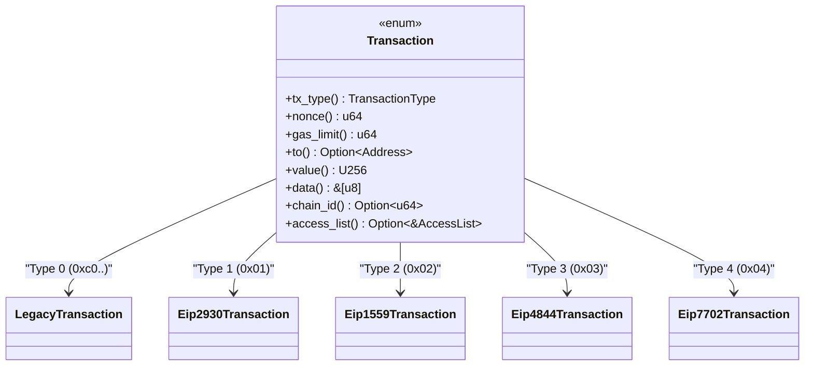

# Transactions

Ethereum transaction envelope detection, type-specific structs (Legacy, EIP-2930, EIP-1559, EIP-4844, EIP-7702), RLP serialization, signing hashes, and the unified `Transaction` enum in `voltaire::primitives`.

## Transaction Hierarchy



## `TransactionType`

`TransactionType` (`#[repr(u8)]`) classifies raw EIP-2718 bytes by their leading byte.

| Variant | Byte | `is_typed()` | `supports_access_list()` | `is_eip1559()` |
|---------|------|--------------|--------------------------|----------------|
| `Legacy` | `0x00` (`type_byte() -> None`) | `false` | `false` | `false` |
| `Eip2930` | `0x01` (`Some(0x01)`) | `true` | `true` | `false` |
| `Eip1559` | `0x02` (`Some(0x02)`) | `true` | `true` | `true` |
| `Eip4844` | `0x03` (`Some(0x03)`) | `true` | `true` | `true` |
| `Eip7702` | `0x04` (`Some(0x04)`) | `true` | `true` | `true` |

```rust
use voltaire::primitives::TransactionType;

let ty = TransactionType::detect(&[0x02, 0xc0]);
assert_eq!(ty, TransactionType::Eip1559);
assert!(ty.is_typed());
assert!(ty.is_eip1559());
assert_eq!(TransactionType::try_from(0x04)?, TransactionType::Eip7702);
# Ok::<(), voltaire::Error>(())
```

## Struct Variants

### `LegacyTransaction` (Type 0)

Fixed `gas_price` and EIP-155 replay-protected `v`.

```rust
use voltaire::primitives::LegacyTransaction;
use voltaire::{Address, U256};

let recipient: Address = "0xd8dA6BF26964aF9D7eEd9e03E53415D37aA96045".parse()?;
let tx = LegacyTransaction {
    nonce: 42,
    gas_price: U256::from(20_000_000_000u64),
    gas_limit: 21_000,
    to: Some(recipient),
    value: U256::from(1_000_000_000_000_000_000u128),
    data: vec![],
    v: 37, // EIP-155 mainnet (chain_id * 2 + 35 + y_parity)
    r: [0u8; 32],
    s: [0u8; 32],
};

assert_eq!(tx.chain_id(), Some(1));
assert_eq!(tx.y_parity(), 0);
let signing_digest = tx.signing_hash(1);
let raw_rlp = tx.serialize();
let tx_hash = tx.hash();
let _ = (signing_digest, raw_rlp, tx_hash);
# Ok::<(), voltaire::Error>(())
```

### `Eip2930Transaction` (Type 1)

Adds `chain_id`, `access_list`, and `y_parity`. Implements `serialize`, `serialize_for_signing`, `hash`, `signing_hash`, `get_sender`, `verify_signature`, `has_access_list`.

### `Eip1559Transaction` (Type 2)

Dynamic fee market with `max_priority_fee_per_gas` and `max_fee_per_gas`.

```rust
use voltaire::primitives::{Eip1559Transaction, AccessList};
use voltaire::{Address, U256};

let recipient: Address = "0xd8dA6BF26964aF9D7eEd9e03E53415D37aA96045".parse()?;
let tx = Eip1559Transaction {
    chain_id: 1,
    nonce: 42,
    max_priority_fee_per_gas: U256::from(2_000_000_000u64),
    max_fee_per_gas: U256::from(50_000_000_000u64),
    gas_limit: 21_000,
    to: Some(recipient),
    value: U256::ZERO,
    data: vec![],
    access_list: AccessList::empty(),
    y_parity: 0,
    r: [0u8; 32],
    s: [0u8; 32],
};

let base_fee = U256::from(10_000_000_000u64);
assert_eq!(tx.effective_gas_price(&base_fee), U256::from(12_000_000_000u64));
let signing_digest = tx.signing_hash(1);
let raw = tx.serialize();
let _ = (signing_digest, raw);
# Ok::<(), voltaire::Error>(())
```

`get_sender(&self) -> Result<Address>` and `verify_signature(&self) -> Result<bool>` on `LegacyTransaction`, `Eip2930Transaction`, and `Eip1559Transaction` recover the signer via `Secp256k1` (requires the `native` feature).

### `Eip4844Transaction` (Type 3)

Carries `max_fee_per_blob_gas: U256`, `blob_versioned_hashes: Vec<Hash>`, and non-optional `to: Address` (blob transactions cannot create contracts; `is_contract_creation()` always returns `false`). Provides `blob_count()`, `has_access_list()`, and `effective_gas_price(&base_fee)`.

### `Eip7702Transaction` (Type 4)

Carries `authorization_list: Vec<SignedAuthorization>`. Provides `authorization_count()`, `has_access_list()`, `is_contract_creation()`, and `effective_gas_price(&base_fee)`.

## Unified `Transaction` Enum

All five structs implement `Into<Transaction>`:

```rust
use voltaire::primitives::{Transaction, Eip1559Transaction, AccessList};
use voltaire::U256;

let tx: Transaction = Eip1559Transaction {
    chain_id: 1,
    nonce: 1,
    max_priority_fee_per_gas: U256::ZERO,
    max_fee_per_gas: U256::ZERO,
    gas_limit: 21_000,
    to: None,
    value: U256::ZERO,
    data: vec![0x60, 0x00],
    access_list: AccessList::empty(),
    y_parity: 0,
    r: [0u8; 32],
    s: [0u8; 32],
}.into();

assert!(tx.is_contract_creation());
assert!(!tx.is_signed());
assert_eq!(tx.chain_id(), Some(1));
assert_eq!(tx.nonce(), 1);
```
