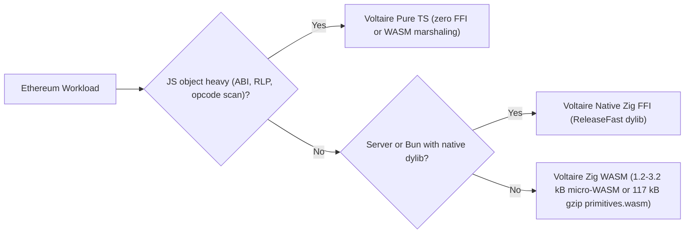

Reproducible measurements of real Ethereum workloads comparing `@tevm/voltaire` across its three execution backends (Pure TypeScript, Zig WebAssembly, and Native Zig FFI) alongside `viem`, `ox`, and `ethers`.

Every implementation is checked for byte-for-byte output parity before timing starts. Numbers below were captured directly from `bun scripts/run-benchmarks.ts --write-docs` on the hardware listed in [Test Environment](#test-environment).

## Choosing a Backend



### Key Takeaways from Measured Data

- **Keccak-256 (32 B):** Native Zig FFI hits 235 ns (4.26M hash/s, 11.2× faster than Pure TS, 19.0× faster than viem). Standalone `keccak256.wasm` (3.16 kB raw / 1.79 kB gzip) hits 469 ns (5.6× faster than Pure TS).
- **Address EIP-55 Checksum (1,000 cold addresses):** `primitives.wasm` completes in 1.36 ms (3.1× faster than Pure TS, 6.6× faster than viem), and Native Zig FFI completes in 1.81 ms.
- **Secp256k1 ecrecover (100 signatures):** Native Zig FFI finishes in 11.76 ms (2.5× faster than Pure TS, 3.2× faster than viem). By contrast, `ReleaseSmall` `primitives.wasm` (60.63 ms) is 2.0× slower than Pure TS because size-optimized WASM disables unrolled elliptic-curve loops.
- **Secp256k1 sign (100 messages):** Native Zig FFI (11.68 ms) matches `ox`/`ethers` and trails `viem` (9.18 ms); Pure TS (67.79 ms) is slower because Voltaire Pure TS does not keep precomputed base-point lookup tables in memory.
- **SHA-256 & BLAKE2b-512 (1 KB):** Native Zig FFI runs SHA-256 in 615 ns (12.0× vs Pure TS) and BLAKE2b-512 in 1.14 µs (22.1× vs Pure TS); standalone `blake2.wasm` (1.80 kB raw) runs BLAKE2b-512 in 3.43 µs (7.4× vs Pure TS).
- **Honest JS-object & boundary trade-offs:** On RLP EIP-1559 round-trips (1,000 txs), Voltaire Pure TS (1.27 ms) is on par with `viem` (1.32 ms). On ABI batch encode/decode, `ox` (1.42 ms) beats Voltaire Pure TS (11.03 ms) because Voltaire validates branded types and allocates fresh views per call. On full Bytecode opcode scans, Pure TS (45.3 µs) edges out WASM (49.4 µs) because marshaling 1,374 instruction objects across the JS↔WASM boundary dominates the scan time.

## Test Environment

| Parameter | Value |
| --- | --- |
| **Captured** | 2026-11-27 |
| **CPU** | Apple M3 Max (16 cores, arm64) |
| **OS & Runtime** | darwin 25.2.0 · Bun 1.4.1 |
| **Voltaire** | `@tevm/voltaire` v0.5.1 (zero `ox` / `@tevm/chains` runtime dependencies) |
| **Comparison Libraries** | `viem` v2.58.6 · `ox` v1.9.0 · `ethers` v6.17.0 |
| **Native Zig FFI** | Auto-detected (`zig-out/native/libprimitives_ts_native.dylib`, ReleaseFast, zero-Rust) |
| **Timing Method** | Monotonic `Bun.nanoseconds()`, JIT warmup, calibrated inner batching, median & p99 reported |

<Note>
Both `viem.getAddress` (8,192-entry `LruMap`) and `ox.Address.checksum` cache checksummed strings internally. To measure genuine parsing and Keccak-256 hashing rather than repeated cache lookups, the Address benchmark rotates through 25,000 unique addresses and clears `ox.Caches` before each timed sample. Applications that repeatedly checksum a small hot set of addresses will observe cache hits in `viem` and `ox`.
</Note>

## Runtime Benchmarks

### Keccak-256 (32 B)

Single 32-byte Keccak-256 digest (e.g. storage slot / Merkle node).

| Implementation | Median | p99 | Throughput | Relative | Notes |
| --- | ---: | ---: | ---: | ---: | --- |
| Voltaire (Pure TS) | 2.62 µs | 3.28 µs | 381,439 hash/s | 11.16× slower |  |
| Voltaire (WASM keccak256.wasm) | 469 ns | 562 ns | 2.13M hash/s | 1.99× slower | 3.16 kB standalone |
| Voltaire (WASM primitives.wasm) | 575 ns | 773 ns | 1.74M hash/s | 2.45× slower | ReleaseSmall |
| Voltaire (Native Zig FFI) | 235 ns | 318 ns | 4.26M hash/s | **1.00× (fastest)** | ReleaseFast dylib |
| viem | 4.46 µs | 5.46 µs | 224,262 hash/s | 18.98× slower |  |
| ox | 2.66 µs | 3.15 µs | 376,421 hash/s | 11.31× slower |  |
| ethers | 4.71 µs | 5.43 µs | 212,202 hash/s | 20.06× slower | returns hex string |

### Keccak-256 (1 KB)

Single 1,024-byte payload Keccak-256 digest (e.g. contract initcode / RLP tx).

| Implementation | Median | p99 | Throughput | Relative | Notes |
| --- | ---: | ---: | ---: | ---: | --- |
| Voltaire (Pure TS) | 18.8 µs | 20.8 µs | 53,075 hash/s | 10.94× slower |  |
| Voltaire (WASM keccak256.wasm) | 3.64 µs | 4.18 µs | 274,506 hash/s | 2.11× slower | 3.16 kB standalone |
| Voltaire (WASM primitives.wasm) | 3.75 µs | 4.58 µs | 266,528 hash/s | 2.18× slower | ReleaseSmall |
| Voltaire (Native Zig FFI) | 1.72 µs | 2.45 µs | 580,385 hash/s | **1.00× (fastest)** | ReleaseFast dylib |
| viem | 34.0 µs | 39.1 µs | 29,433 hash/s | 19.72× slower |  |
| ox | 19.1 µs | 22.1 µs | 52,285 hash/s | 11.10× slower |  |
| ethers | 34.4 µs | 45.3 µs | 29,078 hash/s | 19.96× slower | returns hex string |

### Keccak-256 Batch (1,000 × 32 B)

1,000 consecutive 32-byte Keccak-256 hashes (1 batch = 1,000 hashes).

| Implementation | Median | p99 | Throughput | Relative | Notes |
| --- | ---: | ---: | ---: | ---: | --- |
| Voltaire (Pure TS) | 2.61 ms | 2.92 ms | 383.5 batch/s | 11.60× slower |  |
| Voltaire (WASM keccak256.wasm) | 458.5 µs | 768.9 µs | 2181.2 batch/s | 2.04× slower | 3.16 kB standalone |
| Voltaire (WASM primitives.wasm) | 558.5 µs | 844.3 µs | 1790.6 batch/s | 2.48× slower | ReleaseSmall |
| Voltaire (Native Zig FFI) | 224.8 µs | 309.0 µs | 4448.6 batch/s | **1.00× (fastest)** | ReleaseFast dylib |
| viem | 4.41 ms | 4.69 ms | 226.9 batch/s | 19.61× slower |  |
| ox | 2.60 ms | 2.99 ms | 384.6 batch/s | 11.57× slower |  |
| ethers | 4.75 ms | 12.65 ms | 210.4 batch/s | 21.14× slower | returns hex string |

### Address Parse + EIP-55 Checksum (Batch 1,000)

Parse 1,000 unique lowercase hex addresses and compute EIP-55 checksums (rotated across 25,000 unique addresses to prevent LRU cache distortion).

| Implementation | Median | p99 | Throughput | Relative | Notes |
| --- | ---: | ---: | ---: | ---: | --- |
| Voltaire (Pure TS) | 4.24 ms | 10.45 ms | 235.8 batch/s | 3.12× slower |  |
| Voltaire (WASM primitives.wasm) | 1.36 ms | 2.13 ms | 735.2 batch/s | **1.00× (fastest)** | ReleaseSmall |
| Voltaire (Native Zig FFI) | 1.81 ms | 2.41 ms | 551.9 batch/s | 1.33× slower | Native Keccak-256 |
| viem | 8.99 ms | 13.64 ms | 111.3 batch/s | 6.61× slower | cold pool (>8192 LRU) |
| ox | 3.43 ms | 3.72 ms | 291.6 batch/s | 2.52× slower | cold (Caches.clear per sample) |
| ethers | 8.43 ms | 20.12 ms | 118.6 batch/s | 6.20× slower |  |

### Secp256k1 recoverPublicKey / ecrecover (Batch 100)

Recover uncompressed secp256k1 public keys for 100 distinct ECDSA signatures (1 batch = 100 recoveries).

| Implementation | Median | p99 | Throughput | Relative | Notes |
| --- | ---: | ---: | ---: | ---: | --- |
| Voltaire (Pure TS) | 29.98 ms | 31.84 ms | 33.36 batch/s | 2.55× slower |  |
| Voltaire (WASM primitives.wasm) | 60.63 ms | 61.24 ms | 16.49 batch/s | 5.16× slower | ReleaseSmall |
| Voltaire (Native Zig FFI) | 11.76 ms | 11.97 ms | 85.04 batch/s | **1.00× (fastest)** | ReleaseFast dylib |
| viem | 37.79 ms | 40.33 ms | 26.46 batch/s | 3.21× slower | async API |
| ox | 30.48 ms | 32.28 ms | 32.81 batch/s | 2.59× slower |  |
| ethers | 38.52 ms | 45.94 ms | 25.96 batch/s | 3.28× slower |  |

### Secp256k1 ECDSA Sign (Batch 100)

Sign 100 distinct 32-byte digests with RFC 6979 deterministic secp256k1 ECDSA (1 batch = 100 signatures).

| Implementation | Median | p99 | Throughput | Relative | Notes |
| --- | ---: | ---: | ---: | ---: | --- |
| Voltaire (Pure TS) | 67.79 ms | 70.11 ms | 14.75 batch/s | 7.38× slower |  |
| Voltaire (WASM primitives.wasm) | 60.62 ms | 61.92 ms | 16.50 batch/s | 6.60× slower | ReleaseSmall |
| Voltaire (Native Zig FFI) | 11.68 ms | 11.77 ms | 85.60 batch/s | 1.27× slower | ReleaseFast dylib |
| viem | 9.18 ms | 12.68 ms | 108.9 batch/s | **1.00× (fastest)** | async API |
| ox | 12.59 ms | 16.72 ms | 79.40 batch/s | 1.37× slower |  |
| ethers | 10.36 ms | 14.24 ms | 96.48 batch/s | 1.13× slower |  |

### SHA-256 (1 KB)

Single 1,024-byte SHA-256 digest (EVM precompile 0x02 / KZG versioned hash).

| Implementation | Median | p99 | Throughput | Relative | Notes |
| --- | ---: | ---: | ---: | ---: | --- |
| Voltaire (Pure TS) | 7.38 µs | 8.69 µs | 135,437 hash/s | 12.01× slower |  |
| Voltaire (WASM primitives.wasm) | 5.92 µs | 7.11 µs | 168,970 hash/s | 9.63× slower | ReleaseSmall |
| Voltaire (Native Zig FFI) | 615 ns | 756 ns | 1.63M hash/s | **1.00× (fastest)** | ReleaseFast dylib |
| viem | 7.16 µs | 8.40 µs | 139,571 hash/s | 11.65× slower |  |
| ox | 7.40 µs | 8.75 µs | 135,084 hash/s | 12.04× slower |  |
| ethers | 1.12 µs | 1.52 µs | 896,855 hash/s | 1.81× slower | returns hex string |

### BLAKE2b-512 (1 KB)

Single 1,024-byte BLAKE2b-512 digest (EIP-152 / Zcash / Polkadot). viem, ox, and ethers do not ship BLAKE2b.

| Implementation | Median | p99 | Throughput | Relative | Notes |
| --- | ---: | ---: | ---: | ---: | --- |
| Voltaire (Pure TS) | 25.2 µs | 27.3 µs | 39,656 hash/s | 22.12× slower |  |
| Voltaire (WASM blake2.wasm) | 3.43 µs | 3.70 µs | 291,717 hash/s | 3.01× slower | 1.80 kB standalone |
| Voltaire (WASM primitives.wasm) | 3.50 µs | 3.89 µs | 285,451 hash/s | 3.07× slower | ReleaseSmall |
| Voltaire (Native Zig FFI) | 1.14 µs | 1.28 µs | 877,244 hash/s | **1.00× (fastest)** | ReleaseFast dylib |

### ABI ERC-20 transfer Encode + Decode (Batch 1,000)

Encode and decode 1,000 ERC-20 `transfer(address,uint256)` calldata payloads.

| Implementation | Median | p99 | Throughput | Relative | Notes |
| --- | ---: | ---: | ---: | ---: | --- |
| Voltaire (Pure TS) | 11.03 ms | 18.20 ms | 90.68 batch/s | 7.78× slower |  |
| viem | 2.39 ms | 10.05 ms | 418.0 batch/s | 1.69× slower |  |
| ox | 1.42 ms | 8.06 ms | 705.9 batch/s | **1.00× (fastest)** |  |
| ethers | 62.81 ms | 78.39 ms | 15.92 batch/s | 44.34× slower |  |

### ABI ERC-20 Transfer Log Decode (Batch 1,000)

Decode 1,000 indexed ERC-20 `Transfer(indexed from, indexed to, value)` event logs.

| Implementation | Median | p99 | Throughput | Relative | Notes |
| --- | ---: | ---: | ---: | ---: | --- |
| Voltaire (Pure TS) | 4.99 ms | 11.59 ms | 200.2 batch/s | 6.52× slower |  |
| viem | 1.97 ms | 10.48 ms | 508.7 batch/s | 2.57× slower |  |
| ox | 765.7 µs | 1.70 ms | 1306.1 batch/s | **1.00× (fastest)** |  |
| ethers | 58.85 ms | 63.97 ms | 16.99 batch/s | 76.87× slower |  |

### RLP EIP-1559 Transaction Encode + Decode (Batch 1,000)

Canonical RLP encode + decode of 1,000 realistic EIP-1559 payloads (with 68-byte ERC-20 calldata + access list entry).

| Implementation | Median | p99 | Throughput | Relative | Notes |
| --- | ---: | ---: | ---: | ---: | --- |
| Voltaire (Pure TS) | 1.27 ms | 2.77 ms | 790.1 batch/s | 1.16× slower |  |
| viem | 1.32 ms | 7.31 ms | 756.4 batch/s | 1.21× slower |  |
| ox | 1.09 ms | 1.33 ms | 917.6 batch/s | **1.00× (fastest)** |  |
| ethers | 22.08 ms | 23.30 ms | 45.30 batch/s | 20.26× slower | hex string API |

### Bytecode JUMPDEST Analysis (2718 B contract)

Locate all 74 valid JUMPDEST offsets across a 2718-byte ERC-20 + EIP-1967 proxy contract while skipping PUSH1..PUSH32 immediate data. viem, ox, and ethers do not ship EVM bytecode analyzers.

| Implementation | Median | p99 | Throughput | Relative | Notes |
| --- | ---: | ---: | ---: | ---: | --- |
| Voltaire (Pure TS) | 4.13 µs | 11.2 µs | 242,284 analysis/s | 1.34× slower | 74 JUMPDESTs in 2718 B |
| Voltaire (WASM primitives.wasm) | 3.08 µs | 4.43 µs | 324,477 analysis/s | **1.00× (fastest)** | ReleaseSmall |

### Bytecode Opcode Scan (2718 B, 1374 ops)

Decode all 1374 instructions and immediate operands across a 2718-byte contract.

| Implementation | Median | p99 | Throughput | Relative | Notes |
| --- | ---: | ---: | ---: | ---: | --- |
| Voltaire (Pure TS) | 45.3 µs | 54.1 µs | 22,084 scan/s | **1.00× (fastest)** | 1374 instructions |
| Voltaire (WASM primitives.wasm) | 49.4 µs | 156.4 µs | 20,233 scan/s | 1.09× slower | ReleaseSmall |

## Bundle Size Comparison

Each entry below was bundled in isolation with `Bun.build({ minify: true, target: "browser", format: "esm" })` and compressed with `zlib.gzipSync(..., { level: 9 })`.

| Primitive | Library | Import Style | Minified | Gzipped |
| --- | --- | --- | ---: | ---: |
| Keccak256 | Voltaire (leaf) | `Keccak256/hash.js` | 5.94 kB | **2.50 kB** |
| Keccak256 | Voltaire (subpath) | `@tevm/voltaire/Keccak256` | 11.85 kB | **4.38 kB** |
| Keccak256 | viem | `viem (keccak256)` | 10.22 kB | **4.08 kB** |
| Keccak256 | ox | `ox/Hash (keccak256)` | 10.51 kB | **4.20 kB** |
| Keccak256 | ethers | `ethers (keccak256)` | 7.03 kB | **3.09 kB** |
| Address | Voltaire (leaf) | `Address/fromHex + ToChecksummed` | 11.68 kB | **4.36 kB** |
| Address | Voltaire (subpath) | `@tevm/voltaire/Address` | 67.76 kB | **23.05 kB** |
| Address | viem | `viem (getAddress, isAddress)` | 11.41 kB | **4.55 kB** |
| Address | ox | `ox/Address (checksum, validate)` | 12.12 kB | **4.81 kB** |
| Address | ethers | `ethers (getAddress, isAddress)` | 8.44 kB | **3.65 kB** |
| Abi | Voltaire (subpath) | `@tevm/voltaire/Abi` | 99.70 kB | **31.91 kB** |
| Abi | viem | `viem (encode/decodeFunctionData)` | 33.76 kB | **11.39 kB** |
| Abi | ox | `ox/AbiFunction (encode/decodeData)` | 38.58 kB | **12.76 kB** |
| Abi | ethers | `ethers (Interface)` | 57.88 kB | **17.91 kB** |
| Rlp | Voltaire (named) | `@tevm/voltaire/Rlp (encode, decode)` | 5.57 kB | **1.92 kB** |
| Rlp | Voltaire (subpath) | `@tevm/voltaire/Rlp (Rlp)` | 12.11 kB | **3.53 kB** |
| Rlp | viem | `viem (toRlp, fromRlp)` | 11.97 kB | **3.91 kB** |
| Rlp | ox | `ox/Rlp (from, to)` | 15.65 kB | **4.98 kB** |
| Rlp | ethers | `ethers (encodeRlp, decodeRlp)` | 4.12 kB | **1.82 kB** |

### Reading the Bundle Size Trade-Offs

- **Leaf and named imports stay small:** `Keccak256/hash.js` is ~2.5 kB gzip and named `Rlp` (`encode`, `decode`) is ~1.9 kB gzip — smaller than or on par with `viem`, `ox`, and `ethers`.
- **Namespace objects trade size for ergonomics:** Importing full namespace objects (`Address`, `Abi`) binds convenience helpers (such as `Address.fromPublicKey` pulling in secp256k1, or `Abi` error and event decoders) at module evaluation time. When minimizing browser bundle size, prefer leaf/named imports or standalone micro-WASM modules.
- **Micro-WASM modules stay between 0.74 and 1.79 kB gzip:** Individual Zig WASM builds (`address.wasm`, `keccak256.wasm`, `blake2.wasm`, `ripemd160.wasm`) avoid shipping JS crypto dependencies altogether.

## Shipped Zig WASM Artifacts

Measured directly from the built artifacts in `wasm/`:

| Artifact | Path | Raw Size | Gzipped | Role |
| --- | --- | ---: | ---: | --- |
| `address.wasm` | `wasm/crypto/address.wasm` | 1.22 kB (1,252 B) | **0.74 kB** | Standalone Address (hex, validate, equals) |
| `ripemd160.wasm` | `wasm/crypto/ripemd160.wasm` | 1.54 kB (1,573 B) | **1.05 kB** | Standalone RIPEMD-160 hash |
| `blake2.wasm` | `wasm/crypto/blake2.wasm` | 1.80 kB (1,845 B) | **1.01 kB** | Standalone BLAKE2b hash |
| `keccak256.wasm` | `wasm/crypto/keccak256.wasm` | 3.16 kB (3,237 B) | **1.79 kB** | Standalone Keccak-256 hash |
| `primitives.wasm` | `wasm/primitives.wasm` | 336.74 kB (344,825 B) | **117.46 kB** | Full primitives + crypto (ReleaseSmall) |
| `primitives-fast.wasm` | `wasm/primitives-fast.wasm` | 590.79 kB (604,970 B) | **210.48 kB** | Full primitives + crypto (ReleaseFast) |
| `state-manager.wasm` | `wasm/state-manager.wasm` | 131.48 kB (134,634 B) | **59.61 kB** | EVM StateManager (ReleaseSmall) |
| `blockchain.wasm` | `wasm/blockchain.wasm` | 130.36 kB (133,485 B) | **57.21 kB** | EVM Blockchain store (ReleaseSmall) |

## Reproducing These Numbers

Run the benchmark suite from the repository root with Bun:

```bash
# Human-readable terminal report
bun scripts/run-benchmarks.ts

# Machine-readable JSON output
bun scripts/run-benchmarks.ts --json

# Markdown tables to stdout
bun scripts/run-benchmarks.ts --markdown

# Re-run and regenerate this documentation page
bun scripts/run-benchmarks.ts --write-docs
```

To include the Native Zig FFI backend on your machine, build the shared library once before running the script:

```bash
zig build build-ts-native -Dwith-c-api=true
bun scripts/run-benchmarks.ts
```

See [Library Comparisons](/comparisons) for architectural differences and [WASM & Runtimes](/concepts/runtimes-and-wasm) for backend selection details.
