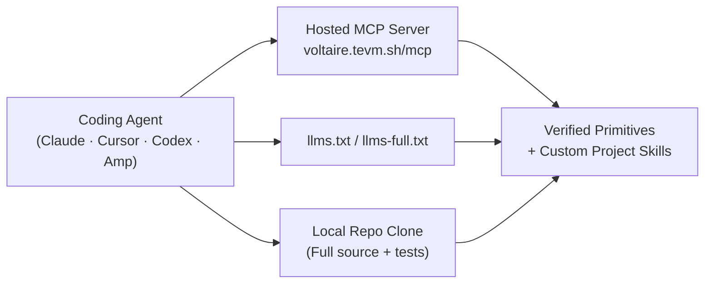

Voltaire is designed so coding agents write correct Ethereum code on the first pass: spec-aligned names, branded types that produce actionable compiler errors, machine-readable `llms.txt` indexes, and a hosted Model Context Protocol (MCP) server.



## Connect the Hosted MCP Server

<Tabs>
  <Tab title="Claude Code">
    ```bash
    claude mcp add --transport http voltaire https://voltaire.tevm.sh/mcp
    ```
  </Tab>
  <Tab title="Cursor">
    Add to `.cursor/mcp.json`:
    ```json
    {
      "mcpServers": {
        "voltaire": {
          "command": "npx",
          "args": ["mcp-remote", "https://voltaire.tevm.sh/mcp"]
        }
      }
    }
    ```
  </Tab>
  <Tab title="Codex">
    Add to `~/.codex/config.toml`:
    ```toml
    [mcp_servers.voltaire]
    url = "https://voltaire.tevm.sh/mcp"
    ```
  </Tab>
  <Tab title="Amp">
    Add to `~/.config/amp/settings.json`:
    ```json
    {
      "mcpServers": {
        "voltaire": {
          "url": "https://voltaire.tevm.sh/mcp"
        }
      }
    }
    ```
  </Tab>
  <Tab title="OpenCode">
    Add to `~/.config/opencode/opencode.json`:
    ```json
    {
      "mcp": {
        "voltaire": {
          "type": "remote",
          "url": "https://voltaire.tevm.sh/mcp"
        }
      }
    }
    ```
  </Tab>
</Tabs>

## Plain-Text Context (`llms.txt`)

For agents or tools without MCP support, fetch the static plain-text indexes directly:

- **Concise index:** `https://voltaire.tevm.sh/llms.txt`
- **Full corpus:** `https://voltaire.tevm.sh/llms-full.txt`

## Maximum Context: Clone Locally

For large refactors or custom EVM/crypto work, clone the repository locally so your agent can inspect implementations and tests directly:

```bash
git clone https://github.com/evmts/voltaire.git
```

## Why Branded Types Help Agents Self-Correct

When an agent swaps a `HashType` and `AddressType`, or passes a raw string where a validated `WeiType` is required, `tsc --noEmit` catches the mistake immediately with an exact type error instead of letting a silent bug ship to production. Combine strict TypeScript with [Skills](/concepts/skills) so your agent can inspect and modify your entire Ethereum integration in one place.
